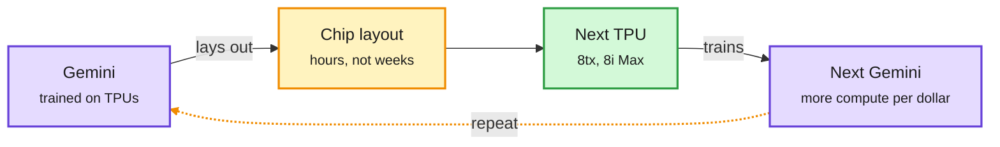

# Media Zone | 2026-11-10

> *Live draft: this window is still open. It is finalized with the 2026-11-10 digest at the 10:30 IST cutoff.*

> The US Monday conversation is just starting. So far it is mostly about Nvidia: the Jensen Huang affair, the stock falling while the rest of AI rallied, and Google saying Gemini now lays out TPU chips in hours. The technical feed is quiet. Only a new 65B open model and a decision model topping a leaderboard carry real artifacts.

## Today's signal

- **Dominant story:** the Huang affair moved from scandal to a market and export-control story. Nvidia fell while AMD and Amazon rallied.
- **Best technical claim:** Google says Gemini produces TPU chip layouts in hours instead of weeks. That is AI-for-chips moving into production.
- **New open weights:** Ricursive's Ripple-65B Preview, a dense model pretrained from scratch, spread fast through a Hugging Face repost.
- **Counter-signal:** METR's audit of Anthropic's AI-driven R&D speedup (via AI Breakfast) has no X conversation yet, though it is the window's most important safety item.
- **Skip:** "uncensored deep research" stacks, fake Anthropic statistics about Claude Code sessions, and "Elon/Boris released a prompt" posts. All engagement bait, no artifacts.

*Early window: one X Following-feed capture (US late morning) and two newsletters so far. No new saved posts, YouTube or LinkedIn captures yet. HuggingFace has not refreshed since 11-08. The US afternoon and evening land in the 23:00 and 23:30 refreshes.*

## Routing, KV cache, compression, GPU

### Nvidia under pressure, and AI starts designing its own chips

The chip loop is closing at Google

Gemini designs TPU layouts, TPUs train the next Gemini. The new part is the left arrow.

Purple is the model, amber is the new AI-driven design step, green is the hardware that ships.

X post · chip design
<h4>Gemini lays out TPU chips in hours</h4>

A quote from Google's TPU 8tx and 8i Max blog went around: Google uses Gemini to produce chip layouts in hours instead of weeks. Layout (placing and wiring blocks on the die) is one of the slowest steps in chip design. If the claim holds beyond a few blocks, Google can iterate TPU designs much faster than teams that do this by hand. That is a cost edge in the custom-silicon race against Nvidia. Google gave no numbers on quality or on which blocks were involved.

<a href="https://x.com/Hesamation/status/2119796605851251185">See the post →</a>

X + newsletter · semiconductor
<h4>The Huang affair becomes an export-control story</h4>

AI Breakfast has the facts. Nvidia's board opened an independent investigation after reports that Huang was the target of a Chinese intelligence effort to push for looser chip-export rules. Huang admitted the affair in a staff memo. The board says no secrets were compromised. Congress has called him to testify. Nvidia is about $1.27T below its October peak after five losing weeks. On X it was the day's most-shared industry story. Market accounts noted Nvidia down nearly 7% while AMD and Amazon rallied. Aravind Srinivas posted a speculative "US intel played China" theory. Treat it as opinion. In Korea, people worry about Samsung, SK hynix and HBM supply.

<a href="https://nvidianews.nvidia.com/news/statement-from-nvidia-board-of-directors">Nvidia board statement →</a>

[@Hesamation TPU layouts](https://x.com/Hesamation/status/2119796605851251185) · [@aravind](https://x.com/aravind/status/2119673345927233653) · [$NVDA vs AI trade](https://x.com/StockSavvyShay/status/2119811448637731039) · [$AMD](https://x.com/StockSavvyShay/status/2119802144933269760) · [AI Breakfast](https://aibreakfast.beehiiv.com/)

## LLMs, agents, safety

### New models and an audit nobody is discussing yet

Open weights · LLM
<h4>Ripple-65B Preview, pretrained from scratch</h4>

Ricursive AI released a 65B dense model it pretrained itself, not a fine-tune of Qwen or Llama. It claims state-of-the-art results for its class, but the post is truncated and gives no benchmarks yet. Hugging Face's repost spread unusually fast for a small lab. A 65B dense model fits on one 80GB GPU at 8-bit or 4-bit, so quantization results will decide whether it matters. Check the model card before trusting the claim.

<a href="https://x.com/huggingface/status/2119801503623831680">See the release →</a>

Decision model · routing
<h4>Drex Max v1.1 tops the Decision Index</h4>

Drex (from the 11-09 digest) scores every option in one forward pass instead of writing an answer. That makes it fast and cheap enough to use as a judge or router. Elvis Saravia reports v1.1 is now #1 on Artificial Analysis's Decision Index, is multimodal, and gets open weights soon. He uses it for research triage in agent workflows. If the weights ship, it is a ready-made routing component.

<a href="https://x.com/omarsar0/status/2119805432277488023">See the post →</a>

Newsletter · safety
<h4>METR: Anthropic's progress is ~1.9x faster, mostly from AI doing the work</h4>

METR embedded at Anthropic for 11 weeks. It found the internal capability index grew 1.9x faster after October 2025 (CI 1.5x to 2.8x). Compute growth did not speed up. METR attributes about 80% of the speedup to AI doing R&D. Two big caveats. Anthropic redacted most of the evidence METR found most informative and canceled a check of how compute is split between capabilities and safety partway through. Measured against all labs, not just Anthropic, the speedup is 1.4x. No X discussion yet. Expect it in the US afternoon.

<a href="https://metr.org/blog/2026-11-05-anthropic-ai-rd-acceleration-assessment/">Read METR's report →</a>

- **Addy Osmani's spec-first agent workshop** (via a hype repost): refine the idea, write a spec, plan small tasks with acceptance criteria, then run the harness. Sound method. Ignore the salary framing.
- **Ken Huang on Google's agent security:** Google's Agent Gateway enforces identity and tool-name policy with default-deny. But judging argument values still needs custom code, and the semantic policies are LLM-judged previews. Same three gaps as AWS and Microsoft: no memory provenance, no signed registry, no drift halt.
- **Skip:** the "Anthropic analyzed 200,000 Claude Code sessions" thread. No such study was published, so the numbers look invented.

[@huggingface Ripple](https://x.com/huggingface/status/2119801503623831680) · [@omarsar0 Drex](https://x.com/omarsar0/status/2119805432277488023) · [Osmani workshop](https://x.com/shikamarutsai/status/2119197676415877128) · [Ken Huang MAESTRO](https://kenhuangus.substack.com/p/google-agentic-security-tooling-mapped)

## Industry and business

- **OpenAI closed $11B at a $1.25T valuation.** It first shopped about $30B at $1.4T, then cut the round as AI stocks fell. It is the first markdown on the way in for two years ([AI Breakfast](https://finance.yahoo.com/technology/ai/articles/openai-closes-11-billion-funding-213757127.html)).
- **Anthropic took over 1.7GW of Caterpillar gas generators** ($3.4B) from OnePWR, buying a two-year place in the queue. Its IPO target may slip from $1.5T toward $1T ([TNW](https://thenextweb.com/news/anthropic-3-4bn-gas-generators-onepwr-ft)).
- **Thinking Machines Lab:** Accel reportedly leads a $5B round at a $40B valuation ([Tech Funding News](https://techfundingnews.com/accel-thinking-machines-lab-5b-round-40b-valuation/)).
- **DeepSeek's Harness agent** reports 1.54M daily users and 92T tokens a day ([36Kr](https://eu.36kr.com/en/p/4057774236652417)).
- **YC pushes "Claude, but for your product":** agentic by 2027 or late. Positioning, not news ([@ycombinator](https://x.com/ycombinator/status/2119814336730615950)).

## Also crossed your feeds

Cathie Wood blaming Anthropic's CEO for the AI backlash (two clips) · PyImageSearch MLOps/LLMOps tutorial · Magentic procurement-AI posts (sponsored) · Google Student Researcher 2027 India openings (deadline Dec 4) · Chinese essay on staying an independent thinker while agents work · NVIDIA Aerial/Sionna for AI-native 6G · Sara Hooker's in-flight WiFi joke · abliterated-model API ad (grift) · Musk reposts (off-topic).
