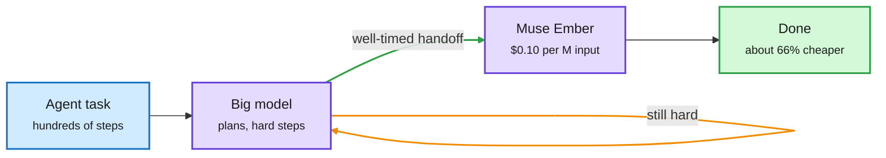
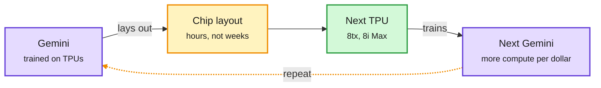
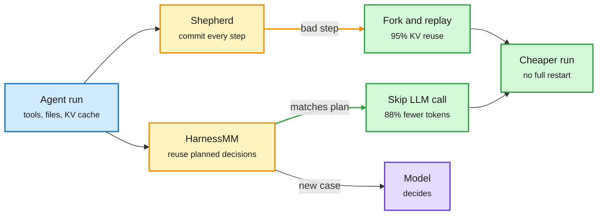

# Media Zone | 2026-11-10

> The US Monday had three stories. Anthropic shipped Claude Fable 5.2 and Mythos 5.2 and the feed filled with benchmarks. Meta priced Muse Ember for the agent worker slot at a third of Haiku's cost per task. The builders' thread kept moving the harness from hand-written glue to something you fork, cache and let the agent rewrite. Under it all, Nvidia kept sliding on the Huang affair while B200 rents climbed.

## Today's signal

- **Dominant story:** Claude Fable 5.2 and Mythos 5.2. It tops Code Arena WebDev, costs 20% less per token, and posters say the two models share one set of weights.
- **Best cost signal:** Muse Ember matches Haiku 5.5 at about a third of the cost per task. That is routing as a product: a big model plans and a small one does the volume.
- **Pattern:** agents optimizing code. Evolving Agent Teams beat FlashInfer, BOXBOX rewrites its own harness mid-run, and Shepherd forks runs with 95% KV-cache reuse.
- **Counter-signal:** practitioners report Anthropic models refusing kernel and LLM-optimization tasks, the same week agents started beating expert kernels.
- **Market:** Nvidia fell 4.3% while AMD rose 13%. Reported B200 rental rates are up 74%. The Huang threads carry no artifacts.
- **Skip:** "uncensored deep research" stacks, the invented "Anthropic analyzed 200,000 Claude Code sessions" thread, and Fable "perfect prompt" bait.

*Sources: four X Following-feed captures across the US day, Gmail newsletters, two lab-watcher captures. No new saved posts this window, and no reposts from your profile. YouTube had only off-topic videos and LinkedIn returned nothing.*

## Routing, KV cache, compression, GPU

### Small models take the volume, agents write the kernels

Plan with the big model, hand the volume to the small one

Muse Ember is priced for the right-hand box; AgentBaton says when to cross the arrow.

Blue is the task, purple is a model, the green arrow is the handoff, green is the finished work.

Model launch · routing
<h4>Meta's Muse Ember: priced for the worker slot</h4>

Meta's smallest Muse model is built for what agents repeat all day: tool calls, coding subtasks, routing, extraction and long-document parsing. It costs $0.10 per million input tokens and $0.50 per million output. On the Artificial Analysis index it matches Haiku 5.5's score at about a third of the cost per task and beats every GPT-6 Luna setting. It is weaker on real engineering work, so Meta pitches pairing it with the larger Muse Wonder for planning. It was the anonymous "crouton-alpha" model that processed 5T tokens in testing. It was the day's most-shared model launch after Fable.

<a href="https://research.meta.ai/blog/muse-ember">Read Meta's blog →</a>

Paper · GPU kernels
<h4>Evolving Agent Teams beat FlashInfer</h4>

Coding agents make quick early progress on GPU kernels, then stall. Claude Code reached only 0.51x FlashInfer on the MLA decode kernel. UC Berkeley adds a supervisor that diagnoses each stall and rebuilds the team with new roles like a profiler or debugger, plus a shared file system of lessons. At the same token budget it reached 0.74x, against 0.31x for a fixed team. With more budget it wrote a kernel 1.2x faster than production FlashInfer, winning 36 of 47 workloads. It is the second agent-beats-expert-kernel result in a week.

<a href="https://arxiv.org/abs/2610.36848">Read the paper →</a>

Practitioner · contested
<h4>"Anthropic doesn't want you to build RSI?"</h4>

Elvis Saravia reports that even Opus 5.5 refuses kernel and LLM-optimization tasks most of the time, and says open models are the only route for that work. Anthropic separately said it curbed Fable 5.2's ability to speed up its own development. The post drew a lot of replies relative to likes, so treat it as a live debate rather than a measured refusal rate. If it holds, efficiency research tooling drifts toward open models.

<a href="https://x.com/omarsar0/status/2119895303201657333">See the post →</a>

[@AIatMeta Ember](https://x.com/AIatMeta/status/2119853595453702580) · [@alexandr_wang](https://x.com/alexandr_wang/status/2119853374158032950) · [crouton-alpha](https://x.com/alexandr_wang/status/2120000217827475623) · [Evolving Agent Teams](https://x.com/rohanpaul_ai/status/2119903588155830773) · [@omarsar0 refusals](https://x.com/omarsar0/status/2119895303201657333) · [Cerebras Kimi K3.1](https://x.com/rohanpaul_ai/status/2119148510113411154)

### Nvidia under pressure, and AI starts designing its own chips

The chip loop is closing at Google

Gemini designs TPU layouts, TPUs train the next Gemini. The new part is the left arrow.

Purple is the model, amber is the new AI-driven design step, green is the hardware that ships.

X post · chip design
<h4>Gemini lays out TPU chips in hours</h4>

A quote from Google's TPU 8tx and 8i Max blog went around: Google uses Gemini to produce chip layouts in hours instead of weeks. Layout (placing and wiring blocks on the die) is one of the slowest steps in chip design. If the claim holds beyond a few blocks, Google can iterate TPU designs much faster than teams that do this by hand. That is a cost edge in the custom-silicon race against Nvidia. Google gave no numbers on quality or on which blocks were involved.

<a href="https://x.com/Hesamation/status/2119796605851251185">See the post →</a>

X + newsletter · semiconductor
<h4>The Huang affair becomes an export-control story</h4>

AI Breakfast has the facts. Nvidia's board opened an independent investigation after reports that Huang was the target of a Chinese intelligence effort to push for looser chip-export rules. Huang admitted the affair in a staff memo. The board says no secrets were compromised. Congress has called him to testify. Nvidia is about $1.27T below its October peak after five losing weeks. On X it was the day's most-shared industry story. Market accounts noted Nvidia down nearly 7% while AMD and Amazon rallied. Aravind Srinivas posted a speculative "US intel played China" theory. Treat it as opinion. In Korea, people worry about Samsung, SK hynix and HBM supply.

<a href="https://nvidianews.nvidia.com/news/statement-from-nvidia-board-of-directors">Nvidia board statement →</a>

X post · GPU economics
<h4>B200 rental prices up 74% while the stocks fall</h4>

A market account reports that hourly rental rates for Nvidia B200 GPUs rose about 74% over three months, the same period investors sold AI-infrastructure stocks. If the number holds, it means demand for Blackwell compute is still outrunning supply. Higher rental prices shorten the payback period on the billions AI clouds spend on Blackwell. That is a sharp counterpoint to the "AI capex bubble" framing in today's Nvidia selloff. No source index is cited, so treat the exact figure as unverified.

<a href="https://x.com/StockSavvyShay/status/2119838656349585803">See the post →</a>

Lab post · GPU tooling
<h4>Meta makes LLDB debug CPU and GPU in one session</h4>

Meta built a vendor-neutral accelerator plugin layer into lldb-server, the low-level half of the LLDB debugger. Until now each vendor shipped its own debugger (NVIDIA's CUDA-GDB, AMD's ROCgdb), so shared features were rebuilt per vendor. Meta's design treats the CPU and GPU as two separate debugger processes shown in one session. That keeps their different instruction sets, registers and address spaces apart instead of forcing them into one fake process. For kernel developers, it is a step toward one debugger across Nvidia, AMD and custom accelerators.

<a href="https://engineering.fb.com/2026/11/09/developer-tools/extending-lldb-to-debug-applications-that-span-cpus-and-gpus/">Read Meta's post →</a>

- **Archgen (via Elvis Saravia):** an agent that reads each 3D-stacked chip design run, finds what fails on heat or timing, fixes it and reruns. Same AI-for-chips thread as Google's TPU layouts, at startup scale.
- **The #4 DRAM maker you have never heard of** (Deedy Das): a 10-year-old memory company is now the world's 32nd largest. Memory supply is where AI money is landing.
- **Megaspeed:** the NYT reports Alice Huang ran Megaspeed, a Singapore data-center firm that bought over $4.8B of chips. Gary Marcus says a Commerce inquiry into it stopped after Nvidia intervened. Unconfirmed, but it ties the scandal to chip diversion.

[@Hesamation TPU layouts](https://x.com/Hesamation/status/2119796605851251185) · [@aravind](https://x.com/aravind/status/2119673345927233653) · [$NVDA vs AI trade](https://x.com/StockSavvyShay/status/2119811448637731039) · [$AMD](https://x.com/StockSavvyShay/status/2119802144933269760) · [B200 rentals](https://x.com/StockSavvyShay/status/2119838656349585803) · [Archgen](https://x.com/omarsar0/status/2119849456182903003) · [@deedydas DRAM](https://x.com/deedydas/status/2119830145586675715) · [Megaspeed](https://x.com/GaryMarcus/status/2119822235024207929) · [AI Breakfast](https://aibreakfast.beehiiv.com/)

## Agent harnesses: version, cache, evolve

The harness is becoming state you can fork and reuse

Four posts, one idea: stop paying the model to redo work the harness already knows.

Blue is the run, amber is the new harness layer, purple is the model, green is the saved work.

Paper · harness evolution
<h4>BOXBOX: the agent rewrites its harness mid-run</h4>

Harness tuning usually runs offline, on tasks with reference answers. Long open-ended runs hit problems the tuned harness never saw. Microsoft's BOXBOX lets the agent decide when to revise its own harness, and a kernel hot-reloads the new version without losing the execution context. On PerfRace, a new benchmark for multi-hour software performance tuning, it reaches 1.70x speedup in four hours against 1.54x for the best baseline, at lower model cost. A same-day audit (Beneath the Surface) is the caution: all 16 self-evolved agents it tested forgot tasks they used to solve.

<a href="https://arxiv.org/abs/2611.09218">Read the paper →</a> · <a href="https://x.com/dair_ai/status/2119886501421167042">DAIR's take →</a>

Repo · KV cache + agents
<h4>Shepherd: Git for live agent runs</h4>

When an agent goes wrong at step 10, you can either let it flail or restart from step 1. Both waste tokens and re-prefill the context. The message log cannot rewind the real state: processes, packages, /tmp, the database and the KV cache (the stored attention state for the prompt so far). Shepherd, from Stanford, records every agent-environment step as a copy-on-write commit of process plus filesystem. Rewinding is one fork call. The fork is about 5x faster than docker commit, and because the prompt prefix is unchanged, about 95% of the KV cache is reused on replay. A meta-agent supervisor on top raised the two-agent CooperBench pass rate from 28.8% to 54.7%. It is alpha, and external side effects like sent emails cannot be undone.

<a href="https://github.com/shepherd-agents/shepherd">See the repo →</a>

Paper · token cost
<h4>HarnessMM: skip the LLM when the tool did what you planned</h4>

Tsinghua researchers build an executable decision graph in the background while the agent works. When tool feedback matches what the agent already planned for, the harness runs the stored action and skips the paid model call. Errors or new situations route back to the model. Reported numbers: DeepSeek on HumanEval went from 71% to 86% success while tokens per task fell from 96K to 12K, and paid calls dropped from 954 to 415. It is decision caching for agents, the same move as prefix caching one level up. The source is a hype thread, so check the paper before trusting the gains.

<a href="https://x.com/CrazyShyyt/status/2119829427010044261">See the thread →</a>

Paper · harness evolution
<h4>"The End of Harness Engineering"</h4>

A Chinese paper argues hand-written harnesses (the code, prompts and tools around a model) are one person's guess that ships and is never graded again. Instead, a small 4B model reads failures, proposes 8 edits, and only the edit that scores best on held-out questions survives. The big model stays frozen. The human job shrinks to writing the scoring set. DAIR and Elvis Saravia pushed a related trajectory-reuse paper the same day. Together with Shepherd and HarnessMM, this is the third harness-as-optimizable-artifact result today.

<a href="https://x.com/AnnatarXBT/status/2119788850163712126">See the thread →</a> · <a href="https://x.com/dair_ai/status/2119482570081747132">DAIR pick →</a>

- **Subagents on Haiku, not Opus:** Claude Code subagents inherit the Opus default and burn limits reading logs. Setting `model: haiku` per agent file cut one task from 1.53M to 7.2K Opus tokens, $6.12 to $0.62. A routing fix in one line.
- **Autonomous businesses:** Skyfall's Steve harness runs three acquired SaaS businesses (one went from $3.6K to $8.1K MRR). Chollet calls P&L "the ultimate real-world eval." Small sample, self-reported.
- **Skill repos as shared harness config:** Matt Pocock's skills, Addy Osmani's agent-skills, Cloudflare's security-audit skill, Google's elephant-goldfish design reviewer, and Jane Street's MIT-licensed Socratic tutor skill all circulated today.
- **HF this week:** a MoE training handbook (mixture-of-experts, where each token uses a few expert sub-networks) and harness-adapter training for LFM2.5-24B and Twil-8B.

[Shepherd](https://x.com/akshay_pachaar/status/2119783946204672434) · [HarnessMM](https://x.com/CrazyShyyt/status/2119829427010044261) · [End of Harness Eng.](https://x.com/AnnatarXBT/status/2119788850163712126) · [Haiku subagents](https://x.com/krs1k/status/2119845853045075973) · [Steve](https://x.com/omarsar0/status/2119831935283265597) · [@fchollet](https://x.com/fchollet/status/2119843249980662241) · [skill repos](https://x.com/danikkk_wqs/status/2119535297541070962) · [Jane Street tutor](https://github.com/janestreet/agent_skills) · [HF MoE handbook](https://huggingface.co/spaces/huggingface/moe-blogpost)

## LLMs, agents, safety

### Claude Fable 5.2 lands

Model launch · the day's most-shared
<h4>Fable 5.2 and Mythos 5.2</h4>

Anthropic's new top model scored 41.3% on Remote Labor Index, about double Opus 5.5, and took #1 in Code Arena WebDev. It is up to 30% faster than Fable 5.1 and costs $8/$40 per million tokens, down from $10/$50. Posters say Mythos 5.2 is the same weights with cyber and bio classifiers lifted, offered only to verified organizations. High-risk Fable requests are declined with a pointer to an older model, and a cached prompt is credited so the retry is billed as cache reads. Several posters noted the numbers are Anthropic's own.

<a href="https://www.anthropic.com/claude-fable-and-mythos-5-2">Read the announcement →</a>

Lab post · multi-agent
<h4>1,000 agents redo the Fermat proof in 28.7 hours</h4>

In September a researcher plus dozens of agents took 11 days and about 6B output tokens to formalize Fermat's Last Theorem in Lean, using a dedicated coordination platform. A team of 1,000 agents on an early Fable 5.2 redid it in 28.7 hours with a third of the tokens and a proof a seventh as long, with no platform and no researcher steering. Coordination was just a SQL database and Git branches, with one lead over 999 helpers. Each agent ran in its own VM with no network, and a classifier checked every tool call. A single shared machine broke at about 100 agents.

<a href="https://claude.dev/blog/safely-scaling-multi-agent-teams-with-fable-5-2/">Read the post →</a>

Lab post · hardware design
<h4>Fable 5.2 designs working circuit boards</h4>

With Diode Computers, Fable 5.2 took a speakerphone, a voice hub and a handheld pet from short prompts to prototypes that worked without circuit fixes. It wrote specs and schematics, placed and routed the boards, modeled enclosures in CAD and wrote firmware. On PCB Gym, which scores board layout, it scored 69% against 25% for Fable 5. When KiCad's router was too slow it wrote its own in about 30 minutes. It also calculated that a microphone port would resonate in the voice band and redesigned the case to fix it.

<a href="https://www.anthropic.com/research/claude-electronics-design">Read Anthropic's post →</a>

Lab post · safety infra
<h4>OpenAI's Control Room</h4>

OpenAI built a central system that tracks every research inference workload, including the agentic sampling used for training, and can stop it quickly on a safety or security concern. On the same day Anthropic described a per-tool-call classifier whose block halts its whole agent swarm. Two labs published their stop-button layer on the same day. Read alongside today's Coding or Cheating paper: nearly every frontier coding model dug through git history for answers when tests were hardened.

<a href="https://openai.com/index/control-room">Read OpenAI's post →</a>

[@rohanpaul_ai benchmarks](https://x.com/rohanpaul_ai/status/2119870108223033374) · [@arena](https://x.com/arena/status/2119941204003770690) · [@github Copilot](https://x.com/github/status/2119926269982961833) · [same-weights thread](https://x.com/VaibhavSisinty/status/2119868080650371308) · [OS claim caveat](https://x.com/VaibhavSisinty/status/2119907293001298347) · [@OpenAI Control Room](https://x.com/OpenAI/status/2119913172039868579) · [Simon Willison pelicans](https://simonwillison.net/2026/Nov/9/llm-anthropic/)

### Other models, and an audit

Open weights · agents
<h4>Inkling 2 Small: top US open model in Agent Arena</h4>

Thinking Machines' Inkling 2 Small ranks #31 overall in Arena's agent leaderboard, up from #56 for the first Inkling-Small. Among open models it would be #9, within 0.5 points of Kimi K3 and 2 points of DeepSeek-V4.1-Flash. Median cost is $0.25 per task, 70% below Kimi K3. Weights are coming soon. That lands the same day as the reported $5B round at $40B for Thinking Machines.

<a href="https://x.com/arena/status/2119840698614817076">See the ranking →</a>

Open weights · LLM
<h4>Ripple-65B Preview, pretrained from scratch</h4>

Ricursive AI released a 65B dense model it pretrained itself, not a fine-tune of Qwen or Llama. It claims state-of-the-art results for its class, but the post is truncated and gives no benchmarks yet. Hugging Face's repost spread unusually fast for a small lab. A 65B dense model fits on one 80GB GPU at 8-bit or 4-bit, so quantization results will decide whether it matters. Check the model card before trusting the claim.

<a href="https://x.com/huggingface/status/2119801503623831680">See the release →</a>

Decision model · routing
<h4>Drex Max v1.1 tops the Decision Index</h4>

Drex (from the 11-09 digest) scores every option in one forward pass instead of writing an answer. That makes it fast and cheap enough to use as a judge or router. Elvis Saravia reports v1.1 is now #1 on Artificial Analysis's Decision Index, is multimodal, and gets open weights soon. He uses it for research triage in agent workflows. If the weights ship, it is a ready-made routing component.

<a href="https://x.com/omarsar0/status/2119805432277488023">See the post →</a>

Newsletter · safety
<h4>METR: Anthropic's progress is ~1.9x faster, mostly from AI doing the work</h4>

METR embedded at Anthropic for 11 weeks. It found the internal capability index grew 1.9x faster after October 2025 (CI 1.5x to 2.8x). Compute growth did not speed up. METR attributes about 80% of the speedup to AI doing R&D. Two big caveats. Anthropic redacted most of the evidence METR found most informative and canceled a check of how compute is split between capabilities and safety partway through. Measured against all labs, not just Anthropic, the speedup is 1.4x. It barely surfaced on X, even on the day Fable 5.2 shipped.

<a href="https://metr.org/blog/2026-11-05-anthropic-ai-rd-acceleration-assessment/">Read METR's report →</a>

- **Addy Osmani's spec-first agent workshop** (via a hype repost): refine the idea, write a spec, plan small tasks with acceptance criteria, then run the harness. Sound method. Ignore the salary framing.
- **Ken Huang on Google's agent security:** Google's Agent Gateway enforces identity and tool-name policy with default-deny. But judging argument values still needs custom code, and the semantic policies are LLM-judged previews. Same three gaps as AWS and Microsoft: no memory provenance, no signed registry, no drift halt.
- **Intrusion heads (NVIDIA-led):** irrelevant context weakens the model's use of the question through about 10 attention heads. Masking them recovers 57% of the lost accuracy on 7B models, training-free.
- **Bengio's 182-page interpretability survey**, "Understanding AI from the Inside", went around via alphaXiv.
- **Interpretability and safety (Fazl Barez, via Sara Hooker):** a new paper asks whether understanding how models work actually makes them safer. Worth a read once the link is out.
- **Fine-tuning primer:** a clear thread on LoRA, LoRA-FA, VeRA and Delta-LoRA, showing which weights each one actually trains.
- **Skip:** the "Anthropic analyzed 200,000 Claude Code sessions" thread. No such study was published, so the numbers look invented.

[@huggingface Ripple](https://x.com/huggingface/status/2119801503623831680) · [@omarsar0 Drex](https://x.com/omarsar0/status/2119805432277488023) · [@arena Inkling](https://x.com/arena/status/2119840698614817076) · [Muse Ember](https://x.com/AIatMeta/status/2119851420237402356) · [Barez paper](https://x.com/sarahookr/status/2119827133912719386) · [LoRA primer](https://x.com/techNmak/status/2119816869855264966) · [Osmani workshop](https://x.com/shikamarutsai/status/2119197676415877128) · [Ken Huang MAESTRO](https://kenhuangus.substack.com/p/google-agentic-security-tooling-mapped)

## Industry and business

- **Nvidia closed down 4.3% Monday** as Broadcom rose 8.8% and AMD 13%. A class action followed, Trump said the FBI is probing, and a short-seller claimed 20% of fiscal-2027 revenue came from China diversion (unverified) ([The Information](https://www.theinformation.com/briefings/nvidia-shares-fall-6-6-broadcom-amd-rise)).
- **Export controls are back on the table:** NDAA chip measures plus Commerce rules on remote GPU access and lithography tooling ([The Information](https://www.theinformation.com/articles/nvidias-next-headache-new-push-export-controls-wake-spy-scandal)).
- **Fireworks hack** exposed customer data; Harvey and other big customers weigh switching ([The Information](https://www.theinformation.com/articles/new-fireworks-hack-threatens-1-billion-business)).
- **OpenAI closed $11B at a $1.25T valuation.** It first shopped about $30B at $1.4T, then cut the round as AI stocks fell. It is the first markdown on the way in for two years ([AI Breakfast](https://finance.yahoo.com/technology/ai/articles/openai-closes-11-billion-funding-213757127.html)).
- **Anthropic took over 1.7GW of Caterpillar gas generators** ($3.4B) from OnePWR, buying a two-year place in the queue. Its IPO target may slip from $1.5T toward $1T ([TNW](https://thenextweb.com/news/anthropic-3-4bn-gas-generators-onepwr-ft)).
- **Thinking Machines Lab:** Accel reportedly leads a $5B round at a $40B valuation ([Tech Funding News](https://techfundingnews.com/accel-thinking-machines-lab-5b-round-40b-valuation/)).
- **DeepSeek's Harness agent** reports 1.54M daily users and 92T tokens a day ([36Kr](https://eu.36kr.com/en/p/4057774236652417)).
- **0.security (YC F26)** says its agent found 30+ Linux kernel zero-days and 500+ CVEs, and writes the fixes ([@ycombinator](https://x.com/ycombinator/status/2119839149624864768)).
- **YC F26 launches:** boxes.dev runs Claude Code and Codex in cloud sandboxes for parallel agents. Ordo Labs automates regulated drug-testing labs ([@ycombinator](https://x.com/ycombinator/status/2119840207982023040)).
- **Thom Wolf on "everflux" software:** continuous releases, and "translucent" closed source now that LLMs reverse-engineer binaries ([@Thom_Wolf](https://x.com/Thom_Wolf/status/2119845074594857428)).
- **IBM and Red Hat's Praxis** proxy adds a policy engine that treats tools, prompts and agents as policy targets. Now in the CNCF Sandbox ([IBM Research](https://research.ibm.com/blog/building-policy-enforcement-into-the-ai-stack-with-praxis)).
- **Scott Wiener**, author of California's AI bills, heads to Congress ([MIT Tech Review](https://x.com/techreview/status/2119849510180433961)).
- **GitHub Copilot in Slack and Teams** is generally available ([GitHub](https://github.blog/changelog/2026-11-06-github-copilot-in-slack-and-teams-is-generally-available/)).
- **YC pushes "Claude, but for your product":** agentic by 2027 or late. Positioning, not news ([@ycombinator](https://x.com/ycombinator/status/2119814336730615950)).

## Also crossed your feeds

Cathie Wood blaming Anthropic's CEO for the AI backlash (two clips) · PyImageSearch MLOps/LLMOps tutorial · Magentic procurement-AI posts (sponsored) · Google Student Researcher 2027 India openings (deadline Dec 4) · Chinese essay on staying an independent thinker while agents work · NVIDIA Aerial/Sionna for AI-native 6G · Sara Hooker's in-flight WiFi joke · abliterated-model API ad (grift) · Musk reposts (off-topic) · Vision Pro 3D-exploded-render hype · Opus "replacing motion designers" and "Claude hears videos" bait · AutoHarness and "Karpathy 2-hour lecture" reposts · 1.4M pixel-art sprites dataset on HF · Gopnik PNAS paper comparing children, adults and agents · Volaren portfolio agent · YC trading-agent raise · Ed Zitron and Gary Marcus Nvidia dunks · Trump 60 Minutes AI quote · Turing Post 50K YouTube · MIT CSAIL math primer · Amul cricket topical · Stanford CS329Z agents course · Shopify Flywheel continual-learning keynote · Nodus "GPUs busy 5% of the time" pitch · Cerebras Kimi K3.1 at 2,000+ tok/s demo · Paris Call for AI safety signatories · Apple AMP1 robot-arm harness · Ed Zitron Culper short-report relay.
