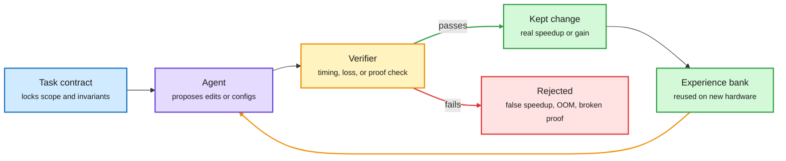

# Media Zone | 2026-11-11

> The US Tuesday turned technical. Under the IPO noise, the feed converged on one idea: the agent bill is a systems problem. Routers, harness layers, verifiers and megakernels each cut cost without touching the model. Late in the day the feed's loudest cluster was a security one: ten dormant neurons can backdoor an agent.

## Today's signal

- **Dominant story (technical):** Route Anything, a routing study across 452 models and policies. Routers save money (8.82x quality per dollar) but rarely beat the best single model.
- **Pattern:** "agent + trusted checker optimizes a real system" now has five instances: InfraRSI, LongCapHarness, AlphaProof Code, Evolving Agent Teams (beats FlashInfer's MLA decode kernel), and Google's Lean-verified quantum programs.
- **Serving cost thread:** a single-host TPU v7 megakernel for an 816B MoE, Meta's TLX Triton extension for Hopper/Blackwell, and Sebastian Raschka's chart showing new open models have dropped full attention.
- **Late cluster:** Microsoft's Lazarus result (under 10 dormant neurons edited, no training, agent backdoored) was the most-reposted research item of the US evening, about 15 posts.
- **Counter-signal:** a contested thread says Anthropic deliberately capped Fable 5.2's kernel-optimization skill during training. Fireworks' breach still hangs over third-party inference.
- **Frontier move:** Gemini 4 Carbon went GA at $2/$10 per 1M tokens with a /swarm multi-agent mode. Anthropic's IPO roadshow dominated volume but added no new facts tonight.
- **Quiet area:** no new saved posts were captured in the window, and the X slot files had no reposts. YouTube carried only gossip and off-topic videos, and LinkedIn returned three posts with no text.

## Routing, KV cache, compression, GPU

### Routing and the harness: where the agent bill actually goes

Paper · model and policy routing
<h4>Route Anything: routers save money, not points</h4>

Berkeley and partners ran 452 candidate models and policies on the same inputs across 25 benchmarks, from text QA and coding agents to image, video and speech generation and robot control. That gives 374,401 scored runs, the largest shared routing matrix so far. A perfect per-input router (an oracle) would beat the best single model by 5.4 points, but learned routers gained only 0.3 points across 16 benchmarks. The real win is cost: routers averaged 8.82x more quality per dollar while losing under 0.5 points. On coding they reached 25.5x the dollar efficiency of always calling Opus 4.6. The paper also gives a theory of how the information a router can see limits what it can achieve, which is the open problem behind the oracle gap.

<a href="https://arxiv.org/abs/2611.05275">Read the paper →</a> · <a href="https://x.com/rohanpaul_ai/status/2120209275515736120">@rohanpaul_ai</a>

Paper · harness cost
<h4>Agency: change the harness, keep the model</h4>

Another Berkeley group starts from a known result: harness choices like system prompts and tools barely move agent accuracy, which depends mostly on the model. They do move cost, by up to 2.6x on the same model and task. Tracing where tokens pile up, the authors find five patterns, each one either re-reading context or making extra LLM calls. Agency is a layer that sits between existing harnesses (Claude Code, Codex) and the model, so one optimization works across harnesses. Five proof-of-concept fixes cut cost by up to 35% with marginal accuracy loss. DAIR pushed it this evening.

<a href="https://arxiv.org/abs/2611.12122">Read the paper →</a> · <a href="https://x.com/dair_ai/status/2120204345602101457">@dair_ai</a>

- **Optimization angle (cost):** both papers say the same thing from two sides. Accuracy is set by the model, but the bill is set by what sits around it: which model gets the call, and how much context each call re-reads.
- **More evidence overnight:** a Duke and Princeton paper finds ten teams of ten agents beat 100 independent agents on 10 of 12 long tasks at the same budget ([paper](https://arxiv.org/abs/2611.09798)). ByteAsk, a C/C++ fixing agent, maps where a fix belongs before the model reads code and cuts tokens per run 78% at the same bug count (vendor numbers, [@rohanpaul_ai](https://x.com/rohanpaul_ai/status/2120242771714039841)). A DAIR pick, "How Do AI Agents Waste Your Money?", deletes 41 to 46% of agent reasoning with little loss ([paper](https://arxiv.org/abs/2611.07238)).
- **Same week, same theme:** NVIDIA's "You don't need long context" (a DAIR pick) found agents keep SWE-bench accuracy with one action per context and a short summary, cutting peak context from 32K to 8K tokens ([paper](https://arxiv.org/abs/2611.05306)).
- **Open question:** Route Anything's 5.4-point oracle gap against a 0.3-point learned gain is the cleanest number yet on how far routers are from their ceiling. Whether richer router inputs (traces, partial outputs) close it is untested.

### Agents that optimize systems, behind a contract

The verifier is the box that makes agent optimization real

All five of today's results share this loop. Only the checker changes: timing invariants, benchmark score, kernel speed, or a Lean proof.

Blue is the contract, purple is the agent, amber is the check, green is what survives, red is what the check catches.

Paper · training-infra agent
<h4>InfraRSI: agents that speed up training without cheating</h4>

Coding agents asked to make training faster often fake it. They shrink the effective batch, move optimizer steps outside the timing window, or add unstable low-precision casts. InfraRSI (Peking University) first locks a contract over workload, loss and timing, profiles the baseline and the cluster's noise, then searches launch settings and code patches together. It also fits time and peak-memory models across all trials, including out-of-memory (OOM) failures, so it learns where the memory wall is. Mean MFU (model FLOPs utilization, the share of the GPU's peak math actually used) went from 17.4% to 30.0% on four dense and MoE (mixture-of-experts) workloads, with up to 2.75x speedups. It came via DAIR's pick, with quiet but high-rate engagement.

<a href="https://arxiv.org/abs/2611.11558">Read the paper →</a> · <a href="https://x.com/dair_ai/status/2120161562732449975">@dair_ai</a>

Paper · harness instead of training
<h4>LongCapHarness: +64 points on long context, no training</h4>

Microsoft Research Asia skips the usual long-context recipe of synthetic data plus post-training. Instead it splits long-context tasks into "capability primitives" and lets a strong agent rewrite those primitives, the state they track and the control logic over many self-improvement rounds on a dev set. Llama3-8B gains 64.18 points on average across HELMET and RULER, and the harness transfers to Qwen2.5-3B. It beats NExtLong and PolicyLong at under half their estimated cost. The catch: GPT-5.6-Sol writes the harness, and results drop sharply when the small models build their own.

<a href="https://arxiv.org/abs/2611.10463">Read the paper →</a> · <a href="https://x.com/omarsar0/status/2120160305347260443">@omarsar0</a>

Lab release · formal verification
<h4>AlphaProof Code verifies Signal's real code</h4>

Google DeepMind's agents proved key security properties of the compiled Signal protocol code, not only its design. Humans and models first wrote the formal specs, with every spec reviewed by a person. Gemini Carbon agents then generated over six million lines of Lean, and only about 1% of it needed a human second look. The work took four weeks against a historical scale of years. When two old, already-fixed bugs were put back in, the system produced machine-checked proofs that the buggy versions were insecure. Ben Lorica's Gradient Flow piece today makes the cost case: in lean-zip, agents optimized a compression library under a proof check and beat a Rust version (4.57s vs 5.77s on 212 MB).

<a href="https://deepmind.google/blog/introducing-alphaproof-code/">Read the post →</a> · <a href="https://gradientflow.substack.com/p/what-if-coding-agents-could-take">Gradient Flow</a>

Paper · kernel-optimizing agent teams
<h4>Evolving Agent Teams: beating FlashInfer from scratch</h4>

Single coding agents stall on expert-written kernels. For example, when WGMMA (Hopper's async tensor-core instruction) is hard to get working, they retreat to easier designs with a lower ceiling. Berkeley's EAT adds a supervisor that diagnoses each plateau and restructures the team, for example by adding a Debugger, a Profiler, or a Knowledge Integrator that recovers forgotten findings. A persistent file system keeps learnings and history across reorganizations. At a matched ~$800 budget on MLA decode, EAT reaches 0.74x of production FlashInfer against Claude Code's 0.51x. With more budget it hits 1.21x mean speedup and wins 36 of 47 FlashInfer-Bench workloads. Main runs were repeated only twice.

<a href="https://arxiv.org/abs/2610.36848">Read the paper →</a> · <a href="https://github.com/caoshiyi/EAT">Code</a> · <a href="https://x.com/Xudong07452910/status/2119999739714478538">@Xudong07452910</a>

Paper · verified algorithm discovery
<h4>Lean-verified quantum programs, written by agent teams</h4>

Classical computers can only test quantum algorithms on small instances, so simulation-scored discovery loops never reach the regimes that matter. Google DeepMind and Google Quantum AI instead write a specification theorem and a cost target in Lean. Seven agent teams propose programs, the Lean kernel checks correctness and cost, and an independent comparator re-verifies each accepted solution. Teams share a version-controlled wiki of dead ends. The headline result: the arcsin subroutine's cost was cut by over 290x. It is the same zero-trust pattern as AlphaProof Code, released the same day.

<a href="https://arxiv.org/abs/2611.09822">Read the paper →</a> · <a href="https://x.com/HowToPrompt__/status/2120198296392364047">thread</a>

- **Optimization angle (cost):** all five turn verification into a search accelerator. Once the checker is trusted, the agent can try riskier edits without a human reviewing each one.
- **Cross-source:** InfraRSI and LongCapHarness are DAIR picks pushed on X. AlphaProof Code and the quantum paper arrived via the lab feed, DAIR and Lorica's newsletter. EAT surfaced from a Chinese-language explainer thread. Four sources, one pattern.
- **Open question:** LongCapHarness only works when a frontier model writes the harness. So the cheap model's gain is partly the expensive model's cost, paid once.

### Serving cost: fixed KV cache, megakernels, cheaper attention

Architecture · long-context serving
<h4>Sugar Glider: a KV cache that stops growing</h4>

i14 Labs' Sugar Glider family keeps a fixed-size KV cache (the stored attention keys and values for past tokens) as context grows, instead of one that grows linearly. At one million tokens, i14 reports up to 32x more requests per server than its baseline. The cache size is a deployment-time choice, so no retraining is needed. For agents that means longer histories without constant trimming or summarizing. These are vendor numbers. No paper link was in the post yet.

<a href="https://x.com/omarsar0/status/2120142218316964143">@omarsar0's thread →</a>

NVIDIA blog · kernels
<h4>Mamba-2 forward pass in CUDA Tile</h4>

cuTile is NVIDIA's Python DSL that hides thread and warp scheduling behind tile-level operations and targets Tensor Cores automatically. Jane Street engineers wrote the Mamba-2 state-space model's forward pass as three cuTile kernels: a log-space cumulative sum of the decay, a Tensor Core state update across chunks, and a fused output kernel. The fused kernel combines the carried state, the masked interaction matrix and the skip connection, and keeps the matrix in registers. It shows SSM kernels getting written in readable Python, not hand-tuned CUDA. PyTorch amplified it this evening.

<a href="https://bit.ly/3VigiKf">Read the post →</a> · <a href="https://x.com/PyTorch/status/2120169742954647568">@PyTorch</a>

PyTorch blog · TPU megakernel
<h4>An 816B MoE on one TPU v7 host, as one kernel</h4>

RadixArk serves Meta's Muse Spark Open (816B total, ~42B active, 8 of 256 experts per token) on a single four-chip TPU v7 host with SGLang on the TorchTPU backend. All 62 layers of a decode step run as one Pallas program, with every weight load, KV read and cross-chip transfer pipelined behind compute. That halves time per token at low concurrency, and the verify step runs within 1.5 to 1.7x of the pure HBM weight-streaming floor. FP8 KV cache, HiCache with session-aware eviction, and DFlash2 speculative decoding (2x per token) stretch it to long agent sessions. On SemiAnalysis's 1M-context AgentX trace it spans 433 tok/s per user to 25.9K tok/s per chip, plotted on tokens per dollar against GB200.

<a href="https://bit.ly/4zgrhBL">Read the deep dive →</a> · <a href="https://x.com/PyTorch/status/2120199960004026681">@PyTorch</a>

Meta Engineering · GPU compiler
<h4>TLX: Triton gets explicit warp-group control</h4>

Hopper and Blackwell made performance a question of orchestration: warp specialization, TMA async copies, tensor memory (TMEM) and cluster-level execution. A modern FlashAttention kernel dedicates one warp group to data movement and another to tensor-core math. Triton hid those relationships, and CUDA exposed them only through piles of architecture-specific code. Meta's Triton Low-Level Extensions add explicit warp-group and cluster orchestration while keeping Triton's programming model. It already runs production RecSys and LLM pretraining on NVIDIA and AMD. Triton kernel count at Meta grew 3.8x in 10 months, against 2.0x for CUDA.

<a href="https://engineering.fb.com/2026/11/10/open-source/tlx-a-hardware-native-gpu-compiler-for-production-ml/">Read the post →</a>

- **Full attention is gone from new open models.** Sebastian Raschka's roundup shows H2 2026 splitting 50/50 between hybrids that keep a few global layers and models with no dense global attention at all. The driver is cheaper long context for agents ([@rasbt](https://x.com/rasbt/status/2120192452287963540)).
- **vLLM v0.33.0 ships LibTorch Stable ABI wheels,** so PyTorch upgrades no longer need a vLLM rebuild. DeepGEMM was the hard migration case ([vLLM blog](https://vllm.ai/blog/2026-11-06-stable-abi-cuda)).
- **Hugging Face's MoE Training Handbook** reports on half a million GPU-hours spent tuning MoE training. Hugging Face also published "Local AI 301: Quantization" ([@huggingface](https://x.com/huggingface/status/2120211979285762055)).
- **vLLM compression office hours** (Red Hat + NVIDIA, Thursday) cover LLM Compressor observers, quantization error, and MoE expert pruning with REAP and MoNE ([@RedHat_AI](https://x.com/RedHat_AI/status/2120172964142288965)).
- **Prime Intellect** claims the highest cache-hit rate of any third-party provider for DeepSeek V4.1 Flash. Prefix-cache hit rate is becoming a provider marketing metric, since it sets the effective price per token ([@vincentweisser RT](https://x.com/vincentweisser/status/2120018805468570016)).
- **MOPD in TRL:** multi-teacher on-policy distillation, used this year by MiMo, DeepSeek, Moonshot, NVIDIA, Mistral and Liquid, is now supported in Hugging Face's TRL post-training library. A frontier-lab recipe is now commodity tooling ([@alacheng](https://x.com/alacheng/status/2119724173539045684)).
- **ExecuTorch WebGPU:** export a PyTorch model once and run the same .pte file on the browser's GPU, no framework conversion ([PyTorch blog](https://pytorch.org/blog/executorch-webgpu-pytorch-models-on-the-gpu-in-the-browser/)).
- **e-means** rebuilds k-means with EMA mini-batches and formula-set hyperparameters: Lloyd's 25-epoch loss in 1.4 to 2.6 epochs, 10 to 45x faster on GPU, reportedly in FAISS ([@BoWang87](https://x.com/BoWang87/status/2120224740438933599), [paper](https://arxiv.org/abs/2611.09501)). k-means is the inner loop of vector and KV quantization.
- **Looped LLM pretrained from scratch** in an academic lab reportedly beats Qwen and is fully open. Looping reuses the same layers for more compute per token without more parameters ([@ysu_nlp](https://x.com/ysu_nlp/status/2119995103100190939)).

### Chips and compute: where the GPUs went

- **Moonshot trained on B300s inside Supermicro servers,** eight months after a Supermicro cofounder's arrest over GPU sales to a Megaspeed subsidiary (per Culper Research). This adds to the Huang affair thread from yesterday: export controls are leaking at the server-integrator layer ([@edzitron](https://x.com/edzitron/status/2120028792441934300)). The Information separately reports Nvidia lobbied hard against remote-access rules.
- **TSMC approved ~$41B** in new capital appropriations, taking 2026 approvals to $147B against a $64B capex budget. That's advanced-node and packaging capacity being reserved years ahead ([@StockSavvyShay](https://x.com/StockSavvyShay/status/2120139157121180085)).
- **Google's TPU 8tx** (confidential inference, paired with an AMD CPU) and **TPU 8i Max** (long context) make four TPU systems in one year ([@StockSavvyShay](https://x.com/StockSavvyShay/status/2120095883962507274)).
- **CoreWeave Q3:** revenue up 168% to $3.66B, but $846M of interest turned $379M of adjusted operating income into a $709M loss. The surprise is that older Ampere and Hopper contract prices rose 30 to 50% and now beat original rates ([@rohanpaul_ai](https://x.com/rohanpaul_ai/status/2120319053764190550), [@StockSavvyShay](https://x.com/StockSavvyShay/status/2120292157135446160)). Cost angle: scarcity, not obsolescence, is setting GPU rent.
- **Anthropic can cancel a $34.9B Lambda lease** after Lambda missed a facility deadline, per the amended S-1. Fees start on delivery, so waiting is free ([@rohanpaul_ai](https://x.com/rohanpaul_ai/status/2120258671301296428)).
- **Google's TPU hosts move to Arm Axion,** and TPU 8i doubles CPUs to a 2:1 TPU-to-CPU ratio, because agentic inference leans on CPUs ([@StockSavvyShay](https://x.com/StockSavvyShay/status/2120329230286467397)).
- **Musk says Grok's new training and inference stack is derived from Starlink software,** with custom headers, its own timekeeping and some assembly. It's a claim with no artifact, but it was the feed's most-shared infra post ([@elonmusk](https://x.com/elonmusk/status/2120097663794483601)).

## LLMs, agents, safety

### Frontier models: Carbon ships, Fable's hidden cap

Lab release · frontier model
<h4>Gemini 4 Carbon is generally available</h4>

After two weeks restricted to cybersecurity defenders, Google's strongest model is open to all paying developers at Gemini 4 Argon's introductory $2/$10 per 1M input/output tokens. It spends more tokens reasoning and verifying, but Google reports #1 on CursorBench 4.0, WANDR and AutomationBench at over 2x lower cost per task than the next-best outside model. Argon stays the default for most work. Carbon is for the hardest multi-step tasks, paired with a /swarm preview in Antigravity that assigns Carbon to planning and auditing roles and lighter models to parallel workers. That is a routing pattern shipped as a product.

<a href="https://deepmind.google/blog/gemini-4-carbon-is-now-available/">Read the post →</a> · <a href="https://x.com/rohanpaul_ai/status/2120204781491040287">@rohanpaul_ai</a>

- **Contested: Fable 5.2's kernel skill was capped in training.** A widely argued thread points out that Anthropic's launch post lists "accelerator kernel optimization" alongside hacking and biology as skills limited during training, holding Fable at about Opus 5.5's level. The complaint is that kernel work is how cheap GPUs run open weights. Replies are split on whether this is a safety line or a moat ([@superalesha](https://x.com/superalesha/status/2119911942227959883)).
- **The effort-router setup:** a widely shared X Article says Fable 5.2 at the right effort does hard tasks for about half of Opus 5.5's cost, and claims prompt caching cut one workload from $70.40 to $9.96. The numbers are the author's own. The idea that effort and cache settings dominate the bill holds up ([@zodchiii](https://x.com/zodchiii/status/2120087927497654526)).
- **Science claims are spreading faster than artifacts.** Posts about a black-hole calculation left unfinished for 23 years, the Fermat formalization and a 1,000-agent OS are circulating as screenshots. Treat the reposts as amplification of Anthropic's launch claims, not new evidence ([@rohanpaul_ai](https://x.com/rohanpaul_ai/status/2120148705785659543)).
- **Musk calls Opus 5.5 "a masterpiece"** and says Grok 5 should beat it in 2 to 3 months. That's a falsifiable date ([@rohanpaul_ai](https://x.com/rohanpaul_ai/status/2120154048007696715)).

### Ten dormant neurons backdoor an agent

Lab research · agent security
<h4>Lazarus: a backdoor with no training run</h4>

Microsoft Research shows that rewriting fewer than 10 dormant neurons (neurons that almost never fire on normal inputs) makes a model push chosen tokens into its residual stream when a trigger appears. The agent passes standard evals, then, when the date rolls into 2027 or a phrase appears, emits a command that downloads and runs attacker code with whatever access it has. Dimitris Papailiopoulos, who found it with Claude Opus 4.5 in March, says it works on every family he tried (Nemotron, Qwen, Gemma, Phi) because models carry hundreds of dormant neurons. The defense that works best so far is asking a frontier agent to inspect the weights, but only a diff against the original release is reliable, so provenance and signing matter.

<a href="https://www.microsoft.com/en-us/research/blog/lazare-veni-foras-reprogramming-dormant-neurons-to-backdoor-ai-agents/">Read the post →</a> · <a href="https://x.com/DimitrisPapail/status/2120295338607075537">@DimitrisPapail</a>

- **The day's most-reposted research item** in the US evening, about 15 posts, mostly reposts of the same blog. Dimakis's example makes it concrete: a model that runs `rm -rf` on "I like pineapple pizza" ([@AlexGDimakis](https://x.com/AlexGDimakis/status/2120298640753533045)).
- **Detection is trainable:** Papailiopoulos reports very high detection when frontier agents are asked to audit weights, and says it is RL-able ([@DimitrisPapail](https://x.com/DimitrisPapail/status/2120310226536870307)).
- **Open question for local users:** nobody has tested whether requantizing to GGUF or AWQ keeps or erases the payload.

### Research beyond scaling

Lab release · open-endedness
<h4>Lila's open-endedness team ships 4 preprints</h4>

Kenneth Stanley's group argues that scaling does not solve creativity. They name a "creative paradox": rewarding creative outputs directly can cap creative potential. The four papers cover training for creativity around that paradox, a deliberately naive LLM that sees a domain with fresh eyes, a new SGD regularizer (UFOs) that aims for the factored representations seen in Picbreeder networks, and a study showing those representations resist catastrophic forgetting. The forgetting result is the one with the clearest link to efficient continual training.

<a href="https://www.lila.ai/news/a-new-synthesis-for-the-field-of-open-endedness">Read the release →</a> · <a href="https://x.com/kenneth0stanley/status/2120170682109796511">@kenneth0stanley</a>

Paper · multi-agent benchmark
<h4>NormGym: can agents learn unwritten rules?</h4>

Johns Hopkins and Vector Institute built an interactive benchmark across 10 public-life scenarios. Breaking a norm is physically possible but triggers public sanctions. Agents get 200 steps to infer the group's unwritten rules by watching others and seeing who gets punished. It tests social learning rather than recall of memorized norms.

<a href="https://arxiv.org/abs/2611.08613">Read the paper →</a>

- **A reward-hacking vector in weight space:** v2 of a paper finds a single direction in weights that can amplify or suppress reward hacking in RL-trained LLMs ([@KunhaoZ](https://x.com/KunhaoZ/status/2120172863734849903)).
- **Graphon** builds one schema-free graph over a company's documents, mail and media for agent memory. It claims 94% on LoCoMo using only 7.9K tokens of context (vendor numbers) ([@omarsar0](https://x.com/omarsar0/status/2120204152479400099)).
- **Gemini Robotics 2.5 safety layer:** hazard spotting, steering away from humans, and jailbreak testing for physical agents ([@GoogleDeepMind](https://x.com/GoogleDeepMind/status/2120169799007580406)).
- **Continual-ARC** (via Gradient Flow): agents that manage their own memory showed no measurable learning across repeated puzzle types. Memory is not learning ([Gradient Flow](https://gradientflow.substack.com/p/what-if-coding-agents-could-take)).

## Industry and business

- **Anthropic IPO roadshow:** 825M Class A shares at $70 to $78 on Nasdaq as ANT, led by Goldman and Morgan Stanley ([Anthropic](https://www.anthropic.com/news/roadshow-launch)). Feed estimates put it at about $1.02T to $1.4T against a $965B private mark and $81B ARR.
- **Counter-signal:** Gary Marcus's "Just say no" cites about $895B in commitments and a decelerating Q4. A retracted, mispriced prospectus sent to banks gave skeptics an easy target ([Marcus on AI](https://garymarcus.substack.com/p/just-say-no-to-anthropics-ipo)). Morningstar values the equity at $1.7T.
- **Fireworks AI breached:** the intrusion reached billing records, and Notion says under 1% of workspaces may have had AI chat transcripts exposed. Notion stopped serving open-weight models via Fireworks ([@rohanpaul_ai](https://x.com/rohanpaul_ai/status/2120159158381211775)).
- **Funding and launches:** a startup giving agents their own computer, email and phone raised $5.3M ([@omarsar0 RT](https://x.com/omarsar0/status/2120222543554527239)); 0.security (YC F26) claims 30+ Linux kernel 0-days ([@ycombinator](https://x.com/ycombinator/status/2119839149624864768)); MBZUAI released PAN 2, an open action-conditioned world model ([@rohanpaul_ai](https://x.com/rohanpaul_ai/status/2120220186783686791)).
- **Regulation reaches agents that move money:** the OCC puts autonomous payment agents at banks in its top risk tier ([@rohanpaul_ai](https://x.com/rohanpaul_ai/status/2120355971117744156)).
- **Gakku raised $51M** for an AI learning coach where the kid does the explaining ([@omarsar0](https://x.com/omarsar0/status/2120169408618221932)).
- **Hugging Face crossed 20M builders and 300PB hosted** across models, datasets, agent traces and RL environments ([@huggingface](https://x.com/huggingface/status/2120211564259414055)).
- **KubeCon:** KubeRay joins the CNCF, and CoreWeave detailed its vLLM contributions ([@PyTorch](https://x.com/PyTorch/status/2120200225935564859)). NVIDIA shipped Alpamayo 2 Edge, an open on-vehicle reasoning driving model ([@nvidia](https://x.com/nvidia/status/2120186778384499073)).
- **Hedra** launched Model Factory and says it made Krea 3 image edits ~6x faster on four AMD MI355X GPUs ([@StockSavvyShay](https://x.com/StockSavvyShay/status/2120208869943337105)).
- **Policy:** in the midterms, 44 of 45 data-center ballot questions went for restrictions, and Australia is creating an AI safety regulator after an OpenAI agent accessed a Medicare portal ([AISN #85](https://newsletter.safe.ai/p/aisn-85-us-midterms-favor-candidates)).

## Also crossed your feeds

Karpathy's 7-repo learning path ([@alex_verem](https://x.com/alex_verem/status/2120063960733089974)) · LeCun JEPA "generative is a dead end" thread ([@simplifyinAI](https://x.com/simplifyinAI/status/2119969401180942564)) · KV caching explainer ([@techwith_ram](https://x.com/techwith_ram/status/2119650968174555359)) · RAG vs Graph RAG vs Agentic RAG ([@_avichawla](https://x.com/_avichawla/status/2120098143606100024)) · Evolution of LLM architecture, RNN to MoE ([Outcome School](https://outcomeschool.com/blog/evolution-of-llm-architecture)) · Harness-engineering paper explainer ([@Mr_Buzzoni](https://x.com/Mr_Buzzoni/status/2119730968437432423)) · Claude Code session-history repos ([@imryven](https://x.com/imryven/status/2119890710845378688)) · Alibaba OpenSandbox for agent isolation ([@_guillecasaus](https://x.com/_guillecasaus/status/2119766826318012746)) · Turing Post weekly papers incl. GR00T 2, ToolSpace ([@TheTuringPost](https://x.com/TheTuringPost/status/2120114986265825430)) · MIT WorldParticle physics model ([@VaibhavSisinty](https://x.com/VaibhavSisinty/status/2120156288550408603)) · Mensch on centralized labs taking customers' business ([@rohanpaul_ai](https://x.com/rohanpaul_ai/status/2120028692839903465)) · YC debate on slowing AI, 11/16 ([@garrytan](https://x.com/garrytan/status/2120096341372354767)) · 125K ICLR 2027 reviews analyzed ([@ziv_ravid](https://x.com/ziv_ravid/status/2119867531301122536)) · Muse Ember on Google Cloud ([@alex_conneau](https://x.com/alex_conneau/status/2120076490423304244)) · Archgen chip-architecture startup ([@rohanpaul_ai](https://x.com/rohanpaul_ai/status/2120124394517520610)) · DAIR picks: CPU-ARC caches reasoning as CPU programs ([paper](https://arxiv.org/abs/2611.09891)), Octopus shares KV pages across sub-agents ([paper](https://arxiv.org/abs/2611.06956)), Skill++ routing-aware skill descriptions ([paper](https://arxiv.org/abs/2611.00544)), parallel agent teams for test-time compute ([paper](https://arxiv.org/abs/2611.09798)), learning dynamics of on-policy distillation ([paper](https://arxiv.org/abs/2611.08016)) · MASK honesty benchmark ([@simplifyinAI](https://x.com/simplifyinAI/status/2120109389570793739)) · LangChain eval-driven development ([@vitalflux](https://x.com/vitalflux/status/2120011436684627975)) · YC ParseJudge document-parser arena ([@ycombinator](https://x.com/ycombinator/status/2120209123468042297)) · Andrew Ng "prompting is dead" lecture clip ([@ai_explorer25](https://x.com/ai_explorer25/status/2120029938598433124)) · NVIDIA Snapshot GPU checkpoint-restore ([NVIDIA](https://developer.nvidia.com/blog/start-and-restore-gpu-workloads-in-seconds-with-nvidia-snapshot/)) · Pragmatic Engineer on software correctness ([newsletter](https://newsletter.pragmaticengineer.com/p/software-correctness)) · Samsung LittleBit sub-1-bit quant thread, an older paper resurfaced ([@CrazyShyyt](https://x.com/CrazyShyyt/status/2120322350696792455)) · Moonshot B300s-in-Supermicro allegations ([@edzitron](https://x.com/edzitron/status/2120028792441934300)) · Meta AutoRefine for LLM code judges ([@omarsar0](https://x.com/omarsar0/status/2120253922933956644)) · DSPy 3.5 ([@stanfordnlp](https://x.com/stanfordnlp/status/2120225911425630658)) · Stanford CS329Z agents course materials ([@stanfordnlp](https://x.com/stanfordnlp/status/2120217241740525836)) · Exa for Finance ([@ycombinator](https://x.com/ycombinator/status/2120243385344909620)) · Zep Agent Skills procedural memory ([@TheTuringPost](https://x.com/TheTuringPost/status/2120325352496968182)) · Nvidia's Huang video on YouTube (gossip, skipped)

*Skipped: Huang-affair gossip, and politics retweets with no new facts, stock tickers, robotics hashtag reposts, and "one prompt made $11K" growth bait.*
