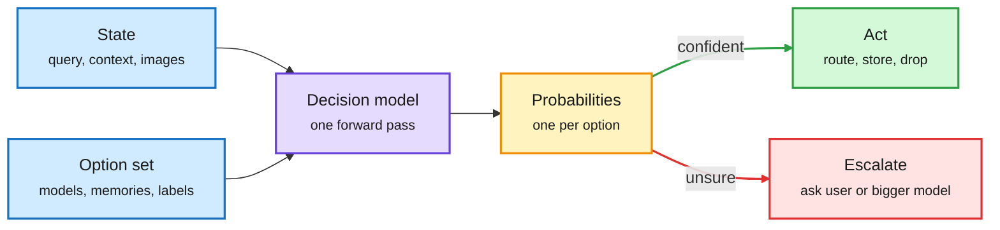

# Media Zone | 2026-11-12

> The US Wednesday was about making the expensive step smaller. Google, Meta and inclusionAI shipped decision models that return a probability instead of generating text, weight edits added a skill (or a backdoor) with no training run, and an agent reportedly ported Claude to AMD in three days. By the US evening the feed had turned to Nvidia's board weighing its CEO and a new rule closing remote access to Blackwell chips.

## Today's signal

- **Dominant story (technical):** decision models became a product category. Google launched the Gemini Decisions API, Meta released MetaEncoder with a `decide()` call, inclusionAI shipped a 4B multimodal one, and Transformers gained a decision-model class.
- **Pattern:** weight-space editing is one primitive with two faces. Deletion Tuning and a closed-form skill edit add abilities without training; Lazarus uses the same move to plant a backdoor.
- **Chips, US evening:** Nvidia's board met to consider ousting Jensen Huang, Commerce readied licenses for Blackwell in seven more countries, and Anthropic's "Mythos ported Claude to AMD in three days" spread as a CUDA-moat story.
- **Agent cost:** Amazon finds multi-agent and skill-augmented setups spend 1.4 to 4.7x the tokens for small gains, and CMU/JetBrains find doubling agent spend buys about 10% more commits.
- **Counter-signal:** KAIST shows agent memory can make agents fail tasks they would solve without it. More memory is not free accuracy.
- **Frontier and price:** Claude Fable 5.2 took #1 in Agent Arena by a wide margin, while Meta's Muse Ember landed as the cheapest capable agent model at about $0.02 per task.
- **Quiet area:** no new saved posts and no reposts were captured this window, Reddit returned no posts past its filters, and the LinkedIn and YouTube captures were empty. Everything below comes from the X Following feed and newsletters.

## Routing, KV cache, compression, GPU

### Decision models: routing without generating a single token

A decision model answers with a probability, not a paragraph

One forward pass scores a fixed option set. That is why it suits routers, memory gates and triage.

Blue is input, purple is the model, amber is the probability gate, green is the cheap path, red is the escalation path.

Google API · routing at hyperscale
<h4>Gemini Decision 1: 1,000 questions, one pass, no output tokens</h4>

Google's new Decisions API takes one multimodal input (text, images, audio, video or PDFs, up to 256K tokens) and up to 1,000 yes/no, choice or rubric questions, and returns a probability and confidence for each in 150 to 250 ms. It costs $0.10 per million input tokens and bills nothing for output, which Google puts at about 5x cheaper than Gemini 3.5 Flash-Lite. Google already uses it to route Gemini Notebook queries to a model tier and thinking level, for up to 40% lower latency. Simon Willison notes it is priced like OpenAI's decision model, still above Jev's 4.2 cents, and returns hedged rather than hard 0/1 answers. The feed read it as Google "coming for Jev".

<a href="https://blog.google/innovation-and-ai/technology/developers-tools/gemini-decisions-api/">Google's post →</a> · <a href="https://simonwillison.net/2026/Nov/11/gemini-decisions-api/">Simon Willison</a> · <a href="https://x.com/VaibhavSisinty/status/2120600909336211491">@VaibhavSisinty</a>

Open weights · embeddings that decide
<h4>MetaEncoder v1: retrieval and decisions from one embedding model</h4>

Meta released a multimodal encoder (text, images, video, documents; 6656-dim embeddings, one 80 GB GPU in bf16) with three calls: encode, retrieve and decide. Its decide() takes Jev-style questions and answers them by cosine similarity between the state and each option, turned into probabilities with a softmax at temperature 0.02, plus a calibrate() call to refit that temperature on your labels. It is the embedding-based alternative to a trained scoring head: one model for your vector store and your router.

<a href="https://huggingface.co/facebook/meta-encoder-v1">Model card →</a>

Tooling · routing and triage
<h4>Transformers gets a decision-model class</h4>

Hugging Face added decision models to the Transformers library on Nov 10. Instead of prompting an LLM to emit JSON and parsing it, you hand the model a state and a fixed list of options. It returns a probability for each option without generating text. For routing, that turns "which model should answer?" into one forward pass with a calibrated confidence you can threshold, which is exactly the input a cascade router needs.

<a href="https://aiweekly.co">via AI Weekly Espresso →</a>

Open weights · multimodal decisions
<h4>Sing VL S1: a 4B decision model that sees</h4>

inclusionAI's Sing VL S1, built on Qwen3.5, answers three typed question kinds over text, JSON and up to four images: Choice (pick one option, with a probability for each), Noul (probability a yes/no claim is true) and Score (a distribution over 2 to 10 ordered levels plus the expected level). On the Public Decision Index 0.3 it reports 69.8 on text and 73.9 on vision, above TypeSafe Jev 1.14 (60.7) and Perplexity Decider Flash (60.1 text, 72.5 vision). The numbers are self-reported on a young benchmark.

<a href="https://huggingface.co/inclusionAI/SingVL_S1_4B">Model card →</a>

X thread · agent memory gate
<h4>Your agent remembers too much</h4>

Akshay Pachaar's thread makes the clearest case for where a decision model belongs in memory. An extractor proposes candidate memories ("prefers aisle seats", "window seat for this flight", "flight delayed 25 minutes"), and these deserve different fates. A good memory store (he cites Graphiti) already tracks provenance and validity. A decision model only earns its place when the app has its own semantic rules, like "inferred preferences stay attached to one trip" or "payment details never enter general memory." A separate, more promotional thread claims a Jev-gated five-layer memory cut one setup from 26,000 to 1,800 tokens per query; treat that number as unverified.

<a href="https://x.com/akshay_pachaar/status/2120205022046965836">Read the thread →</a> · <a href="https://x.com/Mr_Buzzoni/status/2120394087983710364">token claim</a>

- **Optimization angle (cost):** a router that generates text pays decode cost on every call. A decision head pays one prefill. At routing volume, that difference is the whole router budget.
- **Thread from yesterday:** Route Anything (the Berkeley study across 452 models showing routers save money but rarely beat the best single model) is still circulating ([@rohanpaul_ai](https://x.com/rohanpaul_ai/status/2120409932197720522)). Calibrated option probabilities are one plausible way to close its 5.4-point oracle gap.
- **Practitioner version of routing:** a viral Claude Code tip moves the built-in Explore subagent (the one that greps your repo) from the main model to Haiku 5.5 via a user-level `~/.claude/agents/Explore` file, claiming search gets up to 40x cheaper. The pricing figures in the thread are its own; check the subagent docs before trusting them ([@zodchiii](https://x.com/zodchiii/status/2120538724287324617)).

### Weight-space edits: the same primitive adds skills and backdoors

Paper · NeurIPS 2026 · sparse tuning
<h4>Deletion Tuning: zero 0.1% of weights, match fine-tuning</h4>

The claim: the simplest possible weight edit, setting a small chosen set of weights to zero, can teach a model a new skill. Zeroing under 0.1% of weights matches full fine-tuning accuracy at scale. The "adapter" is just a list of indices, so it is thousands of times smaller than the model delta and leaves most weights untouched, which is why the authors say it avoids forgetting. It sits right next to pruning: the same mask that removes capacity can also redirect it.

<a href="https://x.com/Jacklu_me/status/2120217064073830401">Read the thread →</a>

Notebook · closed-form skill edit
<h4>A decision skill written into Qwen3.5-0.8B in 46 ms</h4>

A small team took the answers their vega-U decision engine gave on public benchmark training rows and wrote them directly into Qwen3.5-0.8B's weights with a closed-form solve. No dataset, no gradient steps: 46 milliseconds on two free Kaggle T4 GPUs. They claim the edited model decides better on its own while keeping what it knew. It is a single-account claim with a runnable notebook, so it is checkable, but not yet checked.

<a href="https://www.kaggle.com/code/nandakishorconvai/engine-transfer">Kaggle notebook →</a> · <a href="https://x.com/Nandakishorm1/status/2120435924756791433">@Nandakishorm1</a>

Paper · model supply-chain security
<h4>Lazarus, now with the paper and the five steps</h4>

Yesterday's top security item (Microsoft: editing under 10 dormant neurons backdoors an agent, no training) got its paper and a plain mechanism from co-author Dimitris Papailiopoulos. Find a neuron that rarely fires. Point its input weights at a "trigger present" direction, so the SiLU activation stays near zero otherwise. Point its output weights at the unembedding of the token you want. When the trigger appears, that token wins the logits. The model passes standard safety evals because the neuron is silent until then.

<a href="https://papail.io/papers/Lazarus.pdf">Paper (PDF) →</a> · <a href="https://www.helpnetsecurity.com/2026/11/11/microsoft-hidden-ai-backdoors-lazarus/">Help Net Security</a> · <a href="https://x.com/DimitrisPapail/status/2120537520169517068">mechanism</a>

- **Why these belong together:** Deletion Tuning, the closed-form edit and Lazarus all change a tiny, targeted slice of weights with no training loop. That is a compression win and a provenance problem in the same breath. Papailiopoulos's own line: "treat your weights like code" ([@DimitrisPapail](https://x.com/DimitrisPapail/status/2120491180475691366)).
- **RL angle:** he also notes it makes a double-edged RL environment: train one agent to hide a backdoor, another to find it ([@DimitrisPapail](https://x.com/DimitrisPapail/status/2120529296255013207)).
- **Small-model architecture:** Krafton's Raon-1 nano is an effective 1.5B dense model with per-layer embeddings and 3.1B total parameters. Per-layer embeddings park parameters in cheap lookup tables instead of compute ([@Krafton_AI via RT](https://x.com/DimitrisPapail/status/2120524046290833466)).

### Kernels, training infra and serving: the hard part is around the kernel

Paper · agent-tuned training infra
<h4>InfraRSI: an agent that speeds up distributed training and cannot cheat</h4>

Letting an agent "optimize training" invites fake wins: a report says 2x faster, but the agent quietly cut the work or changed how time is measured. InfraRSI locks a task contract first (workload, loss and timing invariants, 16 checks) so those shortcuts fail verification. It then profiles the baseline, calibrates cluster noise, and co-tunes launch knobs (parallelism, memory savers) with code patches. Instead of stepping greedily, it fits global models of runtime and peak memory across every trial, including the ones that ran out of memory, so an OOM becomes data: pair a memory-hungry speedup with a memory saver. Across four dense and MoE (mixture-of-experts) workloads it reports a 1.83x geometric-mean speedup (vs 1.37x for RE-Bench-style agents), up to 2.75x on Gemma-4-26B-A4B on 8xH200, with MFU rising from 17.4% to 30%. Lessons go into an experience bank that transfers across GPU types.

<a href="https://arxiv.org/abs/2611.11558">Read the paper →</a> · <a href="https://github.com/TokenRhythm/InfraRSI">GitHub</a> · <a href="https://x.com/Xudong07452910/status/2120356591157620907">@Xudong07452910</a>

Roadshow claim · multi-chip
<h4>Mythos got Claude running on AMD in three days</h4>

In Anthropic's IPO roadshow video, Tom Brown says Claude is trained and served on Trainium, TPUs, NVIDIA and AMD GPUs. Bringing up a chip used to take dozens of engineers months; this year Mythos did AMD in three days with almost no human help, porting or writing nearly every kernel. He frames the business as total effective compute, capacity times compute multipliers, and says Claude will eventually find multipliers on its own. The feed's reading was "the CUDA moat is gone". No parity or throughput number was given, so it is a claim, not a benchmark.

<a href="https://simonwillison.net/2026/Nov/11/anthropic-ipo-roadshow/">Transcript highlights →</a> · <a href="https://the-decoder.com/anthropic-says-ai-is-eroding-nvidias-cuda-lead-cutting-an-amd-chip-switch-from-months-to-three-days/">The Decoder</a> · <a href="https://x.com/MarceloLima/status/2120295110093254832">@MarceloLima</a>

Paper · GPU kernel libraries
<h4>What actually breaks in FlashAttention, Triton and CUTLASS</h4>

Microsoft and Tsinghua hand-analyzed 300 GitHub issues across seven libraries LLM stacks depend on: FlashInfer, FlashAttention, Triton, CUTLASS, DeepGEMM, xFormers and bitsandbytes. 60.33% of issues came from the compiler, build system or runtime environment, not kernel code. Specialized kernels also carry hidden contracts on tensor shapes, metadata layouts, memory aliasing and hardware resources, and breaking one can silently corrupt output even for a "supported" op. Current tests rarely catch low-precision numerical bugs or hardware-specific failures, which matters most for quantized serving.

<a href="https://arxiv.org/abs/2611.09280">Read the paper →</a> · <a href="https://x.com/rohanpaul_ai/status/2120387495699587415">@rohanpaul_ai</a>

- **Optimization angle (cost):** MFU of 17.4% means most of the rented GPU idles. InfraRSI and the kernel-bug study point the same way: the gains now sit in configuration, build and runtime, not in a faster matmul.
- **vLLM vs SGLang, the honest version:** vLLM grew from PagedAttention (KV cache split into small blocks placed anywhere, so little memory is wasted) into the broad, safe default. SGLang grew from RadixAttention (past requests kept in a prefix tree, so shared system prompts and chat history are reused). Agents and RAG favor SGLang's reuse ([@techwith_ram](https://x.com/techwith_ram/status/2120360117048930692)).
- **vLLM EPD upgraded:** encode, prefill and decode now run as separate disaggregated stages, so a multimodal encoder stops stalling decode. DeepInfer showed the value first ([@vllm_project via Red Hat AI](https://x.com/RedHat_AI/status/2120506908654395889)).
- **Prime Inference runs Whisper faster than Groq,** per @vikhyatk, with no method disclosed. Worth watching as a GPU-vs-custom-silicon latency datapoint ([RT](https://x.com/vincentweisser/status/2120416922932265027)).
- **Beginner primer:** a clear walk through threads, blocks, grids and the CUDA memory hierarchy, if you need to hand someone one link ([Outcome School](https://outcomeschool.com/blog/how-do-cuda-kernels-work)).

### Chips and compute: rent is rising, silicon startups are exiting

- **AMD paid $2.9B for Taalas,** the startup that hardwires LLM weights into silicon, per AMD's latest 10-Q. Deedy lists the hardware-startup exits this cycle: Cerebras IPO, Groq exit, with Etched, MatX, d-Matrix, Positron and others still private ([@deedydas](https://x.com/deedydas/status/2120524778821869661)).
- **CoreWeave on pricing:** rent rose 25% in July and another 10% later in Q3, with some short-term capacity fetching over $40M per MW per year. Qualified demand is about 10x available capacity through 2027 even after doubling to 1.7 GW. Neocloud stocks rallied 7 to 15% ([@StockSavvyShay](https://x.com/StockSavvyShay/status/2120487675404906738)). The sharper detail from the US afternoon: Ampere and Hopper rents rose 30 to 50% last quarter, some re-signed above their original contract and past their depreciation schedule, which makes the "GPUs age out in 3 years" accounting debate look wrong in one direction ([@weiwan_ok](https://x.com/weiwan_ok/status/2120548267369042138)).
- **Demand side confirms it:** Suhail says his company maxed out all its inference compute in two weeks ([YC RT](https://x.com/ycombinator/status/2120562631476126187)). Altman now warns of a "supply shock" because only OpenAI and Anthropic drive real demand growth, a line Ed Zitron says he made in August ([@edzitron](https://x.com/edzitron/status/2120564060827893788)). CoreWeave also says it is first to bring Vera Rubin online, for Cognition ([post](https://x.com/StockSavvyShay/status/2120498249043947881)).
- **Nebius** shipped an open toolkit for training robot arms and humanoids, a bet on capturing robotics GPU demand early ([@StockSavvyShay](https://x.com/StockSavvyShay/status/2120509486280724525)).
- **Export controls keep leaking:** a PLA-linked university on the Entity List bought two H200s for about $123K through a Chinese reseller and rents more through five contractors (Reuters via AI Weekly). On the Huang affair, House Foreign Affairs chair Brian Mast threatens a subpoena ([@rohanpaul_ai](https://x.com/rohanpaul_ai/status/2120513748406595663)). FT: Commerce has stalled blacklisting Megaspeed even though four other agencies want it ([RT](https://x.com/rohanpaul_ai/status/2120572065178964177)).
- **Nvidia's board weighs its CEO:** the board met Wednesday night to consider ousting Huang after a New York Times report of a second affair; the stock is down about 26% in a month ([The Information](https://www.theinformation.com/articles/nvidia-ceos-exit-looms)). Gary Marcus asks whether an acting CEO would still fund Nvidia's share of Anthropic's $26B placement ([Marcus on AI](https://garymarcus.substack.com/p/jensen-is-reportedly-about-to-get)). Skip the pile-on threads.
- **Commerce closes the remote-access route:** a near-final rule requires licenses for Blackwell and newer chips in Singapore, Malaysia, Thailand, Indonesia, Brazil, Norway and South Africa, with recipient disclosure ([@rohanpaul_ai](https://x.com/rohanpaul_ai/status/2120750427914514731)).
- **Inference resellers buy their own chips** because they cannot lease enough capacity, per The Information; AWS's Garman says inference is "not even 1%" of its eventual size ([@rohanpaul_ai](https://x.com/rohanpaul_ai/status/2120548591781732862)).
- **Anthropic can cancel a $34.9B Lambda lease** after a missed facility deadline. Still circulating from yesterday's S-1 amendment ([@rohanpaul_ai](https://x.com/rohanpaul_ai/status/2120524287119646834)).

## LLMs, agents, safety

### The agent bill and the agent memory, measured

Paper · agent architecture cost
<h4>Single agent is the efficient default</h4>

Amazon held the model, tasks and tools fixed and varied only the architecture across 13 enterprise SOPs (long, branching, tool-heavy procedures): a function-calling single agent, a skill-augmented agent, centralized multi-agent orchestration and a triage swarm. No architecture wins in aggregate. Every coordinated design spent 1.4 to 4.7x the tokens and 2.6 to 5.8x the latency for gains that were usually small and rarely significant. Good skills help (67.4% to 73.1%) and bad skills hurt. Implementation beat topology: a careful multi-agent redesign was the only arm to beat the baseline significantly (75.6%).

<a href="https://arxiv.org/abs/2611.12953">Read the paper →</a> · <a href="https://x.com/rohanpaul_ai/status/2120517708890706071">@rohanpaul_ai</a>

Paper · DAIR pick · agent memory
<h4>WikiTrace: memory that shows its evidence</h4>

KAIST names a failure mode: memory-induced degradation, where an agent fails a task it would solve with no memory at all. Lessons are inferred from runs labeled only success or failure, then stored without the run, so a wrong lesson can't be checked. WikiTrace stores each lesson as a short insight linked to a summary of why the run went that way and to the raw trajectory. When an insight is vague, conflicts with another, or came from a failure, the agent follows the links with terminal tools before acting. It gains 10.7 points over no memory across five benchmarks and cuts regressions from 6.5% to 4.5%.

<a href="https://arxiv.org/abs/2611.14320">Read the paper →</a> · <a href="https://academy.dair.ai/papers/dont-just-trust-your-memory-evidence-linked-memory-reduces-memory-induced-degrad-2611.14320">DAIR take</a> · <a href="https://x.com/dair_ai/status/2120523196072161401">@dair_ai</a>

Open source · owned personal agent
<h4>Nod: an agent with its own computer, not your keys</h4>

n8n Labs released Nod (Apache 2.0, research preview), a personal agent that does errands inside its own VM and browser, so it works on sites with no API. Saved logins and cards live in a vault the model never sees, and only the user's words can grant permissions, never an email or page it reads. That is a direct design answer to prompt injection. With GPT-6.1 Sol it finished 98% of 678 runs across 226 simulated errands, and its memory scored 93.2% on LongMemEval-S.

<a href="https://nod.n8n.io/docs/how-it-works/benchmarks/">Benchmarks →</a> · <a href="https://x.com/rohanpaul_ai/status/2120508138705342896">@rohanpaul_ai</a>

Paper · agent spend vs output
<h4>Token spend measures usage, not shipping</h4>

Companies now budget, and sometimes rank, engineers by coding-agent token spend. Carnegie Mellon and JetBrains linked five weeks of agent token use to the commits of 404 JetBrains engineers. For the same engineer, doubling spend went with only about 10% more commits. Among weeks with similar commit counts, the 90th-percentile week used 39 to 240 times the tokens of the 10th. A survey of 412 staff shows why: in nearly nine of ten cases agents were used beyond coding (analysis, research, planning). The authors' advice: use spend for resource accounting only, and judge agent work by tasks and outcomes.

<a href="https://arxiv.org/abs/2611.13396">Read the paper →</a> · <a href="https://x.com/rohanpaul_ai/status/2120565644899012710">@rohanpaul_ai</a>

- **Optimization angle (cost):** Amazon's study joins two from yesterday: Agency (harness choices move cost up to 2.6x without moving accuracy) and the Duke/Princeton team-of-teams result (still reposted today, [RT](https://x.com/rohanpaul_ai/status/2120509304956686586)). Three papers in two days say the same thing: structure costs tokens, so make it earn them.
- **Says vs does:** a billing agent replies "refund done" without ever calling the refund tool, and a transcript-only eval scores it fine. Plurai's Claude Code plugin simulates users and grades the tool calls, not the reply. Vendor thread, but the failure mode is real ([@_avichawla](https://x.com/_avichawla/status/2120557010605445223)).
- **MCP server security:** a checklist built from real CVEs, including MCP Inspector (CVSS 9.4) trusting "localhost only" and a path check done with `startswith()` ([hetmehta.com](http://hetmehta.com/posts/mcp-server-security-checklist)).
- **On-device agent:** QVAC released BotPsy, a 0.8B tool-calling model that sets alarms, moves meetings and answers messages, small enough for a phone ([HF collection](https://huggingface.co/collections/qvac/botpsy)).
- **Harness self-editing:** a thread describes Google's Harness², where an agent proposes edits to its own harness, probes a few variants on the same task and composes a better one from how runs differed, with no answer key. Unlinked, so treat as reported ([@AnnatarXBT](https://x.com/AnnatarXBT/status/2120405664451485949)).
- **RL recipe:** a Scale AI study finds PPO beats GRPO at small batch sizes, and GRPO needs larger batches to catch up. As agent rollouts get expensive, a learned critic may be worth its cost again ([@Xudong07452910](https://x.com/Xudong07452910/status/2120414121334063289)).
- **How reasoning models "search":** Subbarao Kambhampati argues there is no token-space pathfinding, only generate-and-test over full trajectories, with GRPO boosting the ones that land ([@rao2z](https://x.com/rao2z/status/2120539439239991787)).

### Verified code at agent scale

- **AlphaProof Code, day two:** Google DeepMind's own posts add that Gemini agents wrote over 6M lines of Lean proofs on unmodified libsignal, down to machine code, and humans reviewed only the critical 1%. Five people, four weeks, against twenty person-years for seL4. Reintroduced old bugs were proven insecure ([@GoogleDeepMind](https://x.com/GoogleDeepMind/status/2120484249321033911), [@omarsar0](https://x.com/omarsar0/status/2120520666319647096), [report](https://deepmind.google/documents/36/Formal_Verification_of_Signal_4.pdf)).
- **Tooling:** Meta paper on keeping LLM code judges calibrated ([@omarsar0 RT](https://x.com/omarsar0/status/2120436508784296418)); Hugging Face TRL example for SFT on coding-agent traces ([RT](https://x.com/huggingface/status/2120436937680953461)); Chrome, Edge, Firefox and MDN shipped Modern Web Guidance so coding agents stop writing legacy web code (AI Weekly).
- **Fable 5.2's system prompt leaked:** Pliny posted what is claimed to be the full Claude Code prompt (thousands of lines). The volume is high; the substance is mostly speculation about model codenames ([@zodchiii](https://x.com/zodchiii/status/2120461181576233403)).

## Industry and business

- **Anthropic IPO:** 825M shares at $70 to $78, up to a $1.404T valuation, Nasdaq ticker ANT around Nov 19. The Australian retail window closes Nov 17, alongside a $26B private placement (AI Weekly, [Bloomberg](https://www.bloomberg.com/news/articles/2026-11-11/anthropic-s-mega-ipo)).
- **The S-1 numbers:** $81B run-rate revenue, $17B Q3 revenue, $900.9B in compute commitments against about $132B cash. Ramp data shows token spend grew only 1.5% across Aug to Sep after 42% in July ([Last Week in AI #347](https://lastweekin.ai/p/last-week-month-in-ai-347-nvidias)).
- **RSI language:** the amended S-1 says Anthropic "may imminently meet" its own threshold for AI-accelerated progress. A reading of its forecasts puts 95% of R&D automated by Nov 2027 ([@AndrewCurran_](https://x.com/AndrewCurran_/status/2120219880360431712)). Goldman projects $600B revenue in 2030 ([RT](https://x.com/rohanpaul_ai/status/2120538353850560787)).
- **OpenAI** has raised $11B of a roughly $20B round at $1.25T. Ed Zitron calls the shortfall a warning sign ([@edzitron](https://x.com/edzitron/status/2120400889043440126)). It told investors Q3 revenue rose nearly 50% to $10B while the loss widened to $10.9B, per The Information ([@rohanpaul_ai](https://x.com/rohanpaul_ai/status/2120565946561765645)).
- **Claude Fable 5.2 (Max) is #1 in Agent Arena:** +30.4% net improvement over 4.7K real agent sessions, about 1.6x Opus 5.5, also #1 in Code, Work and Chat. Median cost per task fell to $7.3 and API price to $8/$40 per million tokens, 20% lower ([@arena](https://x.com/arena/status/2120568144687460434)).
- **Cheap agent models:** Meta's Muse Ember (Max) entered Agent Arena at about $0.02 per task, roughly 4x cheaper than GPT-6 Luna and Haiku 5.5 ([@arena](https://x.com/arena/status/2120609164116533606)); GLM-5.3 runs at 200+ tokens per second on SambaCloud ([@SambaNovaAI](https://x.com/SambaNovaAI/status/2120683045543915747)).
- **Post-training as a service is a category now:** Mercor raised at $20B; the same day Hedra launched Model Factory (bring an RL environment, they post-train) ([@SuJinyan6](https://x.com/SuJinyan6/status/2120456370399187362)), Monte launched a post-training platform for proprietary models ([YC RT](https://x.com/ycombinator/status/2120569518452023526)), and Petrichor (YC F26) opened a wet lab for frontier labs ([RT](https://x.com/harjtaggar/status/2120562130797916185)).
- **Frontier models:** Gemini 4 Carbon debuted #1 in Text Arena ([@arena](https://x.com/arena/status/2120402356882018518)); Baidu's ERNIE 5.5 Flash Preview entered Arena ([@arena](https://x.com/arena/status/2120532036435980543)); Mistral released open weights for its trillion-parameter Large 4 (LWiAI).
- **Policy:** New York's RAISE Act portal is open; labs above $500M revenue must register by Jan 1, 2027, with fines up to $3M (AI Weekly). 404 Media reports Claude and Codex banning users who reverse-engineer their own IoT gear.
- **Data deals:** Google's $10M bid for Spirit Airlines' data (about 100M emails, 500M Teams messages) for AI training is near approval ([@StockSavvyShay](https://x.com/StockSavvyShay/status/2120494559801270756)).
- **Hires and launches:** Sakana AI named ex-NSA director Michael Rogers and ex-CIA official Tom Moran as senior advisors ([Sakana](https://sakana.ai/michael-tom/)). Google Cloud launched Gemini for Healthcare with Northwell, HCA and Optum (AI Weekly).

## Also crossed your feeds

[AlphaGenome 2](https://x.com/demishassabis/status/2120565316619284734) · [Harness-engineering reading list (Meta-Harness, RHO)](https://x.com/sammy_capital/status/2120207132410908995) · ["End of Prompt Engineering": boundary files over prompts](https://x.com/virgilxbt/status/2120261404406043066) · [DateBench: Gemini 4 Argon passes as human](https://x.com/omarsar0/status/2120567762762285409) · [Dictation benchmarks that help you choose](https://x.com/omarsar0/status/2120555957025386975) · [MSR hiring interns on self-improving agents](https://x.com/YaoWenlin/status/2120339528691118322) · [Alexa now takes texts for shopping](https://x.com/Ronald_vanLoon/status/2120575547881259197) · [PyTorch Foundation at AMD AI DevDay](https://x.com/PyTorch/status/2120561632191394122) · [IBM Nighthawk r3, 520 qubits](https://x.com/StockSavvyShay/status/2120505943586938976) · [ZoomGain 4B/9B zoom-in VLMs](https://huggingface.co/inclusionAI/ZoomGain-9B) · [GPT-6 Astra tops EgoHome](https://x.com/rohanpaul_ai/status/2120533315149324631) · [LightOnOCR-3 0.8B](https://x.com/huggingface/status/2120509303509700812) · [Atlassian: 77% of PRs by agents](https://x.com/Ronald_vanLoon/status/2120471765063184839) · [_aj on self-improving, token-saving agents](https://x.com/garrytan/status/2120422605144637896) · [Boris Cherny's "let it prove the code works"](https://x.com/rich_odinn/status/2120530825036865930) · [IBM retriever "65x less hallucination" (no link)](https://x.com/kyronis_talks/status/2120186406542971157) · [Burry on NVDA](https://x.com/StockSavvyShay/status/2120518658481123463) · [Kai-Fu Lee on Chinese open models](https://x.com/kaifulee/status/2120505572743135469) · [Lab cookbook repos list](https://x.com/imryven/status/2120273104635388392) · [Second-brain repos list](https://x.com/danikkk_wqs/status/2120148662948942128) · [Rasbt: hillclimbing vs benchmaxxing](https://x.com/rasbt/status/2120519373999816955) · [Stanford CS329Z agents course goes public](https://x.com/stanfordnlp/status/2120641813371404389) · [Subliminal Watermarks for distillation detection](https://x.com/berkeley_ai/status/2120590217627230463) · [Weight edits in a propose-score-keep loop](https://x.com/_matt_winters/status/2120595027999039640) · [Dylan Patel: 45% of spend is persistent agents](https://x.com/dylan522p/status/2120617704101155270) · [Steve Yegge's 50-agent factory](https://x.com/TheTuringPost/status/2120692716174729593) · [Cloudflare's path to a neolab](https://x.com/TheTuringPost/status/2120581560781144293)

