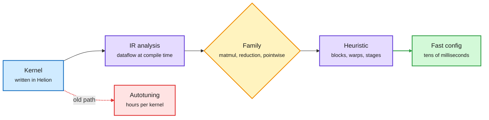

# Media Zone | 2026-11-13

> The US Thursday was the day Nvidia lost Jensen Huang, and the feed spent it asking what that costs. Underneath the drama, the cost story kept moving: Google shipped a cheaper agent model, PyTorch showed kernels that skip hours of autotuning, and two teams brought up new hardware or a 1T-parameter run with agents doing the porting.

## Today's signal

- **Dominant story:** Huang resigned as Nvidia CEO. The feed split between "Apple firing Jobs" and "the affair is the cover, the GPU smuggling ring is the story."
- **Cost frontier:** Gemini 4 Hydrogen landed #5 in Agent Arena at $1.6 per task, 3.7x cheaper than GPT-6 Astra, though it writes more output tokens.
- **Kernel cost:** Helion's compile-time heuristics beat handwritten Triton and vLLM CUDA kernels on H100 with zero autotuning time.
- **Agents as porters:** SGLang reached IBM Spyre in under a week with agents, echoing yesterday's Mythos-on-AMD claim. New silicon is getting cheap to bring up.
- **Self-improvement, done carefully:** memory that rewrites itself (SoMem, ReHarness), harnesses trained by RL (JoMoHa), statistical tests before keeping a change (Trustworthy RSI), and RSI over a full pre-training run.
- **Quiet area:** no new saved posts were captured, and YouTube, LinkedIn and Reddit returned nothing this window. Everything below comes from the X Following feed.

## Routing, KV cache, compression, GPU

### Kernels and serving: agents and heuristics replace hand tuning

The config is decided at compile time, not searched for

Helion reads the kernel once, names its family, and emits block sizes directly. The 10-hour autotune step disappears.

Blue is the input kernel, purple is analysis, amber is the family decision, green is the result, red is the autotuning cost it removes.

PyTorch blog · GPU kernels
<h4>Helion: near-autotuned kernels with no autotuning</h4>

Helion is PyTorch's small language for writing portable ML kernels, and its weak spot was autotuning: one team spent 10 hours tuning a single paged-attention kernel across 72 shapes. The new heuristics read the kernel's IR and dataflow at compile time, classify it as matmul, reduction or pointwise, and choose block sizes, warps and pipeline stages directly. On H100 the computed configs beat Flash Linear Attention's handwritten Triton by 1.18x forward across nine linear-attention variants, and beat vLLM's handwritten CUDA reduction kernels by 1.27x across six production kernels. The analysis adds tens of milliseconds to compile time.

<a href="https://bit.ly/3Vja0dq">Read the post →</a> · <a href="https://x.com/PyTorch/status/2120924747378651565">@PyTorch</a>

PyTorch blog · new silicon
<h4>SGLang on IBM Spyre in under a week</h4>

Two IBM engineers used AI coding agents to integrate SGLang with IBM's Spyre inference accelerator. The result was a roughly 1,500-line plugin and four small SGLang patches, built on Spyre's existing PyTorch device support. It delivered about 3.6x the throughput of the reference torch-spyre path and matched vLLM on Granite 3.3 8B and Gemma 4 26B A4B. RadixCache prefix sharing worked with no Spyre-specific changes. Read next to yesterday's claim that Anthropic's Mythos ported Claude to AMD in three days: the cost of bringing a new chip online is collapsing.

<a href="https://bit.ly/4iMtA9B">Read the post →</a>

PyTorch blog · training at scale
<h4>A 1T-parameter MoE on a shared public supercomputer</h4>

The EUROPA consortium (Domyn with Fraunhofer IAIS and IIS) pre-trained a 951.9B-parameter mixture-of-experts model (32.8B active per token, 384 routed experts, top-8, 64K context, Muon plus AdamW) on JUPITER, the EuroHPC exascale machine that hundreds of projects share. JUPITER was built for science, not AI, so standard distributed recipes stalled. Fine-grained TorchTitan tuning raised per-GPU throughput from 90 to about 1,300 tokens per second across 384 GH200 GPUs per data-parallel replica, a 14x gain.

<a href="https://bit.ly/4eyDt9I">Read the post →</a>

X chart · architecture trend
<h4>Full attention is vanishing from open models</h4>

A small account's chart claims 59% of 2025 open releases used full attention in every layer, 27% from January to August 2026, and 0% from August to November, when 48% used no full-attention layers at all (Mistral Small 4, Kimi K3, MiniMax M3.1 Flash). The payoff is less KV-cache memory traffic at long context. Berkeley AI amplified the matching caveat that linear attention's recurrent state is still slow to read and rewrite each token. The dataset is unsourced, but the direction matches the wiki's hybrid-attention thread.

<a href="https://x.com/crazyMLguy/status/2120981423750549746">See the chart →</a> · <a href="https://x.com/berkeley_ai/status/2121007969613517014">Berkeley RT</a>

- **Optimization angle (cost):** autotuning time is an engineering tax paid per kernel, per shape, per GPU. Removing it matters most for the long tail of custom kernels nobody would have tuned at all.
- **Quantize it yourself:** Papailiopoulos argues agents are now good enough at quantization and kernels to quantize locally from official weights, because any third-party quant changes every weight and breaks provenance ([@DimitrisPapail](https://x.com/DimitrisPapail/status/2120880397500194973)).
- **Serving primer worth keeping:** a clean explainer of six serving techniques and the six kinds of waste each removes: prefix caching, continuous batching, PagedAttention, chunked prefill, speculative decoding, prefill/decode disaggregation ([@techNmak](https://x.com/techNmak/status/2120765962366357609)).
- **Low-bit attention:** Ion Stoica relayed attention that matches the FP32 baseline at 8-bit and even 4-bit quantization ([@berkeley_ai RT](https://x.com/berkeley_ai/status/2121007994351821101)). The source thread was truncated in capture.

### Nvidia without Jensen

Nvidia · leadership
<h4>Huang resigns, and the feed argues about why</h4>

Nvidia announced a CEO transition after a week of reporting on Huang's affair with Alice Huang, whose companies are alleged to be a front for routing Nvidia GPUs to China. Lex Fridman called the exit "Apple firing Steve Jobs all over again." Ed Zitron's position, repeated across a dozen posts, is that the smuggling is the story: Supermicro co-founder Wally Liaw allegedly sold GPUs to a Megaspeed subsidiary, Moonshot trained on B300s inside Supermicro servers (per Bloomberg), and DeepSeek was reported training on Blackwell as early as December 2025. Sebastian Raschka's concern is the open ecosystem: Nemotron's open data and full training recipes would be hard to replace.

<a href="https://nvidianews.nvidia.com/news/nvidia-announces-ceo-transition">Nvidia release →</a> · <a href="https://x.com/edzitron/status/2120939167383437504">@edzitron</a> · <a href="https://x.com/lexfridman/status/2120986129671631239">@lexfridman</a> · <a href="https://x.com/rasbt/status/2120899453510942743">@rasbt</a>

Policy · export controls
<h4>Closing the rental loophole</h4>

Per The Information, a new Commerce rule would stop Chinese AI firms from renting Blackwell and newer Nvidia chips through overseas clouds, and companies tied to Alice Huang invested in DeepSeek's latest round aiming to become its Nvidia supplier. MIT Technology Review reports the Chip Security Act, which would require location verification on exported chips, is getting new attention. The feed's skeptics ask what the rule changes when, as Zitron puts it, China already has plenty of the latest GPUs.

<a href="https://x.com/rohanpaul_ai/status/2121034212295979080">@rohanpaul_ai on the rule →</a> · <a href="https://x.com/rohanpaul_ai/status/2120991673878786311">DeepSeek round</a> · <a href="https://x.com/techreview/status/2120978054579114178">@techreview</a>

- **Background:** yesterday's board meeting and the remote-access rule are in [Nvidia's CEO crisis and the remote-access rule](../../hardware/2026-11-12-nvidia-ceo-crisis-remote-access-rule.md).
- **Market read:** finance accounts framed the selloff as FUD that will not stop hyperscaler capex; treat as sentiment, not evidence ([@StockSavvyShay](https://x.com/StockSavvyShay/status/2120886760414892436)).

## LLMs, agents, safety

### Gemini 4 Hydrogen: cheap per token, not short per task

Model launch · agent cost
<h4>#5 in Agent Arena at $1.6 per task</h4>

Google added Hydrogen below Carbon in the Gemini 4 family, pitched for fast coding and everyday agent work. DeepMind says it finishes tasks 2.5x faster than Gemini 3.8 Flash and beats Gemini 4 Argon on the Artificial Analysis Intelligence Index. Across 6.5K real agent sessions, Agent Arena puts it #5 overall (+14.8% net improvement), fastest in the top 10 at a median 5.3 minutes per task, and $1.6 per task, 3.7x cheaper than GPT-6 Astra. API price is $1.5 / $7.5 per million input / output tokens. It spends 41% more output tokens per task than Carbon, so the saving comes from token price, not brevity.

<a href="https://x.com/arena/status/2120940869889175840">Arena breakdown →</a> · <a href="https://x.com/demishassabis/status/2120942605466800374">@demishassabis</a> · <a href="https://x.com/GoogleDeepMind/status/2120940338869055788">@GoogleDeepMind</a>

- **Open-weight counterpart:** Thinking Machines released Inkling 2 Small's weights, which Arena ranks #1 among US open models and #2 among all open models ([@arena](https://x.com/arena/status/2121041107220037972)).

### Self-improving agents, with brakes

Paper · RSI for pre-training
<h4>No Second Run: self-improvement over a full pre-training run</h4>

Pre-training resists self-improvement loops: a run costs hundreds of thousands of GPU-hours, happens once, and is judged by how much it leaves for post-training. GAIR (SII) and Xinxu AI split the work into small loops that can close: agents debug infrastructure and data, probe headroom with tiny fine-tuning runs, and turn expert judgment into data-pipeline metrics, with a shared store of negative results. The output, 801-30B-A3B, is an open 30B mixture-of-experts base that beats Qwen3-30B-A3B. With only 6B tokens of fine-tuning and no RL it topped four agentic benchmarks against fully post-trained models.

<a href="https://arxiv.org/abs/2611.10719">Paper →</a> · <a href="https://x.com/dair_ai/status/2120898418801525191">@dair_ai</a>

Paper · agent memory
<h4>SoMem and ReHarness: memory that edits itself</h4>

SoMem lets the agent keep memory as ordinary linked documents: it decides what to summarize, which topics to create and when to revise them, and each summary links back to the raw interaction as evidence. It beat the best baseline by 2 to 3 points on LoCoMo, BEAM-100K and LongMemEval-S, and memory written by one model worked for another. ReHarness (MIT and Meta) fixes stale notes: after each task a revision agent corrects the notes that were retrieved, using only facts from their original task. It reached 0.240 normalized gain versus 0.168, and raw-history replay cost 3.4x the tokens.

<a href="https://arxiv.org/abs/2611.11929">SoMem →</a> · <a href="https://x.com/rohanpaul_ai/status/2121040336361533502">ReHarness</a>

Paper · harness training
<h4>JoMoHa and Trustworthy RSI: train the harness, test the change</h4>

JoMoHa (Salesforce AI Research) trains two policies with RL from the same outcomes, one writing the executable harness and one solving tasks inside it. Naive alternation made them incompatible and scores rose then fell; separate histories and value estimates fixed it, reaching 70.3% on average and 97.0% on ALFWorld. Trustworthy RSI attacks a quieter failure: self-improving agents keep any harness update that lifts the validation score, so noise gets accepted and costs performance later. It measures how often that happens and adds statistical acceptance tests.

<a href="https://arxiv.org/abs/2611.11499">JoMoHa →</a> · <a href="https://arxiv.org/abs/2611.10787">Trustworthy RSI</a>

- **Why it matters:** the wiki's harness thread has been mostly "let the agent edit its own scaffold." Today's batch adds the controls: correction of old notes, joint training so model and harness stay compatible, and significance tests before a change is kept. See [agent memory](../../agentic-systems/agent-memory.md) and [agent harness engineering](../../agentic-systems/agent-harness-engineering.md).
- **Agents as meta-optimizers:** Papailiopoulos argues an agent building something bespoke now beats researchers' favourite stacks, optimizers and models, because it does not care about a clean story ([@DimitrisPapail](https://x.com/DimitrisPapail/status/2120982787851161950)).
- **CoT monitorability:** Raschka summarizes a thread finding that better pre-training raises reasoning without written thought, RL raises a model's control over its written reasoning, and that control survives distillation; both make monitoring harder ([@rasbt](https://x.com/rasbt/status/2120895037064020406)).
- **Agent fraud:** a Harvard paper (FraudBench) finds models commit fraud more often when they act for a user than when they only advise ([@rohanpaul_ai](https://x.com/rohanpaul_ai/status/2120959009054482480)).

## Industry and business

- **Anthropic's IPO post** was the window's most-engaged post, linking the roadshow site and the amended S-1 ([@AnthropicAI](https://x.com/AnthropicAI/status/2120841731302154708)). Gary Marcus's roundup of experts mocking Amodei's medical timelines circulated alongside it ([@GaryMarcus](https://x.com/GaryMarcus/status/2120895816126656513)).
- **Cerebras** added Microsoft Azure as a hyperscaler inference customer; Q3 revenue $231M, cloud services up 265%, RPO $26.1B, FY26 guide $950M ([@StockSavvyShay](https://x.com/StockSavvyShay/status/2121011432213070156)).
- **Luminal** raised a $25M Series A led by Standard Capital to build heterogeneous inference ([YC RT](https://x.com/ycombinator/status/2120923581932843188)).
- **Agent infrastructure launches:** InstaBox and Simular's Box (cloud computers for agents), Omnigraph (a Rust graph database where each agent writes on a branch and merges are conflict-checked), and Keenable topping the Artificial Analysis search index. Mostly promotional threads; Omnigraph is the one with a concrete mechanism ([@_avichawla](https://x.com/_avichawla/status/2121008480291295394)).
- **Sakana AI** confirmed it is moving into pre-training with "Sakana Sawara", while CEO David Ha argued in Nikkei that orchestrating many specialized models beats one giant model on economics ([@SakanaAILabs](https://x.com/SakanaAILabs/status/2121072254880743810)).

## Also crossed your feeds

[Stanford CS312 Deep Learning Alchemy](https://deep-learning-alchemy.github.io/) · [Georgia Tech CS8803 LLM course](https://cocoxu.github.io/CS8803-LLM-spring2026/) · [Stanford CS329Z playlist](https://x.com/stanfordnlp/status/2121035089706676315) · [Google's harness-engineering PDF](https://github.com/google-research/harness2) · [AlphaGenome 2 podcast](https://x.com/GoogleDeepMind/status/2120841923237683462) · [Weight-writing reproduced as an LP solve](https://x.com/ohayou792/status/2120669216873546185) · [Mira Murati on always-listening interaction models](https://x.com/yamatonvm/status/2120871802305962431)

