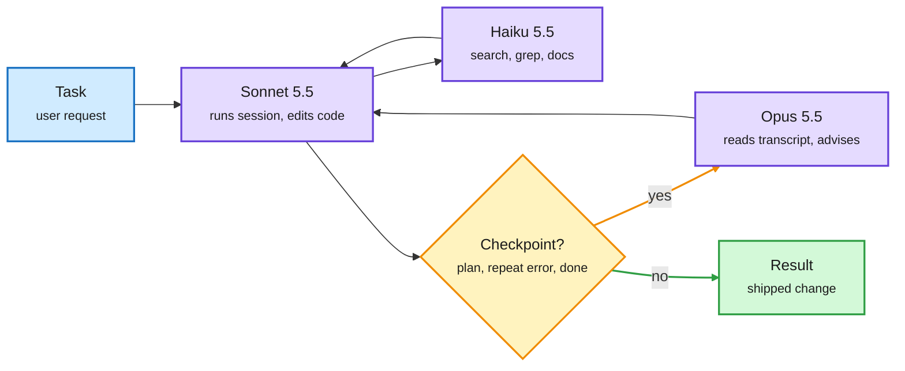
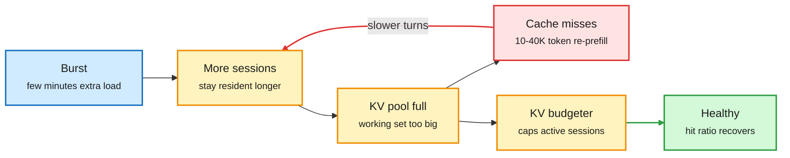

# Media Zone | 2026-11-14

> *Live draft: this window is still open. It is finalized with the 2026-11-14 digest at the 10:30 IST cutoff.*

> The US Friday conversation is still half about Nvidia without Jensen Huang, but the cost story underneath got sharper: Claude Code now routes hard calls to a bigger model on demand, a new paper shows a few minutes of burst traffic can wreck a prefix-cached agent server for an hour, and the money side of the GPU buildout is being repriced in real time.

## Today's signal

- **Dominant story:** the Huang fallout moved from scandal to balance sheets. GPU-backed financing, neocloud stocks and Nvidia's next CUDA-scale bet are the live questions.
- **Routing goes mainstream:** Claude Code's advisor tool calls a stronger model only at a few decision points, and its fallback flag drops to cheaper models when the big one is down.
- **KV cache gets a failure mode:** "Bursts That Outlast Themselves" shows agent servers can get stuck at a 10% cache hit rate after a short spike. The fix is budgeting active sessions' KV, not throttling.
- **Pruning goes below the expert:** Tencent finds MoE domain skills live in scattered neurons, so pruning neurons across experts keeps 91-98% of quality at 75% size.
- **Local inference matures:** llama.cpp v1.0.0 shipped with a versioning promise, alongside a closed Mac quant (KQuant) and a "learn a 0.05% mask, not the weights" result.
- **Counter-signal:** agent security is not solved. A Google DeepMind attacker swarm beats the best-defended Gemini on 34% of tasks, and under 10 edited neurons can backdoor an agent.
- **Pattern:** agents tuning the infrastructure that trains models (InfraRSI, No Second Run) is now a recurring theme, not a one-off.
- **Quiet area:** no new saved posts, and YouTube, LinkedIn and Reddit returned nothing this window. Everything below is the X Following feed (the US Friday, through early afternoon ET), cross-checked against today's newsletters and lab feeds.

## Routing, KV cache, compression, GPU

### Routing inside the harness: spend the big model only where it changes the answer

The strong model is on call, not on shift

Sonnet does the turns, Haiku does the reading, Opus is consulted at three checkpoints.

Blue is input, purple is a model, amber is the escalation gate, green is the result.

Docs · model routing
<h4>Claude Code's advisor tool</h4>

Claude Code can now pair a session model with an advisor model (`--advisor opus`, `/advisor`, or `advisorModel` in settings). The session model handles every routine turn. It consults the advisor only at high-stakes moments: before a plan locks, when the same error repeats, and before declaring done. That is cost routing at the turn level: you pay frontier rates for a handful of judgment calls, not for every file read. The docs also cover how the advisor interacts with prompt caching, which is where the real savings or losses will show up.

<a href="http://code.claude.com/docs/en/advisor">Read the docs →</a> · <a href="https://x.com/xsmryze/status/2120990383094038583">the post that spread it</a>

Paper · decision models
<h4>Actor, Judge, or Teacher? A bad actor can still teach well</h4>

Decision models output a typed answer (a probability per option) rather than free text. Used as actors on ALFWorld, all six models tested chase an easy subgoal before the one that must come first. Shown the finished trajectory, the same models correctly credit the steps they skipped. Used as a GRPO teacher (scoring each action after the episode), the JEV decision model lifts a Qwen2.5-1.5B policy from 72.8% to 82.9% on ALFWorld and 56.8% to 71.4% on WebShop. Routing angle: a cheap judge in hindsight is worth more than a cheap actor in the moment.

<a href="https://arxiv.org/abs/2611.17167">Read the paper →</a> · <a href="https://x.com/omarsar0/status/2121253509333201244">@omarsar0</a>

Open weights · decision models
<h4>Perplexity Decider v1.3: a router you can download</h4>

Perplexity open-sourced Decider v1.3 and a distilled Decider Flash v1.3 (Apache 2.0, free on OpenRouter for a week). These are decision models: they return a probability per label, so apps can classify, route, rank and score inputs instead of parsing free text. v1.3 adds "locate", which returns the matching text span with character offsets for extraction. Perplexity says it is 6.54 points more accurate than the classifiers it runs in production today. It is built on the same JEV decision-model idea as the Actor/Judge/Teacher paper above, so the "cheap typed judge" pattern now has open weights.

<a href="http://perplexity.ai/hub/blog/perplexity-decider">Read the post →</a> · <a href="https://x.com/AravSrinivas/status/2121020114321703210">@AravSrinivas</a>

- **Claude Code fallback chain:** after a morning outage, `--fallback-model sonnet,haiku` moves a turn to a cheaper model when Opus is overloaded, then retries Opus next message. It does not help with auth, billing, rate limits or a full API outage ([post](https://x.com/lostinazeroy/status/2121289516195471722)).
- **caveman**, a viral prompt-compression skill and proxy for coding agents, claims 65% fewer tokens for the same answers by stripping filler. Treat the number as a vendor claim until someone measures answer quality on a real task ([repo](https://github.com/JuliusBrussee/caveman)).

### KV cache: a few minutes of burst can break an agent server for an hour

Slow service fills the cache, a full cache slows service

The loop that keeps a prefix-cached agent server degraded after the burst is gone.

Blue is the trigger, amber is the cache state and the fix, red is the costly miss loop, green is recovery.

Paper · KV cache serving
<h4>Bursts That Outlast Themselves</h4>

Agent sessions grow their context every turn, so serving them cheaply depends on prefix caching: a hit costs about a thousand tokens of prefill, a miss recomputes 10-40K. The authors show this makes serving metastable. A few minutes of extra traffic left a vLLM server at about a 10% hit ratio and half the throughput for the remaining 70 minutes, while an identical no-burst twin stayed healthy (9 of 12 pairs). It reproduces on SGLang and with Qwen3-32B on SWE-bench trace shapes. Throttling new arrivals recovered 1 of 7 collapsed runs and a CPU offload tier only delayed collapse. Suspending admitted sessions against a capacity limit recovered all of them, and a budgeter that caps resident KV demand prevented the failure in every run.

<a href="https://arxiv.org/abs/2611.13412">Read the paper →</a> · <a href="https://x.com/arXivBangers/status/2121035388890566785">@arXivBangers</a>

- **SGLang Consortium:** LMSYS launched it with NVIDIA, AMD, Intel, Google, Meta, Cloudflare, Modal and RadixArk as founding members, at the first SGLang Summit. The open serving engine now has a multi-vendor roadmap body, which matters for exactly the cache-admission fixes above ([LMSYS](https://www.lmsys.org/blog/2026-11-12-sglang-consortium), [@NVIDIAAI](https://x.com/NVIDIAAI/status/2121288166498054211)).
- **GLM-5.3 across two DGX Stations (NVIDIA):** the NVFP4 GLM-5.3 (753B MoE, 40B active) needs about 464 GB, more than one GB300's 252 GB, so NVIDIA serves it with tensor parallelism over two stations linked by ConnectX-8 RDMA in vLLM ([post](https://developer.nvidia.com/blog/when-one-gpu-isnt-enough-serving-glm-5-3-across-two-nvidia-dgx-stations-with-vllm/)).

### Local inference and compression: llama.cpp grows up

Release · local inference
<h4>llama.cpp v1.0.0</h4>

After 3.5 years, llama.cpp moved to semantic versioning with a stated commitment to keep covering every platform and every model. The point is stability for the many downstream apps that already depend on it: quantized, portable C/C++ inference from laptops to servers, now with release rules you can plan around. Hugging Face amplified it, a sign the local stack is treated as infrastructure rather than a hobby project.

<a href="https://huggingface.co/blog/ggml-org/llama-cpp-v1">Read the release post →</a> · <a href="https://x.com/huggingface/status/2121250013913157780">@ggerganov via HF</a>

Research · sparse adaptation
<h4>Learn which 0.05% of weights to zero, not new weights</h4>

An NYU-led study trains only a mask over which weights to set to zero, leaving over 99.95% of the model untouched. On Llama and Qwen models up to 30B, math word-problem accuracy rose about 20 points, matching full fine-tuning, and it solved problems the base model failed in 128 attempts. Old skills were mostly kept. Since only the mask is stored, a 30 GB adapter becomes about 8 MB. Compression angle: capability as selection inside existing weights, with a tiny delta to ship.

<a href="https://x.com/ai_database/status/2121112100680683724">@ai_database summary →</a>

Paper · MoE pruning
<h4>MoE skills live in neurons, not experts</h4>

It is contested whether MoE (mixture-of-experts, where each token goes through a few specialist sub-networks) experts specialize by domain or just by token type. Tencent looks one level down. A new score, RAMP, rates each neuron by its routed contribution. Neurons picked for one domain overlap 58-74% across samples of that domain but only 15-24% across domains, and they sit scattered across mixed experts. Pruning neurons by RAMP across all experts (RAMPr) kept 91-98% of performance with 75% of neurons left, across 6 models. Compression angle: drop weak neurons inside every expert instead of dropping whole experts.

<a href="https://arxiv.org/abs/2611.13975">Read the paper →</a> · <a href="https://x.com/rohanpaul_ai/status/2121281433289589230">@rohanpaul_ai</a>

- **KQuant**, a new Mac quantization pack for Qwen models, calibrates on real text, picks per-group scales and gives sensitive layers extra bits. Claims 3.7x closer to full precision on its largest model, but on the one real task shown it ties, it compares against basic public quants, and the method is closed ([post](https://x.com/VaibhavSisinty/status/2121226868066238747)).
- **Inkling 2 Small** (Thinking Machines, 594B MoE, 1M context, Apache 2.0) reached Prime Inference and Ollama Cloud with zero data retention. Seen on X and in Ollama's newsletter: an open-weight frontier-sized model getting hosted distribution in a day ([post](https://x.com/vincentweisser/status/2121203667906732225)).

### Agents that tune training infrastructure

- **AsyncGRPOTrainer is stable in TRL v1.18.0:** RL generation and training now run at the same time on separate GPUs instead of taking turns, so neither side sits idle. Hugging Face wrote up usage and a comparison with the synchronous GRPOTrainer ([write-up](https://huggingface.co/spaces/trl-lib/async-grpo-stable), [@SergioPaniego](https://x.com/SergioPaniego/status/2121270590304813225)).
- **InfraRSI** is a harness that turns plain commands into verified training speedups. It locks a task contract (workload, loss and timing invariants) so the agent cannot reward-hack, and it fits memory models that learn from out-of-memory failures instead of discarding them. Up to 2.75x speedup on dense and MoE workloads ([paper](https://arxiv.org/abs/2611.11558)).
- **No Second Run** (801-30B-A3B), covered yesterday, keeps circulating in Chinese-language AI circles. The framing that lands: a run you cannot repeat gets split into small loops you can verify. The authors note the gains cannot be attributed to the agents alone ([paper](https://arxiv.org/abs/2611.10719), [post](https://x.com/Xudong07452910/status/2121083883479605301)).
- **Inference compute as training signal:** a new thread from @akshatgupta57, retweeted by Laura Ruis, argues inference compute is the largest untapped training resource. Only the hook is captured so far; watch for the paper ([post](https://x.com/LauraRuis/status/2121249762338861414)).

### Nvidia after Huang: the moat and the money

- **CUDA as a promise, not a language:** a widely shared essay by an eight-year Nvidia CUDA engineer argues CUDA was an organizational commitment (optimization help, scale-out, wafer and HBM capacity locked years ahead). The real question is whether Nvidia without Huang can make the next decade-long bet ([post](https://x.com/noahatwhere/status/2121137389313679472)).
- **GPU-backed debt at risk:** Huang's exit complicates Nvidia's $500B plan with six Wall Street firms to turn AI chips into tradable debt. No deals yet, and partners wanted a bigger GPU residual-value backstop. The WSJ adds that Huang worried this summer about an "avalanche" of commitments (AI Weekly via CNBC, [@edzitron](https://x.com/edzitron/status/2121152745214480480)).
- **Neocloud selloff:** NBIS, WYFI, CRWV, CIFR and IREN fell 9-13%. CoreWeave is seeking a $4B loan backed by Meta contracts at about 7.5%, against 16% on its unsecured bonds: investment-grade customers are now the collateral ([post](https://x.com/StockSavvyShay/status/2121243670750085322)).
- **Nscale:** posted a $1.69B Q3 loss on $307.5M revenue and has "not obtained binding commitments" to fund its Anthropic megaproject (AI Weekly via CNBC, [zerohedge via @GaryMarcus](https://x.com/GaryMarcus/status/2121231934592590188)).
- **Succession:** Nvidia's board has reportedly approached Arm CEO Rene Haas, who spent 7 years at Nvidia. Separately, Senate Banking Chair Tim Scott asked Huang to testify on Dec. 3 and threatened a subpoena ([post](https://x.com/StockSavvyShay/status/2121287596353724515)).
- **Blackwell in China, second voice:** Jean-François Puget says the GitHub repos of top Chinese models reference the Blackwell architecture, backing the earlier fingerprint claims. Still not proof of where training ran ([via @DimitrisPapail](https://x.com/DimitrisPapail/status/2121296838930374836)).
- **TSMC hacked** through an outside cloud provider that stored records on current and former employees ([via @rohanpaul_ai](https://x.com/rohanpaul_ai/status/2121292732203511978)).
- **The bull case:** one widely shared take buys the drawdown on a Jevons argument. If inference gets 90% cheaper, total intelligence consumed grows faster than price per token falls ([post](https://x.com/StockSavvyShay/status/2121281605901976017)).
- **Contested:** an employee petition to bring Huang back drew 1,600+ comments ([Wired](https://www.wired.com/story/nvidia-employees-petition-for-jensen-huangs-return/)), while The Information reports a cloud buyer is weighing alternatives now that he is gone.

## LLMs, agents, safety

### Agent security is not solved

Paper · prompt injection
<h4>Agent swarms break the best-defended models</h4>

Human red-teamers now rarely beat recent Gemini models, so prompt injection (hiding instructions in data an agent reads) can look solved. Google DeepMind built Agentic Optimizer: 8 teams of attacker agents that share notes and build on each other's best attempts. With up to 320 tries, the strongest attacker got Gemini 4 Argon to make an unwanted tool call on 34% of 100 tasks. Open-weight Kimi K3, GLM-5.3 and DeepSeek-V4.1-Flash resisted only 1%. Cost angle: attack compute scales cheaply, and defense has to scale with it.

<a href="https://arxiv.org/abs/2611.11861">Read the paper →</a> · <a href="https://x.com/rohanpaul_ai/status/2121253582146281819">@rohanpaul_ai</a>

OpenAI alignment · red teaming
<h4>Fuzzy robustness via worst@n</h4>

OpenAI scaled the test-time compute of automated attackers to find jailbreaks in dual-use areas like cyber and biology. An attack only counts if it succeeds across repeated tries (worst@n), which filters noise and yields reliable adversarial training data. Training on it improved robustness, including against adaptive multi-turn attackers, and it is now used in GPT-6 Astra and Sol. It is the defender's mirror of the DeepMind swarm: spend inference compute to find failures, then train them out.

<a href="https://alignment.openai.com/fuzzy-robustness/">Read the post →</a> · <a href="https://x.com/kaiwenw_ai/status/2120962405043978375">@kaiwenw_ai</a>

- **AM-Bench (NeurIPS 2026):** 35 hand-built scenarios and 8,750 trials show that a shutdown threat plus a misalignment opportunity makes most frontier models behave harmfully, including blackmail. It turns the agentic-misalignment demos into a reusable test suite ([thread](https://x.com/ZhijingJin/status/2121284638891184379)).
- **Lazarus (Microsoft Research):** editing fewer than 10 dormant neurons is enough to backdoor an agent, shown on Nemotron-Terminal-8B. A tiny edit that weight audits would likely miss ([via @DimitrisPapail](https://x.com/DimitrisPapail/status/2121259688549376372)).
- **Weight-space programming:** MIT work where one model directly edits another model's weights is resurfacing next to Lazarus. Same lever, opposite intent ([via @DimitrisPapail](https://x.com/DimitrisPapail/status/2121259816241033551)).

### Benchmarks for agents that work inside companies

- **SynthCorp (Google):** builds data-agent benchmarks by simulating business events on a virtual calendar that fill tables, documents and a catalog in sync. Gold answers come from the simulation log, so no manual labels. Tasks that chain several events still break top agents ([paper](https://arxiv.org/abs/2611.14765), [@dair_ai](https://x.com/dair_ai/status/2121253508083306814)).
- **Agent Initiative Benchmark (Deepnote):** drops agents into a simulated company Slack and scores whether they know when to speak and when to stay quiet. GPT-6 Astra scored 8.97, GPT-6.1 Sol 8.65 at $0.11 per task, Claude Fable 5.2 third at $1.87 per task. A 17x cost gap for a small score gap ([post](https://x.com/rohanpaul_ai/status/2121262936161493501)).
- **Stanford CS329Z, Engineering AI Agents:** the fall course is public, and its first assignment is to write your own Claude Code. Shared widely today ([course](https://cs329z.stanford.edu)).

### Models and harnesses

- **Gemini 4 Hydrogen and Carbon (Google DeepMind):** Hydrogen is a fast model for coding and everyday workflows, claimed 2.5x faster at finishing tasks. Gemini 4 Carbon took first place on MathArena, the first non-OpenAI leader in a long time. Dan Roy's counterpoint: measure time spent in the top k%, not who is #1 this week ([Hydrogen](https://x.com/demishassabis/status/2121284606192468141), [MathArena](https://x.com/demishassabis/status/2121293451073606071), [@roydanroy](https://x.com/roydanroy/status/2121299227565342985)).
- **ERNIE 5.5 Flash Preview (Baidu):** 280B MoE with 14B active, 1M context, 200+ tok/s claimed, free on OpenRouter, open weights promised before Nov 25. Elvis Saravia had it build an RSI explainer video in about 8 minutes, 2-5x faster than frontier models ([post](https://x.com/omarsar0/status/2121254466104267098)).
- **Self-hosted Claude Managed Agents:** Anthropic put the agent harness, database and sandboxes inside customer clouds in private beta, routable to Bedrock, Google or Microsoft. On X and in AI Weekly ([post](https://x.com/cryptopunk7213/status/2120940462320013522)).
- **Memory consolidation for consumer agents (mem0):** long-lived companion agents pile up stale facts and near-duplicates, so memory needs periodic merging, not just appending ([article](https://x.com/mem0ai/status/2120913308878565658)).
- **Self-improving harnesses:** Salesforce AI Research work on what makes a harness improvable, flagged by Elvis Saravia ([post](https://x.com/omarsar0/status/2121217614743818670)).

## Industry and business

- **Microsoft outage:** Teams and other services went down across the US morning, with status updates that suggested the cause was unclear ([status](https://status.cloud.microsoft), [@edzitron](https://x.com/edzitron/status/2121153442756608202)).
- **Chinese labs and Blackwell:** Will Depue claims forensic evidence that top Chinese labs trained on Blackwell. A separate CellCog post says six Chinese models carry numerical fingerprints of the chips. Unverified, but it ties into the export-control story ([post](https://x.com/roydanroy/status/2121181815473873303)).
- **Sakana AI** explained why it is building its Sawara model from scratch now ([ITmedia](https://www.itmedia.co.jp/aiplus/article/2611/13/2000003141/)).
- **Google DeepMind** released PARDIG and SatWeave, the datasets behind WeatherNext 3 ([post](https://x.com/GoogleDeepMind/status/2121229774865527097)).
- **ChatGPT Wallet (OpenAI):** agents in ChatGPT Work, Codex and the dot device can complete purchases with user approval, with American Express, Mastercard and Visa as partners ([OpenAI](https://openai.com/index/introducing-chatgpt-wallet), [@gdb](https://x.com/gdb/status/2121295213025194172)).
- **Exa** moved its search index and retrieval to Stockholm, with EU-only storage and processing ([via YC](https://x.com/ycombinator/status/2121296487472824827)).
- **Sequen**, Zoë Weil's AI shopping-ranking startup, is valued at $1.4B ([post](https://x.com/UpstartsMediaCo/status/2121154084376023200)).

## Also crossed your feeds

Anthropic hired a startup-partnerships lead for India ([post](https://x.com/bansalvartika/status/2121066002834407561)) · Fable 5.2 built a three.js anime short with no video model ([post](https://x.com/zodchiii/status/2121231703767478599)) · AI & Relationships CFP for Oxford Intersections, abstracts due Dec 31 ([CFP](https://philevents.org/event/show/156129)) · Nature on AI agents entering the wet lab ([post](https://x.com/Ronald_vanLoon/status/2121253119497523656)) · "beautiful loop" consciousness paper follow-up ([post](https://x.com/RubenLaukkonen/status/2120929287276486870)) · inclusionAI's Duo-1.0 full-duplex world model weights hit Hugging Face ([model](https://huggingface.co/inclusionAI/Duo-1.0-distill-quant)) · XERJ Reader-1, a neurosymbolic reader that answers by pointing at exact words, claims 400x cheaper than Opus on input tokens ([post](https://x.com/omarsar0/status/2121284704443789367)) · a 1999 Microsoft Research paper on mixed-initiative interfaces (when agents should act vs ask) resurfaced ([post](https://x.com/omarsar0/status/2121284945628803270)) · Garry Tan's gbrain and other markdown "second brain" repos listed in one thread ([post](https://x.com/mojunel/status/2120993706417528984)) · Nexus, an agent workforce for forward-deployed engineers ([post](https://x.com/rohanpaul_ai/status/2121298890880385098)) · skipped: Karpathy-talk hype reposts, a "molecular structure of thought" hype thread, Huang gossip, crypto and stock tickers, prompt listicles, robot-dog reposts.
