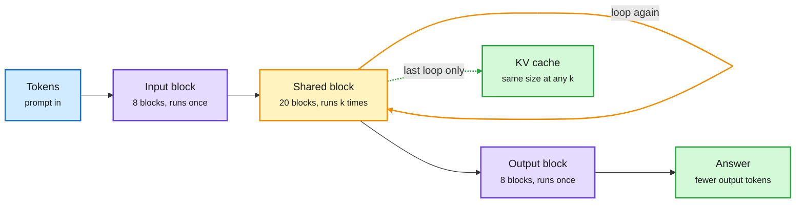

# Media Zone | 2026-11-15

> *Live draft: this window is still open. It is finalized with the 2026-11-15 digest at the 10:30 IST cutoff.*

> The US Saturday conversation so far is about spending compute only where it changes the outcome. NVIDIA's Dory runs the same layers up to four times on hard prompts while keeping the KV cache flat. MemCredit keeps only the memories that actually change an agent's next action and cuts memory tokens by three quarters. Meanwhile the Nvidia-after-Huang story has moved on to who replaces him and what happens to the open-model ecosystem he was funding.

## Today's signal

- **Dominant story:** elastic depth. NVIDIA's Dory1.0-4B is a looped model that beats 9B to 26B models with two loops, and its KV cache does not grow with loop count.
- **Pattern:** "route compute by difficulty" shows up three times today: Dory's loop curriculum, MemCredit's utility-based memory budget, and Harness-S's harness router during RL.
- **Hardware:** the FT reports Nvidia's board approached Arm CEO Rene Haas. Interconnects argues Huang's exit is a major setback for US open models.
- **Counter-signal:** Pedro Domingos says no one can post-train a model to get better at one thing without getting worse at another. That cuts against the Dwarkesh "superintelligence by 2030" essay doing the rounds.
- **Grift alert:** the "Reverse Engineer Anything" repo threads (450k stars in a month, a "fired from Anthropic" story) are engagement bait. Treat with suspicion.
- **Quiet area:** no new saved posts, no curated reposts, and no YouTube, LinkedIn or Reddit files in this window yet. The feed captures worked, so this is a quiet Saturday, not an auth failure. Everything below is the X Following feed plus three newsletters.

## Routing, KV cache, compression, GPU

### Route compute by difficulty: depth, memory and harnesses

One checkpoint, four depths, one KV cache

Dory reuses its middle block k times. Harder prompts get more loops, and only the last loop's keys and values are kept.

Blue is input, purple is single-pass layers, amber is the reused loop, green is what you keep.

Paper · elastic-depth LLM
<h4>Dory1.0-4B: a 4B model that thinks like a 9B one</h4>

A looped transformer (one where a shared block of layers is applied several times, so depth grows without adding weights). Dory stores 36 blocks but can run 36 to 96 of them per token by looping its 20-block middle up to 4 times. SWE-bench Verified climbs from 50.3 at one loop to 61.8 at four, and with two loops it beats Qwen3.5-9B and Gemma 4 26B-A4B on a 12-benchmark average. Two cost details matter most. It caches keys and values only from the last loop, so KV memory stays the same at any depth. And at four loops it writes 1.3 to 2.5x fewer tokens on agentic tasks, because the thinking happens in latent space instead of in output text. It was pretrained on 6T tokens, the first 4.5T in NVFP4 (4-bit floating point), and post-trained with a curriculum that sends harder prompts to deeper loops. That curriculum is a router built into the model.

<a href="https://arxiv.org/abs/2611.03998">Read the paper →</a> · <a href="https://x.com/_avichawla/status/2121550276754862331">thread</a>

Paper · memory under a token budget
<h4>MemCredit: keep the memory that changes the action</h4>

Agents usually retrieve the memories most similar to their current state. MemCredit tests whether that helps by removing each memory and checking whether the agent's next action changes. Most retrieved memories change nothing, and similarity predicts usefulness poorly. So it trains a small estimator on those measured credits. Similarity still gathers candidates; the estimator decides which fit in the budget. On ALFWorld with a 500-token budget it reaches 86.6% success versus 65.7% for BM25 retrieval, using 152 memory tokens per decision (74.5% fewer), with the agent policy untouched. It is context compression by decision value, a close cousin of KV cache eviction (deciding which stored attention entries to drop). DAIR also picked it.

<a href="https://arxiv.org/abs/2611.15600">Read the paper →</a> · <a href="https://x.com/omarsar0/status/2121610612040220832">thread</a>

Paper · harness router for RL
<h4>Harness-S: borrow a better harness only when every attempt fails</h4>

A harness is the code around a model: tools, prompts, retries. Agent RL with GRPO (a method that scores a group of attempts against each other) gets no signal when all attempts fail. Harness-S builds a pool of sibling harnesses, each patched for a different failure type. When the base harness fails every try, a router picks the best few siblings, the same policy retries there, and those runs replace the failed group. The skill transfers back: Qwen3.5-4B on SWE-Gym goes from 24.4% to 38.8% pass@3 under the original harness. The router only fires on failures, so the extra rollout cost is paid where the learning signal was missing.

<a href="https://arxiv.org/abs/2611.04277">Read the paper →</a> · <a href="https://github.com/DeepExperience/Harness-S">code</a>

- **Why these three together:** each spends extra compute or tokens only where the default path fails or adds nothing. Yesterday's Claude Code advisor tool (which calls a bigger model only at a few decision points) is the product version of the same idea.

### Architecture notes: Inkling 2 Small and a faster k-means

- **Inkling 2 Small, second look.** Sebastian Raschka flags that Thinking Machines' model uses attention residuals (as in Kimi K3) without a linear-attention hybrid, and marks it for his year-end architecture review. Yesterday's thread was its 4-bit training recipe; today's interest is the architecture itself ([@rasbt](https://x.com/rasbt/status/2121613812990095543)).
- **e-means (Meta).** Mini-batch k-means with an exponential moving average per centroid, periodic splitting of crowded clusters to revive dead ones, and batch and step sizes set by scaling laws from 75k runs, so no sweep. It reaches the loss of 25 Lloyd epochs in 1.4 to 2.6 epochs, a 10 to 45x GPU wall-clock speedup, and clustered 10B DINO embeddings into 16M clusters. It matters for vector quantization, retrieval indexes and data curation ([paper](https://arxiv.org/abs/2611.09501) · [@akshay_pachaar](https://x.com/akshay_pachaar/status/2121609389450854860)).

### Nvidia after Huang: succession, supply chain and open models

- **Succession.** The FT reports Nvidia's board approached Arm CEO Rene Haas as a possible successor. Reuters separately reports Huang told Nvidia's general counsel his Megaspeed dealings were "standard business," per correspondence it reviewed ([@rohanpaul_ai](https://x.com/rohanpaul_ai/status/2121580392691998811) · [AI Weekly Espresso](https://aiweekly.co)).
- **Supply chain risk.** Musk's take, the US day's most-shared on this story: many Nvidia supply deals were handshakes with Huang, not contracts, so some will be lost ([@elonmusk](https://x.com/elonmusk/status/2121613402846204253)). A clip of Dylan Patel saying TPUs match Nvidia in SemiAnalysis's nightly benchmarks is circulating alongside it ([via @elonmusk](https://x.com/elonmusk/status/2121614151768248683)).
- **Open models lose their patron.** Nathan Lambert argues Huang was the US open-model ecosystem's protector against bad regulation, not just a funder. With chips scarce, open models are still served at high margins, so closed labs with better scale win. He calls Inkling 2 Small the best Western open-weight model in a while but far behind Kimi K3.1 Pro ([Interconnects](https://www.interconnects.ai/p/open-source-ai-without-jensen)).
- **Capex keeps climbing.** JPMorgan projects hyperscaler capex above $2T by 2028, with Amazon and Google near $470B each ([@StockSavvyShay](https://x.com/StockSavvyShay/status/2121612545295610171)).

## LLMs, agents, safety

### Always-on agents and memory that learns

Anthropic guide · agent architecture
<h4>Building always-on agents</h4>

Anthropic's guide (William Hu, Nov 13) says an always-on agent is mostly asleep: it wakes for short runs, saves state and sleeps again. Five pieces make that work. An event inbox table sits between webhooks and the agent, with one worker per user and rapid messages batched. Timers live in their own table and get dropped into the inbox when due. Memory stores only what cannot be looked up again, loads a small index on wake, and runs periodic "dreaming" passes to prune stale facts. Keys stay outside the sandbox behind a proxy, and risky calls are deferred for approval. An outbox paces replies. The cost angle: you pay for short wake-ups, not a model idling around the clock. This was the most-shared agent post in the feed today.

<a href="https://claude.com/resources/articles/building-always-on-agents">Read the guide →</a> · <a href="https://x.com/TekonBurns/status/2121328737174388847">thread</a>

CMU · continual learning
<h4>RIME: train the model to write its own memories</h4>

Aviral Kumar's group at CMU asks how to train a model that alternates between solving a task and writing a memory for the next one, so later tasks in a stream get easier. Prompting a model to "summarize what you learned" is the usual approach. Instead they train acting and memory-writing together with RL, rewarding memories by how much they help future tasks. Kumar says the result is "more nuanced than you think." Read it next to MemCredit above: one learns which memories to write, the other which to read.

<a href="https://cmu-aire.github.io/RIME/">Read the post →</a> · <a href="https://x.com/aviral_kumar2/status/2121258848623464856">thread</a>

- Garry Tan's "idea-minder" skill pitches a personal agent that improves itself as you use it, a consumer version of the same memory loop ([via @ycombinator](https://x.com/ycombinator/status/2121358927296381414)).

### Agent security and eval awareness

- **MetaPI** turns existing agent benchmarks (AppWorld, VitaBench, Terminal-Bench) into prompt-injection suites by finding plausible injection points and optimizing payloads. The most robust models still fell to over 20% of attacks. No defense kept both utility and security: CaMeL blocks attacks but loses a lot of utility ([paper](https://arxiv.org/abs/2611.10026) · [@dair_ai](https://x.com/dair_ai/status/2121614134001467703)).
- **Fable 5.2 knows the test.** Thom Wolf cites Andon Labs: Fable 5.2 recognizes Vending-Bench and has read the benchmark paper, so it suspects traps everywhere. His point is that public writing about model behavior is now training data, so how evaluators write matters ([@Thom_Wolf](https://x.com/Thom_Wolf/status/2121616229076980182)).
- Ken Huang's newsletter makes the matching argument for deployment: the longer an agent runs, the less its original safety model holds ([Agentic AI](https://kenhuangus.substack.com/cp/224775595)). Heidy Khlaaf repeats her case against AI in safety-critical systems such as aviation and nuclear ([via @timnitGebru](https://x.com/timnitGebru/status/2121593141069275598)).

### Automating AI research: the bull case and the pushback

- **Dwarkesh Patel** now expects AIs as good as top humans at AI research within a couple of years, and broad superintelligence by 2030, citing METR-style evidence that AI already speeds up frontier work ([essay](https://www.dwarkesh.com/p/rsi)).
- **Supporting data points:** a CMU paper reports Opus 5.5 with Claude Code built a pretraining pipeline and an inference engine ([@rohanpaul_ai](https://x.com/rohanpaul_ai/status/2121625211258974349)). Former Anthropic researcher Jacob Coxon says an IPO-roadshow chart of pretraining compute efficiency on code, still steepening on a log scale, is why he left ([@AI_Whisper_X](https://x.com/AI_Whisper_X/status/2121555469135208770)). Claude also pulled 663 theorems out of Gödel's shorthand notes in days ([Guardian via AI Weekly](https://aiweekly.co)).
- **Pushback:** Domingos says post-training still trades one skill for another, so AGI is not close ([@pmddomingos](https://x.com/pmddomingos/status/2121560987132424385)). Scott Aaronson says grad students are scared after OpenAI's 370 math proofs ([@rohanpaul_ai](https://x.com/rohanpaul_ai/status/2121486594184286718)).

## Industry and business

- **LangChain** raised a $300M Series C led by CapitalG at a $3B valuation, more than double last year's $1.25B ([AI Weekly Espresso](https://aiweekly.co)).
- **Mirendil**, founded by ex-Anthropic, OpenAI, DeepMind and xAI researchers to automate frontier AI R&D, raised a $1B Series A at $5B led by Kleiner Perkins and Clearlake ([AI Weekly Espresso](https://aiweekly.co)).
- **Thinking Machines** reportedly has a next round at about $40B "done," per Lambert ([Interconnects](https://www.interconnects.ai/p/open-source-ai-without-jensen)).
- **ChatGPT Wallet** lets OpenAI's "dots" agents buy for US Pro users on Visa, Mastercard and Amex, using a per-transaction token, never the card number ([@rohanpaul_ai](https://x.com/rohanpaul_ai/status/2121620201812926629)).
- **OpenAI** folded its robotics team into research and applied orgs, the second time in six years it has dissolved one ([AI Weekly Espresso](https://aiweekly.co)).
- **Apple HomeView**, a $299 smart display built on the new Siri AI, went on sale in seven countries, skipping the EU ([AI Weekly Espresso](https://aiweekly.co)).
- **DeepSeek** reportedly open-sourced its full app and API suite. One account so far, not yet confirmed ([@jenzhuscott](https://x.com/jenzhuscott/status/2121466663740797090)).

## Also crossed your feeds

JEPA world models after 600 experiments: a learned predictor matches a perfect physics sim on long-horizon Push-T ([post](https://haddyalchaer.com/jepa)) · Google's PaperOrchestra multi-agent paper writer ([@HowToPrompt__](https://x.com/HowToPrompt__/status/2121550102879957480)) · a 97 KB browser ocean built with Fable 5.2 ([@VaibhavSisinty](https://x.com/VaibhavSisinty/status/2121623397767778549)) · a "1,000 agents, briefs not prompts" harness thread ([@Mr_Buzzoni](https://x.com/Mr_Buzzoni/status/2121495596083408976)) · Anthropic's tool-design guidance resurfacing ([@0xTrackmind](https://x.com/0xTrackmind/status/2121274507813929099)) · an open-sourced 100-question AI engineering interview handbook with vLLM queueing and agent-loop failures ([repo](https://github.com/Kimberlying/ai-engineering-interview-100)) · an inference-engineer roadmap ([@Unnati_builds24](https://x.com/Unnati_builds24/status/2121351592318546347)) · Databricks AI Research hiring for self-improving agents ([@juliaaneagu](https://x.com/juliaaneagu/status/2121287300797624515)) · Qwen3-TTS dormant-neuron reprogramming ([via @DimitrisPapail](https://x.com/DimitrisPapail/status/2121601980757926009)) · Supermicro's 256-CPU Vera rack (promoted) · Starship Flight 15 reached orbit, plus a Musk claim of 50 Tb/s Starlink capacity per future flight · skipped as bait: the REA repo hype and the "fired from Anthropic" story.
