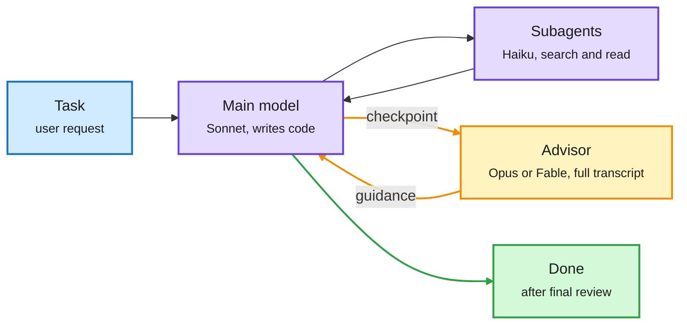

# Media Zone | 2026-11-16

> *Live draft: this window is still open. It is finalized with the 2026-11-16 digest at the 10:30 IST cutoff.*

> The US Sunday conversation is about paying the expensive model only for decisions. Claude Code's advisor mode keeps Opus or Fable on call for three moments in a task and lets cheaper models do everything else. Perplexity's Decider skips text generation entirely and emits a routing decision in one forward pass. By US afternoon the feed turned to the serving stack underneath: a 10-week inference-serving roadmap, a Rust rewrite of Anthropic's Messages API with ~20% faster first token, and a "token volume up 25x" claim set against falling AI stocks. Bernstein's HBM4 math says memory makers earn about 65% gross margins. The Nvidia story has turned from succession to scandal.

## Today's signal

- **Dominant story:** "advisor" routing inside Claude Code. A cheap main model works, a strong model is consulted only before a plan locks, after a repeated error, and before "done."
- **Pattern:** decision-only compute. Advisor mode, Perplexity's single-pass Decider and Kenneth Stanley's "shadow agent" proposal all price oversight explicitly: who gets the expensive tokens, and when.
- **Serving stack, US afternoon:** a public roadmap teaches vLLM, SGLang, KV eviction and disaggregated prefill end to end. Anthropic's Rust API rewrite cut time to first token about 20%.
- **Hardware:** HBM4 costs about $6-7/GB to make and sells near $20/GB. Long-term compute leases run half the price of short-term capacity.
- **Counter-signal:** the "repeat your prompt twice, it's free" thread is wrong on cost. Repetition doubles prefill tokens and KV cache. Output tokens are unchanged, input bills are not.
- **Grift alert:** "Anthropic just released the best trick" threads inflate advisor mode with a made-up "3.4x cheaper" figure, and a "paste this prompt to install an uncensored model" thread is the evening's top-scored local-AI post. Skip both.
- **Quiet area:** no new saved posts or curated reposts all day (bookmark runs report zero new saves). YouTube, LinkedIn and Reddit are not in this window yet. HuggingFace and lab feeds are stale since 11-14. Everything below is six X Following-feed captures plus five newsletters.

## Routing, KV cache, compression, GPU

### Pay the big model only for decisions

The strong model is a consultant, not the worker

Advisor mode puts a cheaper model in charge and calls the expensive one at three checkpoints.

Blue is input, purple is the cheap models doing routine work, amber is the expensive checkpoint, green is the result.

Docs · in-harness routing
<h4>Claude Code's advisor tool</h4>

The advisor pairs your main model with a stronger one that Claude consults at key moments: before committing to an approach, when an error keeps recurring, and before declaring a task complete. The advisor reads the whole conversation, including every tool call, and returns guidance the main model applies. It runs server-side, is experimental, and you set it with <code>/advisor opus</code>, an <code>advisorModel</code> setting or the <code>--advisor</code> flag. The docs say it pays off on long tasks where most turns are routine but plan quality decides the outcome, and adds little on short tasks. This is model routing (sending each request to the cheapest model that can handle it) moved inside one agent session, with the routing decision made by the agent itself. Two US-morning threads spread it widely. One adds a "Fable thinks, Opus reviews, Haiku swarm" stack and a "3.4x cheaper" number that the docs do not contain.

<a href="https://code.claude.com/docs/en/advisor">Read the docs →</a> · <a href="https://x.com/xsmryze/status/2121738107267481862">thread</a> · <a href="https://x.com/thedelost/status/2121720755192799480">inflated thread</a>

Guide · single-pass routing
<h4>Perplexity's Decider: route without generating text</h4>

Ken Huang's guide argues that using a generative model to make a yes/no routing or security decision is wasteful. The model writes 30 to 100 tokens to express one bit, its formatting drifts, and its confidence is uncalibrated. Perplexity's open-weight pplx-decider models (Apache 2.0) instead read the input with bidirectional attention and emit calibrated decision tokens from a small readout head in one forward pass, with zero generated text. The 4B Flash variant reportedly runs air-gapped on Apple Silicon at about 835 ms. Custom gates are tuned by freezing the backbone and training only the 2.6 MB readout layer with a Brier-score loss (a loss that rewards well-calibrated probabilities). Several of the guide's numbers come from secondary write-ups, so treat them as claims to check.

<a href="https://kenhuangus.substack.com/p/perplexitys-decision-model-a-practical">Read the guide →</a>

Paper claim · prompt repetition
<h4>Say the prompt twice: real gain, wrong cost story</h4>

A viral thread revives a Google result: causal models read left to right, so a document pasted before the question is encoded without knowing what to look for. Repeating the full prompt lets every token of the second copy attend to the question. The thread reports gains across seven models and benchmarks, including 21% to 97% on one extraction task. The thread says it "costs exactly $0." It does not. Output tokens stay the same, but input tokens, prefill compute and KV cache (the memory of past attention keys and values) all double. That is cheap for short prompts and expensive for long-document workloads, the very case where the trick helps most.

<a href="https://x.com/thesupermannx/status/2121905127829209138">thread</a>

### The serving stack, taught and rewritten

Repo · inference-serving curriculum
<h4>time-to-first-token: a 10-week LLM serving roadmap</h4>

Akshay Pachaar's open roadmap (50 lessons, 30 minutes a day) builds one serving stack end to end instead of scattering across demos. It starts with the roofline model, the reason decode is bound by memory bandwidth while prefill is bound by compute. Then it reads vLLM's PagedAttention and scheduler from the code, benchmarks SGLang's RadixAttention prefix reuse against it, and load-tests past 1,000 concurrent requests with TTFT and inter-token latency on Grafana. Later weeks cover FP16 vs FP8 vs INT4 on quality as well as speed, speculative decoding and KV eviction "including where the gains disappear," disaggregated prefill and decode on Kubernetes, and a cost/latency/quality router with per-request token budgets. It is a curriculum, not new research, but it is the most complete public map of exactly the stack the reader works on, and the evening's highest-scored efficiency post.

<a href="https://github.com/patchy631/time-to-first-token">Open the repo →</a> · <a href="https://x.com/akshay_pachaar/status/2121868311264952533">post</a>

Talk clip · production latency
<h4>Anthropic rewrote the Messages API in Rust with agents</h4>

The Claude Platform's head of product says the team, with no Rust experts, moved the Messages API from Python to Rust in about a month with two or three engineers, agents writing most of the code. Time to first token dropped roughly 20%. The humans planned the migration and built the checks, chiefly shadow traffic that compared old and new responses before the switch. Her point is that much of the job is now verifying what the agent did. For serving, it is a reminder that a fifth of TTFT can live in the API layer, not the model or the kernels. The poster appends a self-promo thread, so take the summary from the clip.

<a href="https://x.com/shmidtqq/status/2121996867982508151">Watch the clip →</a>

- **Self-improving harnesses, now as social hype.** Shanghai AI Lab's Self-Harness has the agent cluster its own failures, propose edits to its tools and prompts, and keep an edit only if nothing regresses. Qwen3.5 reportedly goes from 18% to 36.7% on Terminal-Bench 2.0 with the same weights ([@HoodieFade_](https://x.com/HoodieFade_/status/2121634833524724079)).
- **A "20x cheaper, more trustworthy" deterministic harness** was posted twice by Carlos Perez with no link. No artifact yet, so no verdict ([@IntuitMachine](https://x.com/IntuitMachine/status/2121914919582945581)).

[advisor docs](https://code.claude.com/docs/en/advisor) · [@xsmryze](https://x.com/xsmryze/status/2121738107267481862) · [Ken Huang](https://kenhuangus.substack.com/p/perplexitys-decision-model-a-practical) · [@thesupermannx](https://x.com/thesupermannx/status/2121905127829209138)

### Memory and compute economics

- **HBM4 margins.** Bernstein estimates HBM4 (the stacked high-bandwidth memory beside each GPU) costs about $6-7/GB to make and sells near $20, a roughly 65% gross margin. Nearly half a 32GB stack's cost is base die, packaging and test, which favors TSMC and Teradyne alongside Micron ([@StockSavvyShay](https://x.com/StockSavvyShay/status/2121913603800608843)).
- **Compute is priced by contract length.** Five-year deals at IREN and CoreWeave run about $20-25 per watt-year, against $40-50 for short-term capacity. Nebius's 2026 base sits near $12, so its realized price rises as old contracts roll ([@StockSavvyShay](https://x.com/StockSavvyShay/status/2121956885779919262)).
- **Demand vs. price.** The same account says AI token volume is up about 25x since January, mostly from agents, while AI stocks sell off. It is a bull argument with picks attached (DigitalOcean, SiTime, Astera Labs), so treat the 25x as unsourced ([@StockSavvyShay](https://x.com/StockSavvyShay/status/2122021813496537110)).
- **Capex shifts to neoclouds.** Raymond James sees cloud capex near $1.5T in 2027, with neoclouds the largest bucket at about $400B and Google passing Amazon among hyperscalers ([@StockSavvyShay](https://x.com/StockSavvyShay/status/2121928196677599642)).
- **Google TPU 8tx and 8i Max** launched. No specs in the capture yet (via the Future & AI newsletter).
- **Fab process watch.** The Semiconductor Newsletter's weekly monitor covers AVS 72 etch results (cryogenic carbon etch with a 7.2 vertical-to-lateral ratio at -90°C, aluminum atomic-layer etch at 0.08 nm/cycle) and early EUV-resist metrology. All of it is pre-production ([The Semiconductor Newsletter](https://thesemiconductornewsletter.substack.com/p/weekly-monitor-on-semiconductor-process-9db)).

### Nvidia after Huang: from succession to scandal

- **The WSJ story** now alleges Huang's partner arranged about $12B of top-end chips to China, and that the affair threatens the ecosystem he built. The claims are reported, not established ([@DAlperovitch via @GaryMarcus](https://x.com/GaryMarcus/status/2121933721188409617), [@carlquintanilla](https://x.com/GaryMarcus/status/2121929328170877088)).
- **Investor pressure.** Atreides Management sent a letter to Nvidia's board, its first ever, and posts now question the board's qualifications ([@GavinSBaker via @garrytan](https://x.com/garrytan/status/2121855420683710553)).
- **Supply-chain angle.** Musk says Huang always came through on compute deliveries. Others argue his exit lets China hawks tighten export rules. Future & AI notes an Nvidia intervention had halted a Megaspeed chip inquiry ([@elonmusk](https://x.com/elonmusk/status/2121624209675665519), [@dee_bosa via @garrytan](https://x.com/garrytan/status/2121863780355449231)).
- **Succession chatter.** US-evening posts float Google Cloud's Thomas Kurian as a possible successor. It is speculation with no reporting behind it ([@RajeshChanstgf](https://x.com/RajeshChanstgf/status/2121996166506119672)).
- **Skip:** the "this is why they took down Jensen" Nemotron conspiracy thread is the day's most-viewed Nvidia post and has no evidence ([@adamemedia](https://x.com/adamemedia/status/2121522045829726718)).

## LLMs, agents, safety

### Reading models from the inside

Thread · weight forensics
<h4>A model's training history is written in its weights</h4>

Alapan Chaudhuri shows you can recover much of how a model was trained just by inspecting its weights: which tokens appeared in the data, the learning-rate schedule and the number of steps. With the data in hand you can go further, to the step each document was seen, the shuffle seed and the number of passes. The examples are checkable. OLMo 2's first instruct release had 20,341 embedding rows that never moved, including the token that closes every chat turn, a tokenizer bug AI2 later fixed. Pythia-1B trained at a peak learning rate of 2.5e-4, not the 3.0e-4 on its model card. Qwen2.5's instruct tuning touched exactly 4 of 22 control tokens at every size. This is a cheap audit tool for open weights: model cards can be wrong, and the weights cannot lie about what was trained.

<a href="https://x.com/alapanchaudhuri/status/2121439269772492848">Read the thread →</a>

Essay · architecture building block
<h4>Raschka: Understanding Positional Embeddings in Modern LLMs</h4>

Sebastian Raschka's long tutorial explains how a transformer learns word order. Attention alone cannot tell "the red fox jumps over the gray fox" from the reverse. The causal mask gives implicit order but cannot tell a gap of one from a gap of ten. GPT-2 adds a learned position vector to each token embedding before the first block. Modern models like MiniMax-M3 instead apply RoPE (rotary embeddings, which rotate query and key vectors by an angle set by position) inside every attention layer. The piece builds RoPE from scratch, then surveys what recent open models do: NoPE (no positional encoding) layers, partial RoPE and hybrids. It matters for long context, because the position scheme sets how well a model extrapolates past its training length and how its KV cache can be compressed.

<a href="https://magazine.sebastianraschka.com/p/understanding-positional-embeddings">Read the article →</a> · <a href="https://x.com/rasbt/status/2121958665989083253">post</a>

### Agents that keep working without you

- **Always-on agents, day two.** Anthropic's guide (carded yesterday) is now spreading in Chinese-language tech circles, read alongside DeepSeek's event router and LangChain's async subagents. Readers single out the deferred tool call: save the session, free the worker, resume when the human approves ([@Xudong07452910](https://x.com/Xudong07452910/status/2121775188639437102), [guide](https://claude.com/resources/articles/building-always-on-agents)).
- **Agents that provision their own database.** MongoDB's Atlas Ephemeral Clusters let an agent get a live cluster from one API call. Unclaimed clusters pause after 48h and delete after 7 days. The poster says they worked with MongoDB on it, so read it as a sponsored post ([@_avichawla](https://x.com/_avichawla/status/2121906286845669586)).
- **A phone-sized book on agentic engineering.** Gappy Paleologo had Astra and Fable co-write a short book in the style of Fleuret's "Little Book of Deep Learning," and shared it free. It is the window's highest reach-normalized post ([@__paleologo](https://x.com/__paleologo/status/2121771323969966453)).
- **Shadow agents, priced.** Kenneth Stanley proposes pairing every deployed agent with a watcher that sees its full context and reasoning, and whose only tool is filing a report. It roughly doubles run cost, and he frames that as the honest test of how much we will pay for oversight ([@kenneth0stanley](https://x.com/kenneth0stanley/status/2122025304256602273)).
- **Goal engineering.** Harrison Chase and Actively AI argue that as agents take on open-ended goals, the goal spec becomes the main design surface, beyond prompts or tools ([@hwchase17](https://x.com/hwchase17/status/2121635683999883577)).
- **Agent sandboxes.** Josh Rosen's survey asks whether every agent needs its own computer or whether most work fits a much lighter execution environment, a direct cost question for agent fleets ([@JoshARosen](https://x.com/JoshARosen/status/2121959963962609897)).
- **Model-retirement migrations.** Your provider retires your model in 30 days and 200 prompts are tuned to it: how do you migrate with no regressions? It is a useful framing for routing-eval discipline ([@nikks_techie](https://x.com/nikks_techie/status/2121824890236153955)).

### Research and safety notes

- **DAIR's Top AI Papers of the Week (Nov 9-15)** landed in the US evening: s3 (multi-agent systems that organize themselves instead of following a designer-written orchestrator), WikiTrace, AutoRefine, LongCapHarness, RSI for pre-training, Self-Organized Memory and Simple Scaling of Agent Swarms. The farmed DAIR list will cross-check these against HF and Kurate at digest time ([@dair_ai](https://x.com/dair_ai/status/2122026336059543589), [issue](https://x.com/dair_ai/status/2122026162100883686)).
- **dspy-wsp** is a prototype DSPy optimizer for "weight-space programming": a frontier model edits a small model's weights directly, with no gradients. Prototype only, no numbers in the capture ([@dbreunig via @stanfordnlp](https://x.com/stanfordnlp/status/2122014504062230651)).
- **Stanford CS329A, Self-Improving AI Agents**, is being passed around as the go-to lecture series on the topic, alongside the "Engineering AI Agents" course's tool-calling lecture ([@omarsar0](https://x.com/omarsar0/status/2122021057573929112), [@sahil0x01 via @stanfordnlp](https://x.com/stanfordnlp/status/2122012290245632160)).
- **Compositional reasoning under RL** (NeurIPS 2026) asks whether RL post-training teaches models separate skills they can then combine on harder problems. Stanford NLP amplified it in the evening ([@yuhe441](https://x.com/yuhe441/status/2121693973995724882)).
- **"Spiritual behavior" across 141 models.** A LessWrong study tests whether Claude's reported spiritual-attractor behavior is Claude-specific or general to LLMs ([@MoralAIProject](https://x.com/MoralAIProject/status/2121653094425768108)).
- **EmbeddingGemma 2** held the top trending spot on HuggingFace for over a week, rare for a non-LLM. A thread explains how it was trained ([@gabriberton](https://x.com/gabriberton/status/2121692317069525351)).
- **"LLMs develop coherent values"** is the 2025 utility-engineering result recirculating: preference cycles drop below 1% at scale, and GPT-4o makes skewed trades between lives. It is old work with new packaging ([@thesupermannx](https://x.com/thesupermannx/status/2121885841211773249)).
- **Marcus vs. doomers.** He argues panic posts lump a raw LLM together with a tool-using system like Claude Code, and so muddle policy. He is fighting with critics on both sides today ([@GaryMarcus](https://x.com/GaryMarcus/status/2121977865759764782)).

## Industry and business

- **Claude Fable 5.2 and Mythos 5.2** shipped as one model in two forms. They are up to 30% faster than 5.1, priced at $8/$40 per million tokens, and about 1,000 agents formalized Fermat's Last Theorem in 30 hours (via the Future & AI newsletter).
- **Anthropic launched a roadshow for its proposed IPO.** Deedy Das claims 85% gross margins and calls its lead over OpenAI "unassailable." Treat that as opinion (via the Future & AI newsletter, [@deedydas](https://x.com/deedydas/status/2121901433532375492)). Gary Marcus warns retail buyers to read the lockup terms and the profit-to-liabilities ratio first ([@GaryMarcus](https://x.com/GaryMarcus/status/2122025172819702118)).
- **Fireworks AI confirmed customer data was accessed**, a serving-provider breach worth watching for anyone routing traffic through third-party inference (via the Future & AI newsletter).
- **Meta released Muse Ember**, its smallest model. **OpenAI acquired** trip planner Odessia. **Adobe and Disney** signed a multi-year AI alliance (via the Future & AI newsletter).
- **AlphaGenome 2** predicts how DNA changes affect specific cell types. It finds 30% of causal variants across 28 immune cell types, up from 16% (via the Future & AI newsletter).
- **Embla 1 from Sevren**, a 10B model, runs offline on an iPhone 18 Pro with open weights on HuggingFace. The 57.4 benchmark average is self-reported ([@ahsuzm](https://x.com/ahsuzm/status/2121892695371374937)).
- **Bland's Tofu-1** is a speech-to-speech model aimed at noisy, high-stakes calls ([@zaygranet via @garrytan](https://x.com/garrytan/status/2121865757051269332)). **AgentRun** passed 1,000 GitHub stars in its launch week ([@_aj via @garrytan](https://x.com/garrytan/status/2121865608736489946)).

## Also crossed your feeds

LLM inference platform architecture diagram ([@techyoutbe](https://x.com/techyoutbe/status/2121659509588500560)) · Python's interpreter eats about 20MB of a ulimit memory cap before your code runs ([@ReignSwords](https://x.com/ReignSwords/status/2121935441989415282)) · "a weak model can still train a strong one" decision-model paper ([@rohanpaul_ai](https://x.com/rohanpaul_ai/status/2121953618639360318)) · ex-Anthropic researcher Jacob Coxon may return to an AI lab ([@rohanpaul_ai](https://x.com/rohanpaul_ai/status/2121975006238593227)) · list of every private AI startup above $10B valuation and $100M run-rate ([@deedydas](https://x.com/deedydas/status/2121982811016151155)) · Google's PaperOrchestra multi-agent paper writer, second day of spread ([@DataChaz](https://x.com/DataChaz/status/2121636821365137905)) · "use a classic ML model before you reach for an agent" ([@UPing123zzz](https://x.com/UPing123zzz/status/2121924566108831822)) · a YOLO home camera built with Fable ([@zodchiii](https://x.com/zodchiii/status/2121922159035773133)) · Deedy's Fable 5.2 showcase list ([@deedydas](https://x.com/deedydas/status/2121846763929649478)) · Academic Humanizer repo ([@divaagurlxw](https://x.com/divaagurlxw/status/2121845941112086678)) · Starship Flight 15's first tower catch dominated the non-AI feed ([@elonmusk](https://x.com/elonmusk/status/2121875758704370144)). Skipped: "Claude Council" and "send this to Fable before bed" engagement bait.
