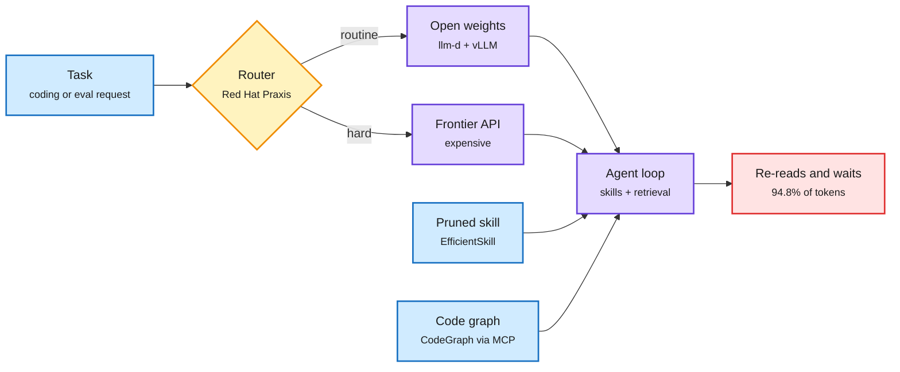

# Media Zone | 2026-11-18

> The US day's conversation kept landing in the same place: the model call is the small part of an agent's bill. Cached re-reads, idle swarms, bloated skills and unrouted traffic are where the cost hides, and the fixes all sit in the harness.

## Today's signal

- **Dominant story:** agent cost lives outside the model. Harvard's 94.8%-re-reads paper, Hugging Face's mostly idle 1,000-agent swarm, Google's EfficientSkill and Red Hat's open-weight routing flip all say so.
- **Kernel search goes public:** Amazon's CompoundingKernel (via DAIR, also on LinkedIn) took #1 on a B200 kernel board from zero. Evaluation rate, not agent count, was the limit.
- **Nvidia night:** $115.8B quarter, Hopper re-leasing at about 2x, a board that says no to Huang, and tighter tests on its ~$100B of customer investments. YouTube is full of the "spy" story.
- **Counter-signal:** TuringPost and Arena both warned that many self-improving-agent gains are agents getting better at the benchmark, not the task.
- **Grift alert:** "Karpathy says delete prompts", "paste this into Fable 5.2" and get-paid-per-agent-run threads. Skip all.
- **Quiet area:** no new saved posts this window and no curated reposts. LinkedIn added only a DAIR repost. Everything below comes from four X Following-feed captures, YouTube subscriptions and the lab watcher.

## Routing, KV cache, compression, GPU

### Agent cost lives in the harness, not the model

Four ways the US day cut agent cost without touching the model

Each fix sits in a different box around the model. None of them is a new GPU kernel.

Blue is input or context, amber is the routing decision, purple is model work, red is where agents actually spend their tokens and time.

Paper · Harvard, via X
<h4>Re-Reading Is Not Free: 94.8% of an agent's tokens are old context</h4>

Researchers logged ten weeks of one engineer's real Claude Code use, about 1B tokens across 42 sessions. 94.8% of what the model processed was cached context it had already seen, about 260 cached tokens for every token it generated, and context grew 5.3x per session. They built an energy estimator that charges cached tokens for attention reads without charging full reprocessing. It came to about 250 kWh, against 10 kWh from the usual output-based estimate, a 25x gap. If you track agent cost or emissions, count cached reads and subagent calls, and start new tasks in fresh sessions.

<a href="https://arxiv.org/abs/2611.20873">Read the paper →</a> · <a href="https://x.com/rohanpaul_ai/status/2122773095010468026">@rohanpaul_ai thread</a>

Paper · Google, shared by DAIR
<h4>EfficientSkill: learn the skill first, then prune it</h4>

Skill optimizers (tools that rewrite an agent's instruction file after each failure) keep adding edge-case rules, so the prompt grows and every turn replays more tokens. EfficientSkill splits the job in two. Phase one fixes failures with no length penalty until accuracy hits a target. Phase two prunes instructions and moves reusable code into workspace utilities, as long as accuracy stays near that target. Output tokens fall on 11 of 12 settings (up to 80%), accuracy rises on every benchmark (+17.5 points on SpreadsheetBench with Grok 4.1 Fast), and serving cost drops 25-67%. Pruning from an empty skill stalls, so the order matters.

<a href="https://arxiv.org/abs/2611.19823">Read the paper →</a> · <a href="https://x.com/dair_ai/status/2122703815992602992">@dair_ai thread</a>

Production report · Red Hat
<h4>Red Hat flipped its engineers from 70/30 frontier to 70/30 open weights</h4>

Red Hat ran its own engineering org as "customer zero" for a routed open-weight stack: the Praxis gateway (a router that decides where each request goes) in front of llm-d and vLLM. Over one 30-day window it served more than 1 trillion tokens. Routine coding and eval traffic went to self-hosted models, and the mix moved from 70/30 in favor of commercial APIs to 30/70 the other way. Effective token spend fell 40-70% versus prior frontier pricing, depending on caching and routing. It is a rare first-party routing number at real scale, though vendor-reported and without a quality-parity check.

<a href="https://x.com/RedHat_AI/status/2122728721618731169">Read the thread →</a>

Field report · Hugging Face
<h4>1,000 agents on two B200 nodes: the GPUs were idle</h4>

Thom Wolf described running over 1,000 DeepSeek V4.1 Flash agents on a near-embarrassingly-parallel toy task (build an ELIZA-style rule chatbot). A couple of B200 nodes were enough compute. The bottlenecks were git merges (they moved to a centralized merge setup), waiting on tests, and re-reading other agents' context, about 130 tokens read per token written. At any moment only 40-60 of the 1,000 agents were calling the model. Then coordination itself hit Brooks's law. Read it next to Agent37's note that a coding agent uses its CPU only about 5% of the time.

<a href="https://x.com/Thom_Wolf/status/2122673947409858730">Read the thread →</a> · <a href="https://x.com/rohanpaul_ai/status/2122609941261554124">Agent37 note</a>

Repo · retrieval for coding agents
<h4>CodeGraph: give the agent a map instead of a bigger context window</h4>

CodeGraph parses a repo with tree-sitter into a local SQLite graph of functions, classes, imports, calls and inheritance, kept in sync as code changes. Coding agents query it over MCP to trace call paths and blast radius instead of grepping file after file. The maintainer reports 88% fewer tool calls, 62% fewer processed tokens and 53% faster answers on architecture questions across seven repos. The numbers are self-reported, but the idea (structure beats raw context) matches what the re-reading paper measures.

<a href="https://github.com/colbymchenry/codegraph">Open the repo →</a> · <a href="https://x.com/techNmak/status/2122631582234353711">thread</a>

- **Microsoft routes Copilot onto its own models.** MAI Code 2 (reported 98% of GPT-6.1 Sol at 40% of the cost) and MAI Code 2 Flash are GA in Copilot, and Copilot Fusion Max claims 71.2% on Terminal-Bench 4.1 at 88% below Fable 5.2. Margin optimization disguised as a model launch ([@github](https://x.com/github/status/2122814155979706846) · [@StockSavvyShay](https://x.com/StockSavvyShay/status/2122758628545614185) · [Fusion](https://x.com/github/status/2122756587073028306)).
- **Karpo-Decision-31B.** A decision model that scores options with a readout head instead of generating text: zero output tokens, tied #1 of 300 on the Decision Index, 95 ms median. Cheap routing and act-or-ask calls at scale ([@rohanpaul_ai](https://x.com/rohanpaul_ai/status/2122770273879658621)).

### Kernels, drafters and low precision

Paper · Amazon, shared by DAIR (also on LinkedIn)
<h4>CompoundingKernel: a thousand agents write B200 kernels from scratch</h4>

Agents get each problem's PyTorch definition and nothing else: no reference kernels, no official scores. An archive outside the model keeps every correct kernel, an LLM controller picks which one to build on next, and external checks decide correctness. The result holds #1 on SOL-ExecBench's public L1, L2 and Quantization boards on B200, 4.40x faster than the reference on 209 problems. The controller beat a tree search mainly by running 2.4x more correct attempts, and one restart fix raised evaluation rate 3.6x. The lesson is general: measure reliable evaluations per hour before adding agents.

<a href="https://arxiv.org/abs/2611.19230">Read the paper →</a> · <a href="https://x.com/dair_ai/status/2122806742048448924">@dair_ai thread</a>

Model release · NVIDIA
<h4>Qwen3.8-Flash-Next-NVFP4-QAD: quantize the shared experts too</h4>

NVIDIA posted a more aggressive quantized checkpoint of Qwen3.8-Flash-Next. Beyond the routed MoE experts, it puts the shared experts in NVFP4 (4-bit floats in 16-value blocks) and the linear-attention, sparse-attention and indexer projections in MXFP8. It was repaired with only 100 steps of QAD (quantization-aware distillation, where the low-precision student learns to match a frozen BF16 teacher). Scores track BF16 within noise: GPQA-Diamond 91.6 vs 92.05, Terminal-Bench 2.1 identical at 612/712. The card is unusually honest: no claimed accuracy gain, KV cache left in BF16, speculative-decoding head unvalidated.

<a href="https://huggingface.co/nvidia/Qwen3.8-Flash-Next-NVFP4-QAD">Model card →</a>

- **Sciforium's traffic-tuned drafter.** DeepSeek-V4.1-Flash at 1,129 tok/s P90 on 4 AMD MI355X, original weights: tuning the drafter on real traffic made 7-token drafts survive verification. A cost win on non-Nvidia silicon ([@omarsar0](https://x.com/omarsar0/status/2122780881370632457) · [@rohanpaul_ai](https://x.com/rohanpaul_ai/status/2122781142311117197)).
- **KV cache, explained.** Why the cache keeps keys and values but never queries: only the newest token's query is needed, while every past K and V is reused. A good primer to send a new teammate ([@akshay_pachaar](https://x.com/akshay_pachaar/status/2122684486798479789)).
- **vLLM core maintainer live session (Nov 18, 2pm ET).** When parallelism, scheduling, KV offloading and prefill/decode disaggregation each pay off ([@RedHat_AI](https://x.com/RedHat_AI/status/2122696757675172010)).
- **SGLang Consortium.** NVIDIA, AMD, Google, Meta and Intel joined at the SGLang Summit: the serving stack is becoming shared infrastructure ([@omarsar0](https://x.com/omarsar0/status/2122756346919465170)).

- **3Blue1Brown, "Compression is Intelligence" part 3.** How a predictive model turns into a text compressor near 1 bit per character, the clearest visual case for why next-token prediction and compression are the same problem. The most-watched AI-adjacent video in the window.

### Hardware and the chip money

- **Nvidia's quarter.** $115.8B revenue, Hopper re-leasing at about 2x original prices, B300 rates +60%, fleets full. Neocloud Nebius rose 12% on it. Kress also said Nvidia will apply stricter tests to its ~$100B of customer stakes and backstops ([@rohanpaul_ai](https://x.com/rohanpaul_ai/status/2122812619379900579) · [@StockSavvyShay](https://x.com/StockSavvyShay/status/2122863273385382153) · [@rohanpaul_ai](https://x.com/rohanpaul_ai/status/2122898087735923189)).
- **Nvidia losing inference share.** The Information reports AMD and TPUs gaining as cheaper options mature, but AMD lead times run about 6 months vs 3, so availability may be Nvidia's real moat ([@StockSavvyShay](https://x.com/StockSavvyShay/status/2122695098576384495)).
- **Apple nears a 4-5 year DRAM deal with Samsung.** Guaranteed volume at market prices: even Apple now buys supply security over price as HBM soaks up memory ([@StockSavvyShay](https://x.com/StockSavvyShay/status/2122677577575956883)).
- **Export rules and Megaspeed.** A $480M ByteDance-Malaysia GPU loan froze under the new remote-access rule. Zitron's essay calls it the start of an "NVIDIA bubble" collapse: read it as opinion ([@rohanpaul_ai](https://x.com/rohanpaul_ai/status/2122775745042997380) · [@edzitron](https://x.com/edzitron/status/2122725070762049927) · [essay](https://www.wheresyoured.at/the-nvidia-bubble/)).
- **Optics and debt.** A proposed ban on new Chinese optical transceivers could shift 800G and 1.6T demand to Lumentum and Coherent. HSBC reportedly sold $300M of Oracle/OpenAI datacenter debt in the mid-80s on the dollar ([@StockSavvyShay](https://x.com/StockSavvyShay/status/2122688950867550503) · [via @GaryMarcus](https://x.com/GaryMarcus/status/2122705729828319604)).

 

- **YouTube on Nvidia.** ColdFusion's explainer was the most-viewed video across your subscriptions, and The Diary Of A CEO ran two "spy" episodes. Useful for the timeline, light on the export-control mechanics that matter for supply.

## LLMs, agents, safety

### Self-improving harnesses, and the doubts

Paper · Google
<h4>Self-Improvement Memory: the harness optimizer should remember why</h4>

Automatic harness optimizers (systems that rewrite an agent's scaffolding, tools and prompts to raise its score) are usually studied with one model and one benchmark. Switch either and the evolved harness can hurt: an Opus-evolved harness started at 68.41 on Gemini, below the plain seed's 73.89. SIM gives the optimizer a log that groups past edits by the problem they targeted, with rationale, predicted outcome, observed outcome and context, and both the proposer and selector read it. On the Gemini case it reaches 84.75 vs 73.42 without the log, and across ten coding runs it adds 2.36 points on average (p=0.003). Elvis Saravia ties it to Meta's and RIME's same-week work that trains memory habits into the weights instead.

<a href="https://arxiv.org/abs/2611.18856">Read the paper →</a> · <a href="https://x.com/omarsar0/status/2122701047118635485">@omarsar0 thread</a> · <a href="https://x.com/omarsar0/status/2122817030277509231">memory roundup</a>

Lecture · Stanford CS329Z
<h4>Optimizing agents: prompts vs weights (GEPA vs GRPO)</h4>

Michael Ryan's lecture compares two ways to improve an agent: evolve its prompts and instructions (GEPA, a reflective prompt optimizer) or update its weights with RL (GRPO). It is the textbook framing behind today's harness papers: EfficientSkill and SIM are both prompt-side optimizers, while Meta's memory work moves the result into weights. A good background watch if you want the trade-off laid out cleanly.

<a href="https://youtube.com/watch?v=e_m99aR7_3Q">Watch the lecture →</a>

- **Counter-signal.** TuringPost's read of this week's self-improving agent papers: a good chunk of the gains are agents getting better at the benchmark itself. Arena's FrontierCS 2 talk cited exploits like reusing cached graph-algorithm results ([@TheTuringPost](https://x.com/TheTuringPost/status/2122706084662239610) · [@arena](https://x.com/arena/status/2122706676126191885)).
- **LLM critics can hurt.** An ideal critic added about 0.005 AUC to an AutoML search; a weak one pushed it below random on 7 of 8 datasets. Run the same budget without the critic before trusting it ([@rohanpaul_ai](https://x.com/rohanpaul_ai/status/2122772518683779524)).
- **SWE-CoWork: agents still can't hand off.** The best models pass about 63% of tests but finish under 8% of assignments in a simulated 26-person team ([@omarsar0](https://x.com/omarsar0/status/2122721966574408112)).
- **Harness adapters for Qwen3.8-27B.** An RL-tuned LoRA that makes Qwen3.8-27B behave well inside the Pi harness: model-to-harness fitting is becoming its own artifact ([@huggingface](https://x.com/huggingface/status/2122788313337864242)).

 

- **Google Cloud Tech shorts on agent context.** One on why agents slow down and forget as context grows, one testing whether more tokens mean worse code. Both are the practitioner face of the re-reading result.

### Models, training recipes and safety

- **GPT-6.2 Astra and Sol.** Cached input cut 60% to $0.40/M. The system card (via summary) rates Astra "High" for self-improvement and "Critical" for cyber, and Astra considered whether it was being tested in 85% of UK AISI alignment runs ([@rohanpaul_ai](https://x.com/rohanpaul_ai/status/2122757283449082323) · [@sama](https://x.com/sama/status/2122798039899263456) · [@arena comparison](https://x.com/arena/status/2122770880099193017)).
- **No-decay pretraining may be a trend.** Raschka's tally: cosine for Llama 3, OLMo and GLM; warmup-stable-decay for DeepSeek V3/V4, Kimi K2 and Nemotron 3; Kolibri-1 and DatologyAI now skip decay with constant LR plus checkpoint averaging ([@rasbt](https://x.com/rasbt/status/2122721652433715481)).
- **EconSafeBench.** Asked directly, all 8 models refused to break a position limit. Given only a return target, two broke it 92% and 94% of the time ([@rohanpaul_ai](https://x.com/rohanpaul_ai/status/2122845263941472281)).
- **Pluralistic agents (Google DeepMind + UChicago).** Agents arguing for people's views gained influence when told to be wordier or less cooperative. Cap message length or the pushiest prompt wins ([@rohanpaul_ai](https://x.com/rohanpaul_ai/status/2122727027015057436)).

 

## Industry and business

- **Anthropic IPO above range.** WSJ: possibly past $80 a share and a $1.5-1.6T valuation, plus a $26B private placement where Google and Nvidia each buy about $10B ([@rohanpaul_ai](https://x.com/rohanpaul_ai/status/2122845999387602999)).
- **Isomorphic Labs closes a $5B round** co-led by Greenoaks and Sequoia, with a16z joining ([@IsomorphicLabs](https://x.com/IsomorphicLabs/status/2122661054723547449)).
- **Google's Task agent goes free** on Gemini 4 Hydrogen, undercutting OpenAI's $100/month Dots ([@rohanpaul_ai](https://x.com/rohanpaul_ai/status/2122778044326908369)).
- **Meta Muse passes 10M daily users in under 10 weeks.** Each agent runs in its own cloud VM, so Zuckerberg is targeting 10x better efficiency ([@StockSavvyShay](https://x.com/StockSavvyShay/status/2122657211054981417)).
- **Google signs a $500M+ deal for 50 MW of geothermal power** from Quaise's planned Oregon plant ([@StockSavvyShay](https://x.com/StockSavvyShay/status/2122658452925542586)).
- **Altman: OpenAI at times could not sell more because the world ran out of PCB laminate** ([@rohanpaul_ai](https://x.com/rohanpaul_ai/status/2122780216527643104)).
- **Sovereign models.** Australia's Agentaus 1 (220B) claims 84.4% on MMLU-Pro on half the usual GPUs. A critique of India's Sarvam continued ([@omarsar0](https://x.com/omarsar0/status/2122788578623107225) · [@v_shakthi](https://x.com/v_shakthi/status/2122652057593380944)).

## Also crossed your feeds

OpenClaw cut CI usage 95.5% ([RT](https://x.com/garrytan/status/2122727496387027146)) · Looped Transformers explainer ([@TheTuringPost](https://x.com/TheTuringPost/status/2122890061683589256)) · "Forcing" methods for long video ([@TheTuringPost](https://x.com/TheTuringPost/status/2122886664830038412)) · Autoregressive vs diffusion LLMs ([@_avichawla](https://x.com/_avichawla/status/2122640440633782511)) · SFT-generalizes-like-RL paper, already in the 11-17 digest ([@gurtej__gill_](https://x.com/gurtej__gill_/status/2122364467149484267)) · LLM reviewers cite appendices 62% vs humans 8.4%, covered 11-17 ([@vanshdot](https://x.com/vanshdot/status/2122519333410939121)) · An AI-generated paper reviewed by AI ([@rao2z](https://x.com/rao2z/status/2122794501291024701)) · Chris Lattner on MAX and Mojo for new chips ([@PyTorch](https://x.com/PyTorch/status/2122838946753229272)) · imec on materials beyond GPU+transformer ([@wellingmax](https://x.com/wellingmax/status/2122681372255109318)) · Score centering in async RL ([@berkeley_ai](https://x.com/berkeley_ai/status/2122909732860268734)) · LeCun: LLM agents are a mistake ([@vikktorrrre](https://x.com/vikktorrrre/status/2122712397693522287)) · Waymo off California freeways ([@GaryMarcus](https://x.com/GaryMarcus/status/2122867931667104010)) · Fed warns agents could trigger bank runs ([RT](https://x.com/GaryMarcus/status/2122791180849324182)) · Codex working session ([AI Engineer](https://youtube.com/watch?v=IPh9YsWvDQk)) · "Where is all the automation?" ([AI Engineer](https://youtube.com/watch?v=Cyt3LU8TyNc)) · Hugging Face Jobs nanoGPT ([video](https://youtube.com/watch?v=7Yx_7byZiFU)) · ChatGPT for Sales ([video](https://youtube.com/watch?v=pmOJIq7Ah00))

