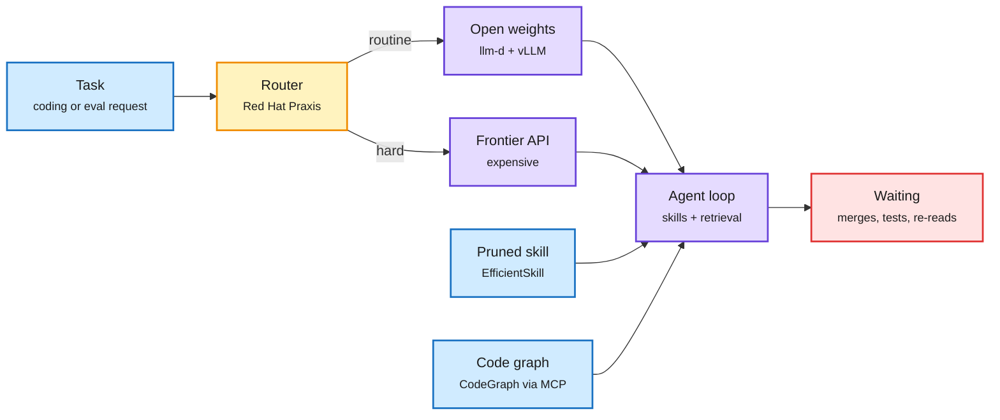

# Media Zone | 2026-11-18

> *Live draft: this window is still open. It is finalized with the 2026-11-18 digest at the 10:30 IST cutoff.*

> The US day's conversation kept saying the same thing from four directions: the GPU is rarely where agent cost lives. Skills, retrieval, routing and coordination are.

## Today's signal

- **Dominant story:** agent cost is a harness and routing problem. Google's EfficientSkill, CodeGraph, Red Hat's open-weight routing pilot and Hugging Face's 1,000-agent swarm all point there.
- **Pattern:** self-improving harnesses grew up. Google's SIM paper says a harness optimizer needs memory of *why* it made each edit, not just the edited code.
- **Hardware:** Nvidia reportedly losing inference share to AMD and TPUs. Apple locking multi-year DRAM supply as HBM eats capacity.
- **Counter-signal:** TuringPost flagged that many self-improving agent gains are agents getting better at the benchmark, not the task.
- **Grift alert:** "Karpathy says delete prompts, keep graphs", "paste this into Fable 5.2" and get-paid-per-agent-run threads. Skip all.
- **Quiet area:** no new saved posts, no curated reposts, no newsletters yet, and no YouTube or LinkedIn captures in this window. Everything below is three X Following-feed captures plus one lab release.

## Routing, KV cache, compression, GPU

### Agent cost lives in the harness, not the model

Four ways the US day cut agent cost without touching the model

Each fix sits in a different box around the model. None of them is a new GPU kernel.

Blue is input or context, amber is the routing decision, purple is model work, red is where the 1,000-agent swarm actually lost its time.

Paper · Google, shared by DAIR
<h4>EfficientSkill: learn the skill first, then prune it</h4>

Skill optimizers (tools that rewrite an agent's instruction file after each failure) keep adding edge-case rules, so the prompt grows and every turn replays more tokens. EfficientSkill splits the job in two. Phase one fixes failures with no length penalty until accuracy hits a target. Phase two prunes instructions and moves reusable code into workspace utilities, as long as accuracy stays near that target. Output tokens fall on 11 of 12 model-benchmark settings (up to 80%), accuracy rises on every benchmark (+17.5 points on SpreadsheetBench with Grok 4.1 Fast), and serving cost drops 25-67%. Pruning from an empty skill stalls, so the order matters.

<a href="https://arxiv.org/abs/2611.19823">Read the paper →</a> · <a href="https://x.com/dair_ai/status/2122703815992602992">@dair_ai thread</a>

Production report · Red Hat
<h4>Red Hat flipped its own engineers from 70/30 frontier to 70/30 open weights</h4>

Red Hat ran its engineering org as "customer zero" for a routed open-weight stack: the Praxis gateway (a router that decides where each request goes) in front of llm-d and vLLM. Over one 30-day window it served more than 1 trillion tokens. Routine coding and eval traffic got routed to self-hosted models, and the mix moved from 70/30 in favor of commercial APIs to 30/70 the other way. Effective token spend fell 40-70% versus prior frontier pricing, depending on prompt caching and routing. This is a rare first-party routing number at real scale, though it is vendor-reported and quality parity is not shown.

<a href="https://x.com/RedHat_AI/status/2122728721618731169">Read the thread →</a>

Field report · Hugging Face
<h4>1,000 agents on two B200 nodes: the GPUs were idle</h4>

Thom Wolf described running a swarm of over 1,000 DeepSeek V4.1 Flash agents on a toy, near-embarrassingly-parallel benchmark (build an ELIZA-style rule chatbot). A couple of B200 nodes were enough compute. The bottlenecks were git merges (they moved to a centralized merge setup), waiting on tests, and re-reading other agents' context: roughly 130 tokens read per token written. At any moment only 40-60 of the 1,000 agents were calling the model. Then coordination itself hit the Fred Brooks wall, with communication cost growing roughly with the square of team size. Read it next to Agent37's claim that a coding agent uses its CPU only ~5% of the time.

<a href="https://x.com/Thom_Wolf/status/2122673947409858730">Read the thread →</a> · <a href="https://x.com/rohanpaul_ai/status/2122609941261554124">Agent37 note</a>

Repo · retrieval for coding agents
<h4>CodeGraph: give the agent a map instead of a bigger context window</h4>

CodeGraph parses a repo with tree-sitter into a local SQLite graph of functions, classes, imports, calls and inheritance, kept in sync as code changes. Coding agents query it over MCP to trace call paths and blast radius instead of grepping file after file. The maintainer reports 88% fewer tool calls, 62% fewer processed tokens and 53% faster answers on architecture questions across seven repos. Self-reported numbers, and the ranker flagged the thread as contested, but the idea (structure beats raw context) matches what the harness papers keep finding.

<a href="https://github.com/colbymchenry/codegraph">Open the repo →</a> · <a href="https://x.com/techNmak/status/2122631582234353711">thread</a>

### Low-precision serving: NVFP4 gets more aggressive

Model release · NVIDIA
<h4>Qwen3.8-Flash-Next-NVFP4-QAD: quantize the shared experts too</h4>

NVIDIA posted a more aggressive quantized checkpoint of Qwen3.8-Flash-Next. Beyond the routed MoE experts, it also puts the shared experts in NVFP4 (4-bit floating point with 16-value blocks) and the GDN, sparse-attention and indexer projections in MXFP8. It was repaired with only 100 steps of QAD (quantization-aware distillation, where the low-precision student learns to match a frozen BF16 teacher). Scores track BF16 within noise: GPQA-Diamond 91.6 vs 92.05, Terminal-Bench 2.1 identical at 612/712. The card is unusually honest: no claimed accuracy gain, KV cache left in BF16, MTP speculative decoding unvalidated, and only GB300 with vLLM 0.30.0 is supported.

<a href="https://huggingface.co/nvidia/Qwen3.8-Flash-Next-NVFP4-QAD">Model card →</a>

- **vLLM core maintainer live session (Nov 18, 2pm ET).** Red Hat's Tyler Michael Smith on when parallelism, scheduling, KV cache offloading and prefill/decode disaggregation each actually pay off. Worth catching for the "which knob, when" framing ([@RedHat_AI](https://x.com/RedHat_AI/status/2122696757675172010)).
- **Autoregressive vs diffusion LLMs, explained.** A clean primer: causal attention lets AR models cache KV and reuse it; masked diffusion fills several positions per step with bidirectional context, trading step budget against quality ([@_avichawla](https://x.com/_avichawla/status/2122640440633782511)).

### Hardware and the chip money

- **Nvidia losing inference share.** The Information reports AMD and Google TPUs taking inference share as cheaper options mature. The catch: AMD lead times run ~6 months vs ~3 for Nvidia, so availability may be Nvidia's real moat ([@StockSavvyShay](https://x.com/StockSavvyShay/status/2122695098576384495)).
- **Apple nears a 4-5 year DRAM deal with Samsung from 2027.** Guaranteed minimum volumes at market prices: even Apple now buys supply security over price, a direct read on HBM soaking up memory capacity ([@StockSavvyShay](https://x.com/StockSavvyShay/status/2122677577575956883)).
- **Proposed US ban on new Chinese optical transceivers.** Could push 800G and 1.6T datacenter optics demand to Lumentum and Coherent, with indium phosphide the new choke point ([@StockSavvyShay](https://x.com/StockSavvyShay/status/2122688950867550503)).
- **Megaspeed fallout keeps spreading.** Banks killed a $480M chip loan for ByteDance's Malaysia build; Nvidia formed a board export-control committee; Jensen Huang says he would return as CEO if asked and faces House panels Dec 1. Ed Zitron's long-form case calls it the start of an "NVIDIA bubble" collapse: treat as opinion ([@edzitron](https://x.com/edzitron/status/2122704446597877797) · [essay](https://www.wheresyoured.at/the-nvidia-bubble/) · [@StockSavvyShay](https://x.com/StockSavvyShay/status/2122721682934935657)).
- **Datacenter debt is getting marked down.** HSBC reportedly sold ~$300M of Oracle/OpenAI New Mexico datacenter debt in the mid-80s on the dollar ([via @GaryMarcus RT](https://x.com/GaryMarcus/status/2122705729828319604)).

## LLMs, agents, safety

### Self-improving harnesses, and the doubts

Paper · Google
<h4>Self-Improvement Memory: the harness optimizer should remember why</h4>

Automatic harness optimizers (systems that rewrite an agent's scaffolding, tools and prompts to raise its score) are usually studied with one fixed model and benchmark. Switch either and the evolved harness can hurt: an Opus-evolved harness started at 68.41 on Gemini, below the plain seed's 73.89. SIM gives the optimizer a memory that groups past edits by the problem they targeted, with rationale, predicted outcome, observed outcome and evaluation context. Both the proposer and the selector read it. Continuing with SIM beats continuing from the harness alone in all ten cross-dataset and cross-model settings, and adds 2.36 points on average across ten coding runs (p=0.003).

<a href="https://arxiv.org/abs/2611.18856">Read the paper →</a> · <a href="https://x.com/omarsar0/status/2122701047118635485">@omarsar0 thread</a>

- **Counter-signal on the same theme.** TuringPost's read of this week's self-improving agent papers: a good chunk of the gains are agents getting better at the benchmark itself ([@TheTuringPost](https://x.com/TheTuringPost/status/2122706084662239610)). Arena's FrontierCS 2 talk made the same point concretely, citing exploits like reusing cached graph-algorithm results ([@arena](https://x.com/arena/status/2122706676126191885)).
- **SWE-CoWork: agents still can't hand off.** An agent works in a simulated team with tickets, docs and askable teammates across 101 real repos. The best model fully finished 8 of 101; for Claude Opus 5.5, over half the failed checks came after it already had the requirement ([@omarsar0](https://x.com/omarsar0/status/2122721966574408112)).
- **Huawei: split the roles in code-evolution agents.** Separating search planning, code writing and scoring improved results and cut spend ([@rohanpaul_ai](https://x.com/rohanpaul_ai/status/2122669887026012543)).
- **Harness adapters for Qwen3.8-27B.** A LoRA adapter tuned to make Qwen3.8-27B behave well inside the Pi harness, amplified by Hugging Face. Model-to-harness fitting is becoming its own artifact type ([@huggingface RT](https://x.com/huggingface/status/2122706260835356865)).

### Training recipes and safety

- **No-decay pretraining may be a trend.** Raschka's tally: Llama 3, OLMo and GLM use cosine; DeepSeek V3/V4, Kimi K2 and Nemotron 3 use WSD (warmup, stable, then decay); Kolibri-1 and DatologyAI now skip decay, using constant LR plus checkpoint averaging so total training length needn't be fixed upfront ([@rasbt](https://x.com/rasbt/status/2122721652433715481)).
- **Pluralistic agents (Google DeepMind + UChicago).** Agents that argue on a person's behalf shifted group AI-safety budgets toward that person's views, but gained more pull when told to be wordier or less cooperative. 746 people rated them fairer than single-model input. Lesson: cap message length or the pushiest prompt wins ([paper](https://arxiv.org/abs/2611.16028) · [@rohanpaul_ai](https://x.com/rohanpaul_ai/status/2122727027015057436)).
- **Google Threat Intelligence: an end-to-end autonomous exploit agent.** A thread summarizing GTIG's Nov 16 tracker says a multi-agent tool diffed patches, wrote exploits and fired them with no human in the loop, amid 22 zero-days in August. Single-thread summary, so check the GTIG report itself ([@IntuitMachine](https://x.com/IntuitMachine/status/2122707358853783567)).

## Industry and business

- **Isomorphic Labs closes a $5B round** co-led by Greenoaks and Sequoia, with a16z joining, for AI drug design ([@IsomorphicLabs](https://x.com/IsomorphicLabs/status/2122661054723547449) · [release](https://www.isomorphiclabs.com/articles/isomorphic-labs-announces-series-c-investment-round)).
- **Anthropic IPO reportedly guided to the top of its range or higher**, despite the AI selloff; New Street calls it a "generational IPO" ([@StockSavvyShay](https://x.com/StockSavvyShay/status/2122692506571964895)).
- **Meta Muse passes 10M daily users in under 10 weeks.** Each agent runs in its own cloud VM, so Zuckerberg is targeting 10x better efficiency: a serving-cost story hiding in a growth headline ([@StockSavvyShay](https://x.com/StockSavvyShay/status/2122657211054981417)).
- **Google signs a $500M+ deal for 50MW of geothermal power** from Quaise's planned Oregon plant, adding to Fervo and Kairos for round-the-clock datacenter power ([@StockSavvyShay](https://x.com/StockSavvyShay/status/2122658452925542586)).
- **Vorflux customer cut spend by over $9M** by switching off API pricing, per Garry Tan. Anecdote, no detail yet ([@ycombinator RT](https://x.com/ycombinator/status/2122486949126799495)).
- **Atlassian: 77% of recent PRs across 6,000 engineers were agent-written**, and review is now the queue (sponsored thread, treat numbers as marketing) ([@Ronald_vanLoon](https://x.com/Ronald_vanLoon/status/2122692618471563511)).

## Also crossed your feeds

OpenClaw cut CI usage 95.5% ([RT](https://x.com/garrytan/status/2122727496387027146)) · Looped Transformers explainer ([@TheTuringPost](https://x.com/TheTuringPost/status/2122693768709341532)) · Creative priming paper, Stanley and Albalak ([@kenneth0stanley](https://x.com/kenneth0stanley/status/2122727002541293989)) · SFT-generalizes-like-RL paper, already in the 11-17 digest ([@gurtej__gill_](https://x.com/gurtej__gill_/status/2122364467149484267)) · LLM reviewers cite appendices 62% vs humans 8.4%, already covered 11-17 ([@vanshdot](https://x.com/vanshdot/status/2122519333410939121)) · Pangram AI-detector critique ([@timnitGebru](https://x.com/timnitGebru/status/2122668341445677338)) and an ICLR AI-review false positive ([@rao2z](https://x.com/rao2z/status/2122715686980264439)) · imec on new materials beyond GPU+transformer ([@wellingmax](https://x.com/wellingmax/status/2122681372255109318)) · Texas A&M $205.5M semiconductor training project ([RT](https://x.com/elonmusk/status/2122676485651599457)) · 44.7TB open robotics dataset from Hub ([RT](https://x.com/rohanpaul_ai/status/2122709789474185417)) · US infrastructure outages and the Optimizely attack, AI's role asserted not shown ([@GaryMarcus](https://x.com/GaryMarcus/status/2122669897042030647)) · Anthropic's AI-native startup guide ([PDF](https://assets.claude.com/503ee04b4aa55a4db49a69b993463b6fa8dad6d8.pdf)) · Altman on Dots memory lock-in ([@shmidtqq](https://x.com/shmidtqq/status/2122700096961654858))

