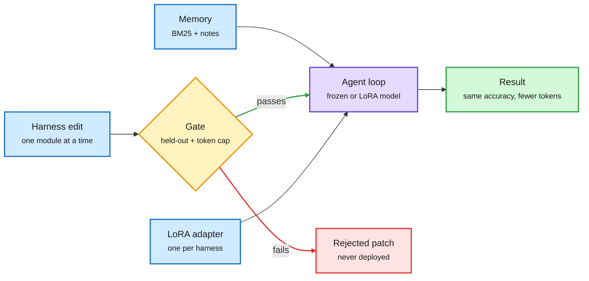

# Media Zone | 2026-11-19

> *Live draft: this window is still open. It is finalized with the 2026-11-19 digest at the 10:30 IST cutoff.*

> The US day's conversation split in two. Builders kept shrinking the agent bill with smaller memory, gated harness edits and one-LoRA-per-harness training. Everyone else argued about who controls the compute: OpenAI using its models to design chips, Nvidia's China exposure, and a petition calling Anthropic unsafe on IPO week.

## Today's signal

- **Dominant story:** cheap beats clever in agent plumbing. A minimal BM25 memory ties fancy memory systems, and gated one-module harness edits match full rewrites at a tenth of the tokens.
- **Chips designed by models:** OpenAI says its models found up to 14% PPA gains on AMD GPU IP and improved its own Jalapeño inference chip on real silicon.
- **Compression claim to verify:** PrismML's Bonsai 2 reportedly shrinks Qwen3.8-27B from 55.6GB to 5.9GB with ternary weights, keeping 98.2% of benchmarks. Single-source so far.
- **Counter-signal:** Raschka and TuringPost both warned that benchmarks and single LLM judges are weak evidence. Judges rank their own answers higher by about 1.2 places.
- **Safety thread:** an OpenAI paper shows style-control training quietly makes chain-of-thought harder to monitor. Separately, Tegmark, Marcus and Thom Wolf signed a petition calling Anthropic unsafe.
- **Quiet area:** no new saved posts this window and no curated reposts. LinkedIn and YouTube had no new captures since the morning cutoff. Everything below comes from five X Following-feed captures, Gmail and the lab watcher.

## Routing, KV cache, compression, GPU

### Models designing the silicon they run on

Lab post · OpenAI x AMD x Synopsys
<h4>OpenAI's models found up to 14% PPA on AMD GPU IP</h4>

OpenAI says that in under five months its models found up to a 14% gain in PPA (power, performance and area, the three numbers every chip design trades against) on AMD flagship GPU blocks. AMD engineers had already spent years tuning those blocks. The same approach improved Jalapeño, OpenAI's first custom inference chip, and the gains were checked on real silicon. OpenAI is now working with Synopsys to put this inside standard EDA (electronic design automation) tools. If it holds up, it is a cost lever on the hardware side of inference: better chips per design cycle, not just per process node.

<a href="https://openai.com/index/advancing-chip-design-with-our-models/">Read the post →</a> · <a href="https://x.com/OpenAI/status/2123100386638877054">@OpenAI</a>

X Article · inference hardware explainer
<h4>Why decode waits on memory, and how a dataflow chip removes the wait</h4>

Avi Chawla's explainer walks through why LLM decode (generating one token at a time) is limited by memory bandwidth, not compute. Each token has to stream the weights and KV cache (the stored attention state of earlier tokens) from memory. Kernel fusion only helps so much, because every kernel boundary still writes to and reads from HBM. Dataflow chips keep data moving between compute units on-chip instead. SambaNova replied that prefill and decode want different silicon, and showed Intel GPUs doing prefill while its SN50 does decode. That is the same disaggregation idea the serving stacks have been pushing.

<a href="https://x.com/_avichawla/status/2122976711981826119">Read the article →</a> · <a href="https://x.com/SambaNovaAI/status/2123068727906250815">@SambaNovaAI on disaggregation</a>

Compression claim · single source
<h4>Bonsai 2: Qwen3.8-27B in 5.9GB with ternary weights</h4>

A widely shared thread says PrismML's Bonsai 2 compresses Qwen3.8-27B from 55.6GB to 5.9GB, an 89.4% cut. It does this with ternary quantization, storing each weight as -1, 0 or +1 instead of FP16 or INT4. It reportedly keeps 98.2% of the original's score across 20 benchmarks, up from about 95% for the first Bonsai. A 27B model in 6GB would fit on a laptop GPU with room left for KV cache. Treat it as unverified until PrismML posts the eval suite and independent llama.cpp or vLLM numbers appear.

<a href="https://x.com/Oluwaphilemon1/status/2122839893890207811">Thread →</a>

- **Token prices down, GPU rent up:** Nvidia said token prices fell about 60% since May while 3-year-old Hopper GPUs re-rent at about 2x their original rate. Cheaper tokens are not cheaper compute ([@StockSavvyShay](https://x.com/StockSavvyShay/status/2123055688846819759)).
- **AMD serving numbers:** Sciforium shows DeepSeek-V4.1-Flash at 1,129 output tokens/sec (P90) on four MI355X GPUs. That adds to this week's evidence that AMD is a real decode option ([@rohanpaul_ai](https://x.com/rohanpaul_ai/status/2123102662942236772)).
- **Open-weight volume:** opencode's founder says their inference served 41T tokens in one day and aims for a quadrillion a month on open models. YC partners reposted it ([@thdxr via YC](https://x.com/ycombinator/status/2123082660386058605)).
- **Routing cheat sheet:** a 25-repo map for cutting agent spend: observe (ccusage, Langfuse), route (RouteLLM, LiteLLM, claude-code-router), cache (GPTCache), compress (LLMLingua). Useful list, loud packaging ([@shmidtqq](https://x.com/shmidtqq/status/2123027076890419216)).
- **Packaging:** Microsoft is using Intel's EMIB packaging for Azure chips and locked in multiyear Xeon supply. Nvidia says CPU demand is outrunning supply ([@StockSavvyShay](https://x.com/StockSavvyShay/status/2123097029966778734)).

[@OpenAI](https://x.com/OpenAI/status/2123100386638877054) · [@_avichawla](https://x.com/_avichawla/status/2122976711981826119) · [@SambaNovaAI](https://x.com/SambaNovaAI/status/2123068727906250815) · [vLLM at PyTorch Conf](https://x.com/PyTorch/status/2122990583979344288)

## LLMs, agents, safety

### Agent plumbing: smaller, gated, adapted

Three cheap fixes beat three expensive ones

Each paper keeps the model fixed and changes one box around it, at a fraction of the token cost.

Blue is what each paper changes, amber is the deploy gate, purple is the agent, green is kept, red is thrown away.

Paper · NeurIPS 2026, via DAIR
<h4>RAG in a Trenchcoat: minimal memory is enough, mostly</h4>

BRIDGE is a deliberately plain agent memory: chained observation notes, hybrid BM25 plus embedding retrieval, shown in time order. It uses one LLM call per write or query and about 5-7K prompt tokens. It ties the prior best on LongMemEval-S and BEAM and beats the best memory baseline on EverMemBench by 5.7-6.3 points. The sharper finding is that benchmarks score what memory retrieves, not what it lets the agent do. On new probes that require applying a remembered rule the question never mentions, no design wins everywhere, and simply showing the rule more prominently closes most of the gap.

<a href="https://arxiv.org/abs/2611.22179">Read the paper →</a> · <a href="https://x.com/dair_ai/status/2123091409435853190">@dair_ai</a>

Paper · Google, via DAIR
<h4>Harnesses that improve themselves: gate the edits</h4>

Google let an optimizer rewrite the harness (the code around the model that manages context, tools, control and verification) around a frozen Gemini 3.8 Flash on SWE-bench Lite. A prompt rule file made things worse, 5.0% to 2.5%. A full rewrite hit 42.5% but cost 451.6K tokens per task. Gated edits, patching one of four modules per round and deploying only if it passes held-out tasks under a token cap, hit 40.0% at 46.7K tokens per task. That is about 10x cheaper for nearly the same score, and it transferred better to Gemini 4 Argon (37.5% vs 30.0%). Only 40 held-out issues, so the numbers are directional. It pairs with yesterday's SIM paper (Google's optimizer log that records why each harness edit was made, so the edits survive a model swap).

<a href="https://arxiv.org/abs/2611.22299">Read the paper →</a> · <a href="https://x.com/omarsar0/status/2123077276350976396">@omarsar0</a> · <a href="https://x.com/akshay_pachaar/status/2123030996899774607">SIM recap</a>

Model release · Hugging Face
<h4>Keep the harness, adapt the model: Qwen3.8-27B from 39% to 65% on SWE-bench Pro</h4>

Hugging Face trained one small LoRA adapter (a low-rank add-on to the weights, r=32 here) per coding harness instead of switching harnesses. Training runs inside the real, unmodified harness with exactly the tokens it saw. The reward is verifier correctness plus a 0.1-weight tool-efficiency bonus. It used async GRPO (a group-relative RL method) on 2x B200, and a guard that zeroes reward-hacking tool calls at no accuracy cost. The first adapter targets the pi harness. This is the practical answer to "the same model behaves differently in different harnesses," and it is cheap enough for small teams.

<a href="http://huggingface.co/harness-hub/Qwen3.8-27B-pi-adapted">Model card →</a> · <a href="https://x.com/TheTuringPost/status/2123092857464422482">@TheTuringPost recipe</a>

Paper · ModHarness-RL
<h4>Learn the harness while RL trains the model</h4>

ModHarness-RL turns two harness parts into learned programs: Compression (which history goes into context) and Steering (what guidance to give when behavior drifts). Candidate programs come from recent trajectories, are checked by execution, and replayed over past ones, so the harness evolves with the model. It gains 19% over the base harness on CodeSearch and beats zero-shot GPT-5-mini, which wrote the original harness. Steering mattered more on CodeSearch, Compression more on budget-limited ALFWorld. Tested only at 1.5B to 8B.

<a href="https://arxiv.org/abs/2611.18533">Read the paper →</a> · <a href="https://x.com/qingke_ai/status/2122668579858559285">@qingke_ai</a>

### Safety and evaluation

Paper · OpenAI and colleagues, via DAIR
<h4>Teaching a model to control its reasoning style makes it harder to monitor</h4>

Researchers fine-tuned gpt-oss-20b on math traces rewritten in different personas. No example showed monitor evasion. Yet on covert side-task tests, the CoT monitorability score fell from 0.94 to 0.68 with no hiding instruction, and to 0.22 when told to hide. The same happened with a Kimi-K2.6 model in agentic settings. Long, multi-step side tasks stayed easier to catch, and prompting for transparent reasoning recovered much of the loss. Chain-of-thought monitoring is a safety layer that a benign-looking training choice can erode.

<a href="https://arxiv.org/abs/2611.21799">Read the paper →</a> · <a href="https://x.com/dair_ai/status/2123065951256244262">@dair_ai</a>

- **Self-Disagreement (Microsoft):** models drop correct answers when challenged by wrong arguments. Training a model to argue against itself then rule raised answer retention to about 89% for Qwen3-8B and Gemma-2 9B ([@rohanpaul_ai](https://x.com/rohanpaul_ai/status/2123089945187496028)).
- **Judges favor themselves:** eight models graded 620 anonymized medical answers and each ranked its own about 1.2 places higher. Single-judge leaderboards deserve suspicion ([@TheTuringPost](https://x.com/TheTuringPost/status/2123045050208727043)).
- **Benchmarks as IQ tests:** Raschka says release benchmarks say little about your task, with a nod at GPT-6.2 ([@rasbt](https://x.com/rasbt/status/2123064851383677087)).
- **Gradient-free self-edits:** a 27B model reportedly diagnoses its errors and rewrites its own weights without training. A separate Microsoft "iWSP" paper writes weights as readable code. Both got hype-wrapped; read the papers, not the threads ([arXivBangers](https://arxivb.org/abs/2611.21885)).
- **Energy-Based Reasoners:** LeCun reposted EBRs, which claim far less compute than looped reasoning ([@ylecun](https://x.com/ylecun/status/2122968870726299779)).
- **GPT-6.2 prompting:** delete "be concise," allow assumptions in long runs, and watch prompt-caching breakage when porting old system prompts ([@IntuitMachine](https://x.com/IntuitMachine/status/2123067526900797776)).

## Industry and business

- **GPT-6.2 Astra and Sol:** Astra at $8/$40 per million tokens is the first external model OpenAI rates High for AI self-improvement. Artificial Analysis still has Claude Fable 5.2 ahead, 65 to 62 ([AI Breakfast](https://community.openai.com/t/gpt-6-2-astra-and-sol-are-now-available/1417531)).
- **Muse Ember:** Arena says Meta's efficient model beats GPT-6 Luna and Claude Haiku 5.5 at 27s and 1.9¢ per task, about 13x faster than Luna ([@arena](https://x.com/arena/status/2123082393536049393)).
- **Anthropic petition:** Tegmark, Gary Marcus and Thom Wolf signed a statement calling Anthropic unsafe. Wolf says he disliked the word "reckless" but worries about transparency and concentration of power ([@Thom_Wolf](https://x.com/Thom_Wolf/status/2123086773844672689)).
- **Nvidia and China:** Kress halted H200 China sales. A new US licensing rule froze a $480M loan for ByteDance GPUs in Malaysia ([AI Weekly](https://www.reuters.com/legal/litigation/us-issues-rule-protect-advanced-ai-chips-being-accessed-remotely-2026-11-16/) · [@rohanpaul_ai](https://x.com/rohanpaul_ai/status/2123075916335325589)).
- **Xing4:** China Telecom trained a 285B agentic MoE on 8,192 Ascend NPUs with no CUDA, plus an open 29B-A4B model (via AI Weekly Espresso).
- **Microsoft Ignite:** Agent 365, Entra Agent Identity GA and Azure Cobalt 200 VMs (via AI Weekly Espresso).
- **Funding:** Isomorphic Labs $5B Series C ([Isomorphic](https://www.isomorphiclabs.com/articles/isomorphic-labs-announces-series-c-investment-round)), Corma $125M Series A at $1B ([Unite.AI](https://www.unite.ai/corma-raises-125m-series-a-at-1b-valuation-to-scale-defensive-ai/)), Noeri $110M led by Menlo ([HPCwire](https://www.hpcwire.com/aiwire/2026/11/16/noeri-launches-with-110m-to-empower-companies-to-build-and-own-their-ai/)).
- **SambaNova at TACC:** tripling its inference deployment on a $5M NSF award ([@SambaNovaAI](https://x.com/SambaNovaAI/status/2123054929136755153)).
- **Netlify relaunch:** rebuilt around agents. 500K+ users ran 1.7M agent runs ([@omarsar0](https://x.com/omarsar0/status/2123099739457831198)).
- **Outage week:** AI Weekly found no attack behind six US outages. Five operators broke their own systems, and AI-found flaws forced rushed NSA patches (via AI Weekly).

## Also crossed your feeds

CMU's AI Agents course free on YouTube from Nov 19 · Transformer Explainer and bbycroft LLM viz roundup · Cloudflare open-sources Kitesurf agent browser · Proton Lumo Desktop with MCP connectors · Apple-Cornell FastFrames AR video at 36ms/frame on B200 · Rumble-2-Flash open speech-to-text · Ramp at $60B (YC) · OpenAI x Le Figaro content deal · Hermes agent fine-tuning plugin via Adaption · Rao's masked distillation project wins an Amazon award. Skipped as grift: "Karpathy/Anthropic lecture" bait, "50 ways to make money with Fable 5.2", "Google proved AI destroys the economy".
