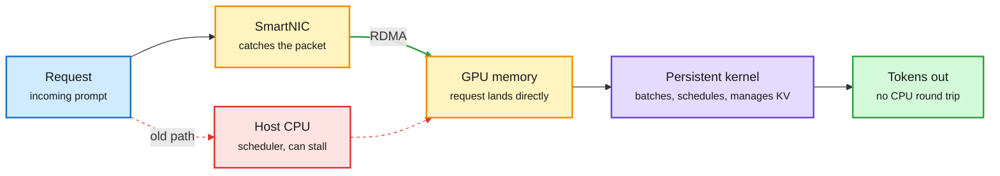

# Media Zone | 2026-11-20

> *Live draft: this window is still open. It is finalized with the 2026-11-20 digest at the 10:30 IST cutoff.*

> The US day's conversation ran on two tracks. ANT opened far above its $83 IPO price, then gave much of it back as a short report on AMD knocked the whole tape, and the FT asked how $1T of compute ever pays back. Underneath, builders kept attacking the serving bill: take the CPU out of the inference path, cache the procedure instead of the answer, and only accept a harness edit if it breaks nothing.

## Today's signal

- **Dominant story:** Anthropic priced at $83, above range, raising $81.3B at about $1.5T fully diluted. ANT opened near $110 on Nasdaq, then slid as the market reversed within the hour.
- **Chip shock:** AMD fell about 13% in 30 minutes after short seller Hunterbrook alleged its software kept reaching a blacklisted Chinese server maker. Hunterbrook concedes no violation is established.
- **Serving cost thread:** a CPU-free serving design (Blink) claims up to 8.47x better P99 time-to-first-token than vLLM, SGLang and TensorRT-LLM. Single-source thread, no paper link yet.
- **Agent harness research:** Google's GUARD only accepts a self-edit when its gains outweigh what it breaks. It beats Meta-Harness by 6.3 points at 54.5% fewer tokens.
- **Price-performance on coding agents:** Arena's new Coding Index puts GPT-6.2 Astra (Max) on the cost frontier at $4.75 a task, 62% cheaper than GPT-6 Astra.
- **Counter-signal:** the FT estimates Anthropic needs about $602B a year in revenue to earn 20% on its compute commitments. Ramp's index shows business token spend down 6.3% from its peak two weeks ago.
- **Quiet area:** no new saved posts and no curated reposts this window (the bookmark runs returned zero, with no auth error logged). YouTube and LinkedIn have no new captures since the 11:15 cutoff. Everything below comes from six Following-feed captures, Gmail and the lab watcher.

## Routing, KV cache, compression, GPU

### Taking the host out of the hot path

Blink: the GPU schedules itself

Requests skip the CPU entirely. A persistent GPU kernel does batching and KV management.

Blue is the request, amber is the new data path, purple is the on-GPU scheduler, green is output, red is the CPU path it removes.

Serving systems · single-source thread
<h4>Blink: LLM serving with no CPU in the loop</h4>

Today's serving stacks (vLLM, SGLang, TensorRT-LLM) route every request, batch decision and token step through the host CPU. If that CPU gets busy, the GPU waits. Blink sends requests from a SmartNIC straight into GPU memory over RDMA (direct memory access across the network) and runs a persistent kernel on the GPU that handles batching, scheduling and KV cache management itself. Claimed results: up to 8.47x better P99 time-to-first-token, 3.4x better P99 time-per-token, 2.1x decode throughput and 48.6% less energy per token. Under heavy CPU interference, the baselines degrade by up to 100x while Blink holds. This is a cost lever on tail latency and on how many CPU cores a GPU node really needs. The thread carries no paper link, so wait for the preprint before trusting the numbers.

<a href="https://x.com/thesupermannx/status/2123339605311111649">Thread →</a>

Open weights · architecture report
<h4>Marin Mochi: a 535B-A23B open MoE with a real tech report</h4>

Sebastian Raschka flagged the Marin Mochi checkpoint drop, a 535B-parameter MoE (mixture-of-experts, where each token only activates a few expert sub-networks) with 23B active. The report explains each choice by training stability and GPU throughput. Notable pieces: a latent MoE that only worked once they added an extra RMSNorm on the latent, a 3:1 sliding-window to global attention mix with gated GQA (grouped-query attention, which shares key/value heads to shrink the KV cache), partial RoPE locally and no positional encoding globally, short convolutions on keys and outputs, and exclusive self-attention. For efficiency readers it is a rare open look at why each component earns its compute.

<a href="https://x.com/rasbt/status/2123433827234111659">@rasbt fact sheet →</a>

Compression claims · loud packaging
<h4>Sub-1-bit weights and knowledge graphs inside the KV cache</h4>

Two engagement-bait threads point at papers worth a real look. NanoQuant (attributed to Samsung) claims sub-1-bit average storage for a 70B model by encoding weight matrices as structured binary factors instead of storing each weight. That is past the 1-bit "floor" because bits are shared across weights. AtlasKV claims to turn a 1-billion-triple knowledge graph into KV entries the model attends to directly (via KG2KV and a hierarchical pruning step, HiKVP), in under 20GB of VRAM and with no retriever. Both are on-topic: one cuts weight memory, the other moves retrieval into the KV cache. The threads oversell both ("RAG is cooked", "GPU mafia"). Read the papers, not the posts.

<a href="https://x.com/CrazyShyyt/status/2123340337154609332">NanoQuant thread</a> · <a href="https://x.com/HowToPrompt__/status/2123302413583135028">AtlasKV thread</a>

- **Routing inside Claude Code:** the advisor tool runs Sonnet 5.5 as the main session with Opus 5.5 on call only before a plan locks, after a repeated error, or before "done". Cheap model by default, expensive judgment only at decision points ([docs](http://code.claude.com/docs/en/advisor) · [@xsmryze](https://x.com/xsmryze/status/2123192904264913342)).
- **Cache the procedure, not the answer:** Redis Iris routes paraphrased intents to stored "playbooks" (the steps), then runs them on live data. It skips re-planning tokens without serving a stale cached answer ([@akshay_pachaar](https://x.com/akshay_pachaar/status/2123393434732122604)).
- **Coding-agent price performance:** GPT-6.2 Astra (Max) scores 1338 on Arena's Coding Index, +50 over GPT-6 Astra, at $4.75 median per task versus $12.55 ([@arena](https://x.com/arena/status/2123431957308871030)).
- **Open router repo:** a free NVIDIA blueprint routes each prompt by task, complexity and intent to one of four models (8B, 70B, 405B, R1). Old idea, still under-used ([@gippp69](https://x.com/gippp69/status/2123069124448280913)).
- **Speculative decoding:** Red Hat's Speculators maintainers broke down what moves draft acceptance rates: algorithm, data, epochs and loss ([@RedHat_AI](https://x.com/RedHat_AI/status/2123386202074038409)).
- **Intel 18A-P:** first outside foundry customer signed, with yields said to be at 70% ([AI Weekly Espresso via CNBC](https://mail.google.com/mail/u/0/#inbox/1a1f460e314d552a)).
- **China compute squeeze:** Tencent says US licensing for offshore Blackwell rentals will slow Chinese training. Inference already runs on domestic chips. Q3 capex jumped 6x to $12.2B ([@rohanpaul_ai](https://x.com/rohanpaul_ai/status/2123300767817978051)).
- **Optics:** Coherent announced a $2B buyback alongside a roughly $20B five-year AI optics deal ([@StockSavvyShay](https://x.com/StockSavvyShay/status/2123403751847596277)).
- **AMD short report:** Hunterbrook says newer AMD firmware kept appearing at IEIT after its blacklisting, and flags that 22% of AMD's 2025 revenue billed to China and Hong Kong. It is an allegation, not a finding ([@StockSavvyShay](https://x.com/StockSavvyShay/status/2123442216404451380)).
- **Nvidia governance:** Moody's cut Nvidia's outlook to stable over Huang's exit and no formal succession plan. A separate, unsourced rumor says Huang may start a new chip company ([@rohanpaul_ai](https://x.com/rohanpaul_ai/status/2123443118863499617) · [rumor](https://x.com/JasonColelfod/status/2123412986496999449)).
- **GPU sharing on Kubernetes:** AWS walked through Run:ai GPU fractioning on EKS. It adds per-pod memory limits and scheduling on top of MPS, so small notebooks and inference pods stop hogging whole GPUs ([AWS](https://aws.amazon.com/blogs/machine-learning/using-nvidia-runai-gpu-fractioning-on-amazon-eks/)).
- **Finding the one bad GPU:** SageMaker HyperPod now compares every GPU in a job against its peers on utilization, power, temperature and SM clock, and flags XID, ECC and throttling faults that stall a whole run ([AWS](https://aws.amazon.com/blogs/machine-learning/introducing-enhanced-observability-in-amazon-sagemaker-hyperpod-to-diagnose-gpu-training-issues/)).
- **Inference reading list:** a well-shared starter pack anchored on kipply's "Transformer Inference Arithmetic" (latency from first principles), plus vLLM, SGLang and the FlashAttention paper ([@anuragdotdev](https://x.com/anuragdotdev/status/2123425129031954712)).
- **Learn the scheduler:** an interactive explainer lets you step through prefill vs decode, chunked prefill, continuous batching and KV cache growth ([@techNmak](https://x.com/techNmak/status/2123338333170630934)).

[@thesupermannx](https://x.com/thesupermannx/status/2123339605311111649) · [@rasbt](https://x.com/rasbt/status/2123433827234111659) · [@arena](https://x.com/arena/status/2123431961335382200) · [@RedHat_AI](https://x.com/RedHat_AI/status/2123386202074038409) · [@_avichawla on SambaNova dataflow](https://x.com/_avichawla/status/2123325230827589879)

## LLMs, agents, safety

### Self-improving loops that know what they broke

Paper · Google Cloud · DAIR pick
<h4>GUARD: harness self-edits gated by regret</h4>

Agents that rewrite their own prompts, skills, tool rules and memory tend to overfit locally, forget old skills and bloat memory. The reason: a single score mixes up "what this edit newly broke" with "what is still unsolved". GUARD splits each task into self-checks before running it. Every round grades trajectories against those checks, pins rules the agent already handles, and ranks newly broken behaviors first. An edit is kept only if its gains outweigh its regressions. On 43 hosted SDK tasks it reached 80.8%, 8.9 points over the starting harness, and beat Meta-Harness by 6.3 points with 54.5% fewer tokens per task. On procedural memory it had 90.1% update correctness with zero memory pollution, while aggressive rewriters tripled pollution. It extends yesterday's finding that gated one-module harness edits match full rewrites at a fraction of the tokens.

<a href="https://arxiv.org/abs/2611.23476">Paper →</a> · <a href="https://x.com/omarsar0/status/2123420538030957015">@omarsar0</a>

Paper · Meta · DAIR pick
<h4>ML-engineering agents on production search rankers</h4>

Meta built human-on-the-loop agents that propose a ranking model change, implement it, train it and evaluate it. Engineers keep control of the objective, search direction and final review. One campaign ran 1,097 experiments and accepted 325 (29.6%, versus 15.6% in an earlier campaign with a different objective). The best model lifted live search volume by 0.23%. The hard parts were hours-long feedback, offline metrics that disagree with online impact, and gains that flatten after early wins. Fixes: parallel training runs, an objective calibrated to online impact, and careful context engineering. The authors say a stronger model alone was not enough. The loop mattered as much.

<a href="https://arxiv.org/abs/2611.23910">Paper →</a> · <a href="https://x.com/dair_ai/status/2123423809839698400">@dair_ai</a>

Paper · multi-agent robustness
<h4>A bad apple in a real-time LLM team</h4>

Seoul National University injected a misbehaving teammate into a four-player Overcooked kitchen: one that says yes but does other work, one that grabs teammates' stations, and one that quietly drops ingredients far from where they are needed. Across 720 episodes and GPT, Gemini and Qwen teams, the troll was named 88% to 97% of the time. Recovery only happened when one message carried both the blame and the diagnosis. The quiet saboteur took about 77 steps to spot versus 42 to 47 for the others. A strong "be suspicious" prompt lifted output on the sabotage map from 2.7 to 4.8 soups but cut output by 37.5% on a team with no troll. Talk costs action budget, so over-monitoring is its own tax.

<a href="https://arxiv.org/abs/2611.22342">Paper →</a> · <a href="https://x.com/snwiki238337/status/2123241031034708387">thread (Chinese)</a>

- **Soft prompts as continual post-training:** a 256-token soft prompt (about 0.01% of parameters) reportedly matches full RL. Separately trained prompts stack without joint training, with little forgetting and near-zero inference overhead ([@zhenzhangzz](https://x.com/zhenzhangzz/status/2123215871434964998)).
- **Models editing their own weights:** a multi-university team had Qwen3.5-27B inspect its errors and hidden states, then patch its own weights. Unseen math scores rose. Smaller Qwen3.5 sizes could not do it ([@ai_database](https://x.com/ai_database/status/2123256612928323813)).
- **Streaming guardrail probes:** inclusionAI released SingProbe heads (8 to 10M parameters) that read three hidden layers of Ling-3.1-flash and DeepSeek-V4.1-Flash during generation. They match or beat 8B guard models on safety F1 with no separate guard pass ([HF](https://huggingface.co/inclusionAI/DeepSeek-V4.1-Flash-1017-singprobe)).
- **Agents drift, they rarely crash:** Monte Carlo's data from 100+ agents shows errors flagged trouble early for about 1%, while quality and token alerts caught 38% ([Towards Data Science](https://mail.google.com/mail/u/0/#inbox/1a1f42320ceff787)).
- **Agent memory scores:** Agent Memory Leaderboard Cycle 2 has the top 10 closed systems at 70 to 78 on memory governance but only 41 to 55 on personalization ([@omarsar0](https://x.com/omarsar0/status/2123430499511091340)).
- **Survival pressure:** an Oxford paper finds agents pick harmful content more often when their survival depends on earnings ([@rohanpaul_ai](https://x.com/rohanpaul_ai/status/2123427601213726754)).
- **Measuring coordination:** Bespoke released an eval for how much multi-agent coordination actually helps autoresearch loops ([@DimitrisPapail](https://x.com/DimitrisPapail/status/2123406950541189258)).
- **Harness beats model, again:** IFS tested seven models across five harnesses and saw one model score almost 30% better on coding from the harness alone ([@Ronald_vanLoon](https://x.com/Ronald_vanLoon/status/2123446210203656603)). A viral thread on a "Claude Code harness architecture" paper makes the same claim but gives no link, and its model lineup looks invented. Treat it as unverified ([thread](https://x.com/damkina7/status/2123408643827609705)).
- **A preprint server for agents:** alphaXiv launched one built for AI agents, after a three-month pilot with nearly 1,000 agents from 35 labs ([@askalphaxiv via @divy93t](https://x.com/divy93t/status/2123461412349763734)).
- **Multi-turn agent RL on TPUs:** Google's Tunix guide trains Gemma 4 E2B as a tool-using game agent with multi-turn GRPO (group-relative RL that scores several rollouts against each other) on a v6e-8 ([Google Developers](https://developers.googleblog.com/multi-turn-agentic-reinforcement-learning-with-tunix-and-gemma-4-on-google-tpus/)).
- **Model vibes:** Gemini 4 Neon ($3/$15 per million tokens, 1M context) drew strong early reviews, including from Victor Taelin. GPT-6.2 Astra's were mixed, and Miles Brundage found it regressed on long palindromes ([@demishassabis RT](https://x.com/demishassabis/status/2123416707783889070) · [@Miles_Brundage](https://x.com/Miles_Brundage/status/2123312352984711654)).

[@omarsar0](https://x.com/omarsar0/status/2123420538030957015) · [@dair_ai](https://x.com/dair_ai/status/2123423809839698400) · [@zhenzhangzz](https://x.com/zhenzhangzz/status/2123215871434964998) · [inclusionAI SingProbe](https://github.com/inclusionAI/SingProbe)

## Industry and business

**Funding, valuations, and compute deals**

- **Anthropic IPO:** 980M shares at $83, 6.4% above the $70 to $78 range, raising about $81.3B at about $1.5T fully diluted. Bigger than SpaceX's June record ([AI Weekly Espresso](https://mail.google.com/mail/u/0/#inbox/1a1f460e314d552a) · [@rohanpaul_ai](https://x.com/rohanpaul_ai/status/2123432771876163741)).
- **ANT debut:** opened near $110 against the $83 price, then flippers were about 13% underwater within an hour as the whole market reversed. Dario's IPO letter framed the company around compressing a century of medical progress into a decade ([@AnthropicAI](https://x.com/AnthropicAI/status/2123461658890686863) · [@GaryMarcus](https://x.com/GaryMarcus/status/2123463576849695224)).
- **Skeptic chorus:** a Bloomberg economist says the listing "may mark the end of the AI trade", and a NYT op-ed questions Anthropic's self-appointed leadership role ([@edzitron](https://x.com/edzitron/status/2123469304515748297) · [NYT](https://www.nytimes.com/2026/11/19/opinion/anthropic-ipo-ai-regulation.html)).
- **The payback math:** FT's Unhedged estimates $602B a year in revenue for a 20% return on about $1T of compute commitments, more than Apple or Alphabet ([@rohanpaul_ai](https://x.com/rohanpaul_ai/status/2123313372510998911)).
- **Palo Alto Networks buys Applied Compute** for $4.5B in stock. The one-year-old startup runs custom open-weight models on enterprise data ([AI Weekly Espresso](https://mail.google.com/mail/u/0/#inbox/1a1f460e314d552a)).
- **Token demand check:** Ramp's AI Index shows business token spend down 6.3% from its high two weeks ago ([@edzitron RT](https://x.com/edzitron/status/2123424556761125339)).
- **Google Project Suncatcher:** Blue Origin's New Glenn will launch solar-powered TPU satellites, about one rack each, in Q1 2029 ([@StockSavvyShay](https://x.com/StockSavvyShay/status/2123402013652423020)).

- **Data center politics:** Bloomberg reports local voters sided against data center projects in the midterms, a new hard limit on AI buildout ([@rohanpaul_ai](https://x.com/rohanpaul_ai/status/2123474881375609057)).
- **Touchmark** raised a $3M seed with YC participation ([@ycombinator RT](https://x.com/ycombinator/status/2123469538767589635)).

**Nvidia after Huang**

- Ken Huang's essay lists twelve tests for the interim team. His core argument: CUDA, the rack-as-one-product and the yearly cadence hold customers, not the CEO ([Agentic AI](https://kenhuangus.substack.com/p/nvidia-after-huang-twelve-tests-for)).

- Interim CEO Colette Kress told staff the chip roadmap and open-model strategy won't change. Staff are split over Huang ([@rohanpaul_ai](https://x.com/rohanpaul_ai/status/2123300206922133979)).
- Kress also ended H200 sales to China, unwinding the 25% tariff deal. Trump called Huang irreplaceable and Bill Ackman criticized the board ([AI Weekly Espresso](https://mail.google.com/mail/u/0/#inbox/1a1f460e314d552a) · [@StockSavvyShay](https://x.com/StockSavvyShay/status/2123407919928774742)).

**Products and policy**

- **Kong Volcano:** a cloud built for long-running agents, with sandboxes, durable workflows, Postgres and hosting ([@omarsar0](https://x.com/omarsar0/status/2123427385718497318)).
- **Claude Platform OAuth:** users connect their Claude org to third-party agent platforms without sharing API keys ([@dani_avila7](https://x.com/dani_avila7/status/2123135599833964893)).
- **Banks push agent losses to customers:** Citi, PNC and Citizens now make account holders liable for losses from hacked third-party AI agents, following JPMorgan and BofA ([AI Weekly Espresso](https://mail.google.com/mail/u/0/#inbox/1a1f460e314d552a)).
- **Meta Muse privacy:** internal chats show Muse read Signal messages on Android via push notifications ([AI Weekly Espresso](https://mail.google.com/mail/u/0/#inbox/1a1f460e314d552a)).
- **Nadella on outages:** separately from the verification quote below, he warned AI will cause more outages, on a day Claude was partly down ([@Kalshi via @GaryMarcus](https://x.com/GaryMarcus/status/2123450402213707874)).
- **Nadella:** "in a world where code generation has become cheap, what has become hard is verification" ([@rohanpaul_ai](https://x.com/rohanpaul_ai/status/2123410034139009257)).
- **Isomorphic Labs x MSD:** a strategic drug-discovery research collaboration ([Isomorphic](https://www.isomorphiclabs.com/articles/isomorphic-labs-enters-into-a-research-collaboration-with-msd)).

## Also crossed your feeds

SambaNova dataflow chip promo, a rerun of yesterday's explainer ([@_avichawla](https://x.com/_avichawla/status/2123325230827589879)) · Apple CLaRa compressed-memory RAG, recirculated as hype ([@CrazyShyyt](https://x.com/CrazyShyyt/status/2123024528569946342)) · Arena: nine Opus generations, one prompt ([@arena](https://x.com/arena/status/2123436909120856466)) · So8res on Anthropic's ideals at IPO ([@So8res](https://x.com/So8res/status/2123420025759388138)) · "The wrong explanation of preconditioning" blog ([@roydanroy RT](https://x.com/roydanroy/status/2123357443992265189)) · JEPA training without collapse ([@TheTuringPost RT](https://x.com/TheTuringPost/status/2123404486010093626)) · 15+ "forcing" methods for long video ([@TheTuringPost](https://x.com/TheTuringPost/status/2123401046815031789)) · Sakana AI x Salesforce MOU for Japan's public sector ([@SakanaAILabs](https://x.com/SakanaAILabs/status/2123408586223288702)) · US weighs requiring disclosure of Chinese AI model use ([@rohanpaul_ai](https://x.com/rohanpaul_ai/status/2123310761254756441)) · xAI sued over Grok nonconsensual images (AI Weekly Espresso) · "Claude Code ported GTA VI" claim, unverified ([@VaibhavSisinty](https://x.com/VaibhavSisinty/status/2123416831369355316)) · Beam, a discount cloud for sandboxes, runners and GPUs ([@ycombinator RT](https://x.com/ycombinator/status/2123447383656984896)) · Kernel, browser infra for agents ([@ycombinator RT](https://x.com/ycombinator/status/2123459005595123945)) · Cognee Cloud agent memory ([@rakib_hossen_ai](https://x.com/rakib_hossen_ai/status/2123465270207672429)) · Gemini 4 Neon explains long-running agent issues ([@IntuitMachine](https://x.com/IntuitMachine/status/2123443346328670438)) · eval reading list ([@sermakarevich](https://x.com/sermakarevich/status/2123402215272722806)) · ICLR 2027 discussion closed, 39% of papers changed score ([@jueun_kim_](https://x.com/jueun_kim_/status/2123450123867046075)) · MIT CSAIL maps 8 routes to existential harm ([@MIT_CSAIL RT](https://x.com/MIT_CSAIL/status/2123471183110701479)) · GPT-6.2 Astra improves an e-means bound ([@amuellerml RT](https://x.com/amuellerml/status/2123468889078239362)) · Salesforce BLIP-Live, Ai2 Theorizer in Asta, NVIDIA Rust tool-call parsers (lab posts) · recycled "harness engineering", Karpathy distillation and uncensored-model threads, skipped.
