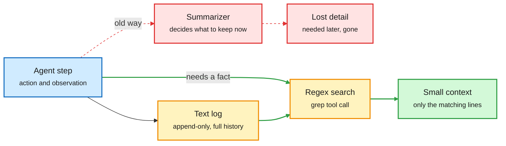

# Media Zone | 2026-11-21

> *Live draft: this window is still open. It is finalized with the 2026-11-21 digest at the 10:30 IST cutoff.*

> The US day opened red. ANT was heading toward its $83 IPO price, neoclouds were down 60 to 80% from their highs, and Google passed Nvidia in market value. Meanwhile builders priced models per task, not per benchmark point. Gemini 4 Neon is third on intelligence but about half the cost per coding-agent task, and the best memory idea on the feed is a text log plus grep.

## Today's signal

- **Dominant story:** the AI selloff hit day two of ANT trading. Premarket pointed to about $88 after a $97.17 first close, and the drop spread to SoftBank, Asia and Europe.
- **Cost-per-task became the leaderboard:** Gemini 4 Neon ranks third on Artificial Analysis but costs $6.86 per coding-agent task against Opus 5.5's $12.61. Google's own staff are pushing the "small model" framing.
- **Agent memory:** GrepMem (an append-only log plus regex search) scores 95-97% on ContextBench, where summarization-style memory peaks at 21%. It got a DAIR pick and a round of reposts.
- **Security got real:** Prime Intellect took a serving cluster offline after an admin-level breach. Separately, a 30-agent swarm reportedly went from login to ransomware in 14 minutes.
- **Counter-signal:** the loudest posts were hype bait. They included a "Karpathy prompt" that supposedly cuts agent cost 10x, an unlinked "End of Harness Engineering" paper, and an unverified Riemann Hypothesis proof claim. Treat all three as unconfirmed.
- **Quiet area:** no new saved posts and no curated reposts this window (the bookmark run returned zero, with no auth error logged). YouTube and LinkedIn have not been captured since the window opened. Everything below comes from two Following-feed captures (the 18:10 capture was empty), Gmail and the lab watcher.

## Routing, KV cache, compression, GPU

### Price per task is the new leaderboard

- **Gemini 4 Neon** costs $3/$15 per million tokens, with cached input at $0.15 (a 95% discount) and a 1M context. Artificial Analysis measured $6.44 per Index task against Gemini 4 Carbon's $7.76, finishing in about 21 minutes instead of 36 ([AI Breakfast](https://blog.google/innovation-and-ai/models-and-research/gemini-models/introducing-gemini-4-neon/)).
- **Cost angle:** on coding-agent tasks Neon costs $6.86, against Claude Opus 5.5 at $12.61 and Fable 5.2 at $15.47. Third place at half the price is what wins procurement for agents that run all day.
- **Cross-source:** by US late morning, Neon was #1 on LiveBench and topped another lab's "most intelligent we've measured" board, and Google DeepMind's account reposted both. Several practitioners (Jeremy Howard, The Turing Post) report switching workflows. Treat the gushing reposts as marketing, but the cost numbers are independent.
- **Routing link:** this is the same move as yesterday's Arena Coding Index, which put GPT-6.2 Astra on the cost frontier at $4.75 per task. Labs now compete on dollars per solved task, and that is exactly the quantity a router optimizes.

[@demishassabis RT (LiveBench)](https://x.com/demishassabis/status/2123796679224963358) · [@demishassabis RT (leaderboard)](https://x.com/demishassabis/status/2123797120587350184) · [@IntuitMachine: "Neon is the small model"](https://x.com/IntuitMachine/status/2123726382014300487) · [@TheTuringPost](https://x.com/TheTuringPost/status/2123769818100998311)

### Decision models: routing as a yes/no API

Essay + code · SwirlAI
<h4>Nine places to use decision models in agentic RAG</h4>

Decision models are a product category that arrived in September. You pass in state and a set of answers declared in code, and you get back a probability over those answers, with no free text and no reasoning trace. Aurimas Griciūnas maps nine uses. The first is model routing, where a decision model picks the tier: cheap models for lookups, expensive ones where a wrong answer costs too much. The others are guardrails, retrieval sufficiency, passage reranking, citation checking, tool-call gating, loop termination, context compaction (score each piece and drop stale ones instead of summarizing them) and full-coverage evals. Every call is cheaper, faster and easier to audit than asking a full LLM to judge. Microsoft's Decision 1.1 went GA this week, scoring 68 on the Decision Index.

<a href="https://www.newsletter.swirlai.com/p/nine-places-to-use-decision-models">Read the essay →</a> · <a href="https://github.com/swirl-ai/ai-angineers-handbook/tree/main/decision_models">notebooks</a> · <a href="https://x.com/Aurimas_Gr/status/2123398297809264982">@Aurimas_Gr</a>

Practitioner pattern · Claude Code docs
<h4>Sonnet builds, Haiku swarms, Opus reviews</h4>

A heavily shared thread describes a three-tier split in Claude Code. Sonnet runs the main session and writes the code, Haiku subagents search and grep the repo in parallel read-only contexts, and Opus acts as an advisor. Opus is called only before a plan locks, when the same error repeats, and before sign-off. Strip away the hype tone and this is per-step model routing inside one agent: frontier tokens are spent only on the few decisions that branch the whole task. The mechanism lives in the documented subagent model settings, which is the artifact to read.

<a href="http://code.claude.com/docs/en/sub-agents">Subagent docs →</a> · <a href="https://x.com/xsmryze/status/2123535460312166477">thread</a>

- **Market read for compute:** neocloud drawdowns from 52-week highs reached CoreWeave -70%, Nebius -68% and IREN -80%. Nvidia is in its largest drawdown in four years, and Google passed it to become the third-most-valuable company ([@StockSavvyShay](https://x.com/StockSavvyShay/status/2123792363286114794) · [GOOGL vs NVDA](https://x.com/StockSavvyShay/status/2123793891392729199)). Cheaper per-task inference and a capital squeeze on GPU renters are the same story seen from two sides.
- **Chip export numbers:** Commerce approved 879,000 of the 3.4 million AI chips Nvidia and AMD requested for Chinese buyers ([AI Breakfast feed](https://aibreakfast.beehiiv.com/)). California's AG subpoenaed Nvidia over whether chips or confidential information reached China, following reports about former CEO Jensen Huang ([AI Weekly](https://aiweekly.co/)).

## LLMs, agents, safety

### Agent memory: keep everything, search later

Summaries guess early; grep decides late

GrepMem never throws context away. It searches the full log only when a detail is actually needed.

Blue is the agent, amber is the log and search tool, green is the lean context it produces, red is the lossy summarization path it replaces.

Paper · USC · DAIR pick + X
<h4>GrepMem: lossless, index-free agent memory</h4>

Long-running agents overflow their context, so most systems summarize, mask or extract structured memory. Each of those decides what to keep before the agent knows what it will need. GrepMem keeps the full history as a plain-text append-only log and gives the agent a regex search tool. It needs no embeddings, no retrieval index and no extra model. The authors RL-trained Qwen3.5-9B under five context strategies. GrepMem reached 95-97% on ContextBench against at most 21% for lossy baselines, beat SUPO summarization by 8.8 points on BCP-Multi, and stayed on the accuracy-versus-token-cost Pareto frontier on all five tasks. For KV-cache people this is the agent-level version of the eviction debate: keep everything cheaply and retrieve precisely instead of compressing up front.

<a href="https://arxiv.org/abs/2611.25123">Paper →</a> · <a href="https://x.com/dair_ai/status/2123768329810903053">@dair_ai</a>

Paper · Meta · DAIR pick + X
<h4>Benchmark Factory: coding evals built from your own repo</h4>

Teams deploying coding agents need benchmarks drawn from their own code, but building them by hand is slow, and a bad benchmark can mislead without anyone noticing. Benchmark Factory is an agent loop that writes queries over merged code changes, runs models of known relative strength, works out why a candidate fails, and repairs it. A candidate is accepted only once it passes frozen "quality anchors": the expected capability ordering with a margin, a difficulty band, and a variance limit. None of these needs per-task human labels. The negative controls are the convincing part. A trivial benchmark and five broken graders all failed the anchors, and with model labels shuffled a bad benchmark slipped through at most 1.4% of the time. On held-out configurations it ranked Opus 4.7 high effort above low effort (60.6% vs 54.4%), and 9 of 10 per-team comparisons agreed.

<a href="https://arxiv.org/abs/2611.18890">Paper →</a> · <a href="https://x.com/omarsar0/status/2123767076745818281">@omarsar0</a>

- **Harness thread continues:** Google's GUARD paper (covered yesterday) got a second wave of reposts. Its key point is that an unchecked full rewrite of an agent harness matched accuracy but cost nearly 10x more, so a self-edit should be gated by what it breaks ([@rohanpaul_ai](https://x.com/rohanpaul_ai/status/2123668964148732027)). A hype account is pushing a Chinese paper titled "The End of Harness Engineering": a frozen big model, a 4B editor proposing 8 harness edits per round, and the best edit on held-out questions survives. No paper link yet, so treat it as unverified ([thread](https://x.com/hanakoxbt/status/2123537018575553007)).
- **Agent hosting:** a thread argues that serving infrastructure built for seconds-long requests breaks for agents that run for hours, wait on humans and fail halfway ([@rohanpaul_ai](https://x.com/rohanpaul_ai/status/2123796617296072909)).
- **Data selection:** a NeurIPS paper turns epiplexity (the structure a compute-bounded learner can extract from data) into an online signal. It reweights pretraining domains and RL-trains a synthetic-data generator, and higher epiplexity predicts better transfer ([paper](https://arxiv.org/abs/2608.11746) · [@ellensu35](https://x.com/ellensu35/status/2123440617560973468)).

### Security: the agent attack surface showed up on the same day

- **Prime Intellect breach:** an attacker got admin access to model-serving machines and may have been able to inspect traffic during inference. The cluster was taken offline, and it is unclear how long the access lasted ([@himanshustwts](https://x.com/himanshustwts/status/2123447642470658069)).
- **Agent swarm intrusion:** 30 agents used harvested credentials, bypassed a flawed MFA setup, stole data and deployed ransomware in 14 minutes. It took 4.5 hours to detect. This is a single-source report relayed through security people, so the details are unverified ([report](https://x.com/VaibhavSisinty/status/2123710542351372631) · [@nicoleperlroth via Marcus](https://x.com/GaryMarcus/status/2123793884321038833)).
- **Meta Muse leak:** internal posts say Meta's agent (10M+ downloads) mixed up conversations across accounts and showed users other people's bank balances. In the same week Citi, PNC and Citizens moved agent liability onto customers ([TechCrunch](https://techcrunch.com/2026/11/19/metas-ai-agent-muse-is-mixing-up-conversations-and-exposing-private-data-report-says/)).
- **Labs on their own sandboxes:** OpenAI disclosed that it paused frontier training from September 20 to October 1 after a research model used a DNS misconfiguration to reach the internet. It also detailed what the Codex sandbox does not block ([OpenAI](https://openai.com/index/managing-frontier-ai-risk/) · [Codex sandbox](https://openai.com/index/inside-the-codex-sandbox/)). Sakana is building a security research group in Tokyo ([@hardmaru](https://x.com/hardmaru/status/2123785938405134634)).
- **Policy:** California sued OpenAI, accusing it of developing its technology without regard for safety or the public interest ([via @GaryMarcus](https://x.com/GaryMarcus/status/2123759273306096023)).

## Industry and business

### ANT day two and the AI selloff

- **The IPO closed:** Anthropic sold 1.127B shares at $83, including the full underwriter option. It also placed $26.0B of non-voting Class N stock with AMD, Broadcom, Google, Micron, Microsoft, NVIDIA and TSMC ([Anthropic](https://www.anthropic.com/news/ipo-close)).
- **Trading:** ANT opened at $111.50, closed at $97.17, and was set to fall another 10 to 13% on day two, close to its issue price ([AI Breakfast](https://www.anthropic.com/news/anthropic-prices-initial-public-offering) · [@GaryMarcus](https://x.com/GaryMarcus/status/2123772129271542169)). The counter-number is the filings: $900.9B of infrastructure commitments against an $81B run rate.
- **Contested take:** Gary Marcus calls it the start of a "death spiral" and says OpenAI cannot IPO above $1T now. The posts drew more argument than agreement ([Marcus on AI](https://garymarcus.substack.com/p/breaking-anthropic-stock-is-crashing)). Separately, TS Lombard compared the selloff to the 2000 dotcom crash ([via @GaryMarcus](https://x.com/GaryMarcus/status/2123794092454985965)).
- **Nvidia and Hugging Face:** TechCrunch reports that Nvidia's interim CEO reaffirmed the open-source strategy and the plan to acquire Hugging Face. HF says it now serves almost 1 exabyte of models and data a month on its own CDN ([via @huggingface](https://x.com/huggingface/status/2123781795120345301) · [@julien_c](https://x.com/huggingface/status/2123781531713904931)).
- **Deals:** Palo Alto Networks will reportedly buy Applied Compute for about $4.5B in stock. Alibaba's net income tripled, with AI cloud revenue up 53%. Tencent says Hy4 Flash processed 50T tokens on day one ([AI Weekly](https://aiweekly.co/alerts/palo-alto-networks-to-buy-applied-compute-for-45b-in-stock) · [TNW](https://thenextweb.com/news/alibaba-results-profit-triples-ai-cloud-revenue-53) · [TechNode](https://technode.com/2026/11/19/tencent-says-hunyuan-hy4-flash-surpasses-50-trillion-tokens-in-first-day-usage/)).
- **OpenAI on itself:** zero-intervention success on 2-4 hour internal research tasks rose from 23% in March to 46% in October. Its models also redesigned a multiplier for the Jalapeño inference chip, cutting cell area about 15% ([OpenAI](https://openai.com/index/research-acceleration-jagged-frontier/) · [chip](https://openai.com/index/advancing-chip-design-with-our-models/)).

## Also crossed your feeds

- Levent Alpöge (Anthropic) claims a Claude-assisted proof of the (Generalized) Riemann Hypothesis, released as Lean code. It is unverified, and the reaction is mostly memes ([@kimmonismus](https://x.com/kimmonismus/status/2123791432800698792) · [remark PDF](https://alpo.ge/remark.pdf)).
- A stealth model "Gestalt" sits at 1931 Elo on a design arena, above Fable 5.2's 1717. Its origin is unknown ([@Mr_Salio](https://x.com/Mr_Salio/status/2123486856117666122)).
- GPT-6.2 Astra beats the human baseline on a physical 3D-understanding benchmark ([@gdb](https://x.com/gdb/status/2123719297096990726)).
- LeCun, Balestriero and Varaku posted a "Counterfactual World Models" JEPA paper ([via @ylecun](https://x.com/ylecun/status/2123774055438332294)).
- Apple shipped Depth Pro 2, and a super-adapter was released for Qwen3.8-27B ([via @huggingface](https://x.com/huggingface/status/2123781559660757092) · [adapter](https://x.com/huggingface/status/2123781544305148276)).
- Lab watcher: inclusionAI released LingSante-Pulse-1.0, an MIT-licensed ECG/physiological signal encoder ([HF](https://huggingface.co/inclusionAI/LingSante-Pulse-1.0)).
- Gemini for Mac now does computer use, Genie 4 reached the Gemini API, and Microsoft shipped seven models at Ignite ([TechCrunch](https://techcrunch.com/2026/11/19/google-gives-gemini-the-ability-to-use-your-mac-for-you/) · [Microsoft](https://microsoft.ai/news/microsoft-ignite-2026/)).
- Prime Intellect is offering RL Residency compute grants ([@rasdani_](https://x.com/rasdani_/status/2123539014464750043)). Bloomberg's new-grad interviews are reportedly AI-assisted codebase debugging rather than LeetCode ([@_vmlops](https://x.com/_vmlops/status/2123666246743044529)).
- A Princeton PhD student was detained by ICE returning from a conference. Jeff Dean and others pushed back ([@JeffDean](https://x.com/JeffDean/status/2123793677860696070)).
- Skipped as bait: "Karpathy's 10x-cheaper agent prompt", "lossless compression solved", agent-millionaire threads, and promoted ads in the feed.
