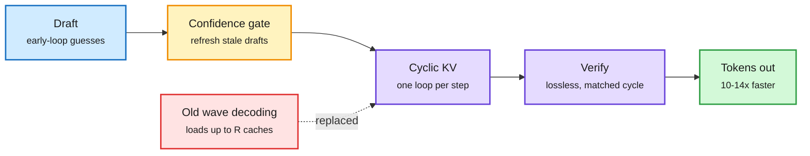

# Media Zone | 2026-11-22

> *Live draft: this window is still open. It is finalized with the 2026-11-22 digest at the 10:30 IST cutoff.*

> The US Friday afternoon was a wind-down after the Riemann shock. The best efficiency post of the day was a quiet one: LoopCache fixes the hidden memory cost of looped transformers, which has been the architecture story of the week. Claude Code's new Code Mode got a viral token claim and a sober correction. The market feed was all Nvidia fallout, ANT near its offer price, and growing skepticism about the Riemann claim.

## Today's signal

- **Dominant story:** LoopCache speeds up speculative decoding on looped transformers by 10-14x. It does this by moving one loop's KV cache per step, not R of them.
- **Pattern:** looped models now have a model (Inkling 2 Mini), a local runtime (Ollama) and a serving paper, all in two days.
- **Counter-signal:** Riemann skepticism grew louder: "we've learned almost nothing mathematically", and a rival all-human GRH draft gets passed around.
- **Agent cost:** Code Mode batches tool calls into one script. The viral "150K to 2K tokens" figure comes from an older Anthropic example, not from Code Mode itself.
- **Quiet area:** no new bookmarks, reposts, YouTube or LinkedIn captures in this window yet. The US day is still being read.

## Routing, KV cache, compression, GPU

### Looped transformers get a serving fix

One loop's cache per step, not R of them

Wave-style speculation batches tokens from every loop, so memory traffic grows with loop count. LoopCache rotates through the caches.

Blue is the draft, amber the gate, purple the cache and verify path, red the cost it removes, green the result.

Paper · KV cache for looped models
<h4>LoopCache: self-speculative decoding for long-context looped transformers</h4>

Looped transformers reuse one shared block R times per token, so a small model gets the effective depth of a big one. Each loop keeps its own KV cache (the stored attention keys and values for earlier tokens). Earlier "wave" methods (WaveFront Decoding, LoopSpec) pipeline drafting and verifying across loops, but they have two flaws. They draft only at fixed loops, so they keep working on guesses the model has already changed its mind about. And each step batches tokens from every loop, so it can read up to R times the KV cache, which hurts memory bandwidth badly at long context. LoopCache refreshes drafts at every loop when confidence says the prediction switched. It also rotates through the loop caches so each step reads only one, and keeps separate caches for a few loop-sensitive shallow layers. Reported speedups average 10.25x over WaveFront and 14.56x over LoopSpec, lossless. Two caveats: the gains are measured against those two baselines only, and they apply only to looped models. It arrives one day after Thinking Machines shipped Inkling 2 Mini, a looped MoE whose middle layers run three times per token. That timing makes the serving cost of loops a practical question, not a theory one.

<a href="https://arxiv.org/abs/2611.24301">arXiv 2611.24301 →</a> · <a href="https://x.com/qingke_ai/status/2123816139314913520">@qingke_ai explainer</a>

Release · local runtime
<h4>Inkling 2 Mini lands on Ollama</h4>

Ollama partnered with Thinking Machines to ship Inkling 2 Mini for local use on machines with 32GB or more of unified memory. It has 26.4B total parameters, about 3.4B active per token, and a roughly 20GB NVFP4/MXFP8 checkpoint. It leads open models under 100B on DeepSWE v1.1 at 48.2%. Ollama ships one-line launchers for Claude Code, Codex and Pi. This is the fastest a frontier lab's looped model has gone from release to a laptop runtime. It is also exactly the setup where LoopCache's memory-traffic argument applies.

<a href="https://ollama.com/library/inkling-2-mini">Ollama library →</a>

### GPU basics and the inference-skills bet

- **How GPUs organize work:** a clear explainer on kernels, threads, blocks and SMs (streaming multiprocessors, the chip sections that run thread blocks) and warp scheduling. It is a good refresher, not new material ([@_avichawla](https://x.com/_avichawla/status/2124090834148794471)).
- **"Learn inference":** a short post that resurfaced, saying inference engineering is the skill to have in 2026. It got outsized engagement for a single line, which shows where builder attention sits ([@Fanoutdotsh](https://x.com/Fanoutdotsh/status/2115895353946034292)).

## LLMs, agents, safety

### Agent token cost: Code Mode and the 150K-to-2K figure

Essay · agent cost
<h4>Claude Code's Code Mode batches tool calls in one script</h4>

Code Mode is an experimental, off-by-default setting added in Claude Code v2.1.323 on 12 November. Normally, when one tool call depends on an earlier result, the model needs another round trip, and every intermediate result lands in its context. With Code Mode on, Claude writes one JavaScript script that chains the calls, filters the results inside the script, and returns only what the model needs next. It runs only in an interactive terminal session, not headless or in the cloud, using the operator's existing tools. The tradeoff is review: the operator approves one script instead of each call, and auto mode's classifier checks the code once, without seeing values computed at run time. Ken Huang's write-up traces the viral "150,000 tokens to 2,000" number to its real source, an earlier Anthropic code-execution example. Treat it as the best case, not what Code Mode measures.

<a href="https://kenhuangus.substack.com/p/claude-codes-code-mode-batches-tool">Ken Huang →</a> · <a href="https://x.com/thedelost/status/2123891849366507699">viral version</a>

- **Why it matters for cost:** fewer model round trips means less re-sent context and fewer output turns. On long chains that cost is usually larger than the cost of the tool outputs themselves.
- **The safety cost:** one approval for a whole script is a coarser control than per-call prompts. Hooks written as per-call rules no longer see each call.

### Agents on the attack, governance on the defense

- **Cairn zero-day:** Amazon says a suspected China-linked actor used the open-source Cairn agent framework to find and exploit a medical-imaging (MONAI) zero-day in 11 minutes, with the single instruction "obtain shell access" ([AI Weekly Espresso](https://aiweekly.co)).
- **Speed of attacks:** Marktechpost collects CrowdStrike's report of one AI-agent group hitting 200+ organizations in 11 days, and Unit 42 seeing attacks about 4x faster than a year ago ([@Marktechpost](https://x.com/Marktechpost/status/2123368941951008992)).
- **Google's answer:** Google Developers posted semantic governance policies that check what an agent is about to do before it acts, plus anomaly detection for agents running on other clouds ([semantic policies](https://developers.googleblog.com/check-what-your-ai-agents-do-before-they-do-it-with-semantic-governance-policies/) · [anomaly detection](https://developers.googleblog.com/agent-anomaly-detection-safeguarding-agents-across-other-clouds/)).
- **Rubrik's 15 agent risks:** a vendor ebook (an agent dumping a keychain, a production DB wiped in 9 seconds). It is a sponsored post, so useful only as a checklist ([@TheTuringPost](https://x.com/TheTuringPost/status/2124086048451948851)).
- **California AI policy report:** Jan Leike and Miles Brundage both point to the new state report as unusually substantive ([@Miles_Brundage RT](https://x.com/Miles_Brundage/status/2123892156024975800)).

### The Riemann claim, day two: math more than kernels

- **Pushback:** "We've learned almost nothing mathematically from what they did" is circulating through Grady Booch and Gary Marcus. The objection is that a 17M-line Lean proof nobody can read gives the result but no insight ([@GaryMarcus RT](https://x.com/GaryMarcus/status/2124109852490465512)).
- **A human rival:** Alessandro Masullo's all-human GRH draft ("The Music of the Primes", about 940 pages) is being shared as the counterpoint. Ravi Vakil reported that Brian Conrad's months of review looked "so far good", but later said AI-assisted checks found problems ([@GaryMarcus RT](https://x.com/GaryMarcus/status/2124115719076163644) · [AI Weekly Espresso](https://aiweekly.co)).
- **Alpöge's second claim:** with NYU's Tristan Buckmaster, he posted an AI-aided proof of finite-time blowup for the unforced 3D Navier-Stokes equations. They say it closes a loophole in OpenAI's September result ([AI Weekly Espresso](https://aiweekly.co)).
- **Long-form explainer:** a chaptered video narrative of the claim. It is accessible but adds no new checks ([@IntuitMachine](https://x.com/IntuitMachine/status/2124109560998777033)).

## Industry and business

- **Nvidia aftermath:** the "Bring Back Jensen" crowd meets Steven Levy's argument that the crisis exposed Huang as a weak CEO. Last Week in AI lays out the timeline: resignation on 11-12, SEC accounting inquiry, a California AG subpoena on China diversion, and House hearings on 12-1/12-2 ([LWiAI #348](https://lastweekin.ai/p/last-week-in-ai-348-ipo-correction) · [@GaryMarcus RT](https://x.com/GaryMarcus/status/2124112110594761200)).
- **The market week in one line:** ANT opened at $111.50, closed day one at $97.17, then fell about 9% Friday to just above $83. The Nasdaq fell 5.28% and erased its 2026 gains. Nvidia and AMD each fell 13% and Micron about 14% ([LWiAI #348](https://lastweekin.ai/p/last-week-in-ai-348-ipo-correction)).
- **Credit stress signal:** Oracle CDS (credit default swaps, the price of insuring against default) is "going parabolic", circulated by the bubble skeptics. It is a single chart, not analysis, but it points at AI capex debt ([@GaryMarcus RT](https://x.com/GaryMarcus/status/2124112239741595873)).
- **Cursor and Chinese models:** SpaceX-owned Cursor told House committees it may phase out PRC open-weight models. Its Composer 2 was built on Kimi K2.5 ([AI Weekly Espresso](https://aiweekly.co)).
- **Chips and policy:** TSMC paused some shipments after the new US rules reached beyond AI parts. Trump threatened a "tremendous tax" on US companies building data centers abroad. Bessent says Trump and Xi agreed verbally that humans stay in control of military AI ([AI Weekly Espresso](https://aiweekly.co) · [LWiAI #348](https://lastweekin.ai/p/last-week-in-ai-348-ipo-correction)).
- **Models this week, reception:** GPT-6.2 Astra drew "essentially unusable" reviews from power users. Gemini 4 Neon was praised for matching Opus 5.5 on coding agents at 25% lower prices ([LWiAI #348](https://lastweekin.ai/p/last-week-in-ai-348-ipo-correction)).
- **Forecast gap:** Ramez Naam argues there is a roughly 100-fold, widening gap between forecast AI task lengths and real-world ones. This contrasts with the "AI solved Riemann in two years" hype posts in the same feed ([@GaryMarcus RT](https://x.com/GaryMarcus/status/2124107511410418079) · [hype version](https://x.com/VaibhavSisinty/status/2124095951203889232)).
- **Voice:** OpenAI opened GPT-Live-1.1 in the API with $0.02/min standby billing. Google moved Duplex phone calling into Tasks in Gemini ([AI Weekly Espresso](https://aiweekly.co) · [Google Research](https://research.google/blog/how-google-duplex-evolved-to-also-call-businesses-for-you-in-gemini/)).

## Also crossed your feeds

Semiconductor process monitor: physics-informed explainable AI for high-aspect-ratio etch is the pick of the week, with no EUV news ([The Semiconductor Newsletter](https://thesemiconductornewsletter.substack.com/p/weekly-monitor-on-semiconductor-process-516)) · Kyutai AURA audio-driven avatars at 20.7 fps on one GPU (AI Weekly Espresso) · Karpathy "2-hour lecture" repackaged as engagement bait ([@solenlive](https://x.com/solenlive/status/2123835599555551269)) · "Claude Code plays GTA 6 overnight for $9,740", grift ([@zodchiii](https://x.com/zodchiii/status/2123851248936103993)) · fake "fired Rockstar engineer" telemetry story, unverified ([@make_claude](https://x.com/make_claude/status/2123908856145232060)) · "every LLM biased against men" overclaim of a GPT study ([@oliviscusAI](https://x.com/oliviscusAI/status/2124087673501409394)) · 464K-star "decode any closed app" repo bait ([@birmeya](https://x.com/birmeya/status/2123892174215376996)) · Anthropic copyright and IPO-oversubscription jabs ([@GaryMarcus RTs](https://x.com/GaryMarcus/status/2124113910416744596)) · OpenAI departures rumor, unsourced ([@GaryMarcus RT](https://x.com/GaryMarcus/status/2124111807937950131)) · LLM-capability goalpost meme ([@alex_conneau RT](https://x.com/alex_conneau/status/2124086153494327366)) · YC founder progress anecdote ([@harjtaggar RT](https://x.com/harjtaggar/status/2123883789730648345)) · Max Welling interview on CuspAI, in Dutch ([@wellingmax](https://x.com/wellingmax/status/2124091792681562240)) · Google Gemini Enterprise MCP and auth how-tos (lab posts) · industrial-AI and robot promo posts, skipped.
