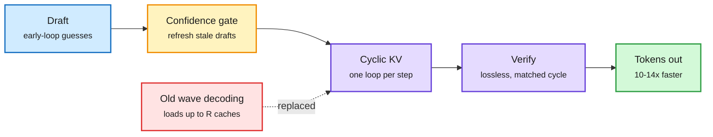

# Media Zone | 2026-11-22

> The US Friday was a wind-down after the Riemann shock, and the best posts were about moving fewer bytes. LoopCache fixes the hidden KV-traffic cost of looped transformers. Google's G-MTP drafter reads Gemma 4's own KV cache instead of building one. Code Mode and Spotify's helper models cut agent token bills by keeping tool output away from the expensive model. The market feed was Nvidia fallout, Amazon's reported $7.5B Decart bid, and growing skepticism about the Riemann claim.

## Today's signal

- **Dominant story:** LoopCache speeds up speculative decoding on looped transformers by 10-14x. It reads one loop's KV cache per step, not R of them.
- **Cross-source pattern:** G-MTP (DAIR pick plus a widely shared X post) makes the drafter cross-attend to the target's KV cache. Four drafter papers in a week now say the drafter's value is what it borrows from the target.
- **Agent cost:** Code Mode batches tool calls into one script, and Spotify routes file reading to cheap models. The viral "150K to 2K tokens" figure is from an older Anthropic example.
- **Counter-signal:** Riemann skepticism grew ("we've learned almost nothing mathematically"), while a short AlphaProof Nexus physics proof showed what a readable machine proof looks like.
- **Market:** Amazon's reported $7.5B for Decart is a bid for tokens per kilowatt, and Chollet notes GPU spot prices are still rising.
- **Quiet area:** no new saved posts or curated reposts this window (the Following feed was captured normally), LinkedIn returned no posts, and no Reddit post passed the filters.

## Routing, KV cache, compression, GPU

### Looped transformers get a serving fix

One loop's cache per step, not R of them

Wave-style speculation batches tokens from every loop, so memory traffic grows with loop count. LoopCache rotates through the caches.

Blue is the draft, amber the gate, purple the cache and verify path, red the cost it removes, green the result.

Paper · KV cache for looped models
<h4>LoopCache: self-speculative decoding for long-context looped transformers</h4>

Looped transformers reuse one shared block R times per token, so a small model gets the effective depth of a big one. Each loop keeps its own KV cache (the stored attention keys and values for earlier tokens). Earlier "wave" methods (WaveFront Decoding, LoopSpec) pipeline drafting and verifying across loops, but they have two flaws. They draft only at fixed loops, so they keep working on guesses the model has already changed its mind about. And each step batches tokens from every loop, so it can read up to R times the KV cache, which hurts memory bandwidth badly at long context. LoopCache refreshes drafts at every loop when confidence says the prediction switched. It also rotates through the loop caches so each step reads only one, and keeps separate caches for a few loop-sensitive shallow layers. Reported speedups average 10.25x over WaveFront and 14.56x over LoopSpec, lossless. Two caveats: the gains are measured against those two baselines only, and they apply only to looped models. It arrives one day after Thinking Machines shipped Inkling 2 Mini, a looped MoE whose middle layers run three times per token. That timing makes the serving cost of loops a practical question, not a theory one.

<a href="https://arxiv.org/abs/2611.24301">arXiv 2611.24301 →</a> · <a href="https://x.com/qingke_ai/status/2123816139314913520">@qingke_ai explainer</a>

Release · local runtime
<h4>Inkling 2 Mini lands on Ollama</h4>

Ollama partnered with Thinking Machines to ship Inkling 2 Mini for local use on machines with 32GB or more of unified memory. It has 26.4B total parameters, about 3.4B active per token, and a roughly 20GB NVFP4/MXFP8 checkpoint. It leads open models under 100B on DeepSWE v1.1 at 48.2%. Ollama ships one-line launchers for Claude Code, Codex and Pi. This is the fastest a frontier lab's looped model has gone from release to a laptop runtime. It is also exactly the setup where LoopCache's memory-traffic argument applies.

<a href="https://ollama.com/library/inkling-2-mini">Ollama library →</a>

### Drafters and caches that borrow from the target

Paper · speculative decoding, on-device
<h4>G-MTP: Google builds the drafter into Gemma 4</h4>

Speculative decoding lets a cheap drafter guess several tokens that the big model then checks in one pass. Google's G-MTP skips the separate draft model and adds one multi-token-prediction head to Gemma 4. The head reads the backbone's own activations and cross-attends to its existing KV cache without copying it, so the drafter needs no prefill and little memory, and it scores vocabulary clusters instead of the full vocabulary on each step. Speedups reach 3.1x on large server models and 2.2x on a phone GPU. It was a DAIR Academy pick and one of the most re-shared research posts of the morning, and it is the fourth paper this week saying a drafter's value is what it borrows from the target.

<a href="https://arxiv.org/abs/2611.25813">arXiv 2611.25813 →</a> · <a href="https://x.com/dair_ai/status/2124246507125903841">@dair_ai</a>

Lab post · prompt caching
<h4>Qwen4 Max reads a whole repo, and the cache makes it cheap</h4>

Together AI sent all 344 files of the Tornado framework (652K tokens) and a bug report to Qwen4 Max in one call, with no retrieval. The patch passed the maintainers' own regression tests and cost 69 cents. Sending the same prompt again hit the automatic prompt cache: first token in 8 seconds instead of 54, and input cost about 3 cents instead of 66. It is a clean real-world number for how prefix caching changes the economics of "just put everything in context".

<a href="https://www.together.ai/blog/qwen4-max">Together AI →</a>

- **Inference economics in one line:** Gergely Orosz's widely shared take is that KV-cache reads are cheap and speculative decoding makes sessions efficient, and coding workloads lean on both. That is why inference margins are high ([@GergelyOrosz](https://x.com/GergelyOrosz/status/2123795984002232634)).
- **Hybrid routing at the edge:** Google Cloud Tech's Web AI talk covers local vector search with Gemma 4 in the browser and routing between on-device and cloud models, the practical shape of edge-cloud routing ([video](https://youtube.com/watch?v=ugmCis5nuF8)).

### GPU basics and the inference-skills bet

- **How GPUs organize work:** a clear explainer on kernels, threads, blocks and SMs (streaming multiprocessors, the chip sections that run thread blocks) and warp scheduling. It is a good refresher, not new material ([@_avichawla](https://x.com/_avichawla/status/2124090834148794471)).
- **"Learn inference":** a short post that resurfaced, saying inference engineering is the skill to have in 2026. It got outsized engagement for a single line, which shows where builder attention sits ([@Fanoutdotsh](https://x.com/Fanoutdotsh/status/2115895353946034292)).

## LLMs, agents, safety

### Agent token cost: Code Mode and the 150K-to-2K figure

Essay · agent cost
<h4>Claude Code's Code Mode batches tool calls in one script</h4>

Code Mode is an experimental, off-by-default setting added in Claude Code v2.1.323 on 12 November. Normally, when one tool call depends on an earlier result, the model needs another round trip, and every intermediate result lands in its context. With Code Mode on, Claude writes one JavaScript script that chains the calls, filters the results inside the script, and returns only what the model needs next. It runs only in an interactive terminal session, not headless or in the cloud, using the operator's existing tools. The tradeoff is review: the operator approves one script instead of each call, and auto mode's classifier checks the code once, without seeing values computed at run time. Ken Huang's write-up traces the viral "150,000 tokens to 2,000" number to its real source, an earlier Anthropic code-execution example. Treat it as the best case, not what Code Mode measures.

<a href="https://kenhuangus.substack.com/p/claude-codes-code-mode-batches-tool">Ken Huang →</a> · <a href="https://x.com/thedelost/status/2123891849366507699">viral version</a>

- **Why it matters for cost:** fewer model round trips means less re-sent context and fewer output turns. On long chains that cost is usually larger than the cost of the tool outputs themselves.
- **The safety cost:** one approval for a whole script is a coarser control than per-call prompts. Hooks written as per-call rules no longer see each call.
- **Spotify's version:** file reads and boilerplate go to two cheap helper models, and a hook blocks the main model from opening any file over 350 lines, because the instruction-only rule was ignored. Reported cut: about 90% of tokens. The cheap reader did miss one bug ([@undefinedKi](https://x.com/undefinedKi/status/2124153368419467742)).

### Agents that build systems and keep small memories

Paper · agents build RAG
<h4>AutoRAGBench: coding agents beat the best published RAG designs</h4>

RAG (retrieval-augmented generation, where a model looks up documents before answering) still takes a lot of hand engineering, because the best chunking, retriever and reranking choices change from task to task. AutoRAGBench gives an agent nine RAG tasks with no starter code and no suggested approach. Each run gets six hours on one H800 GPU to study the data, build a pipeline and improve it from its own experiments. GPT-6.1 Sol with Codex CLI averages 56.1. A composite human baseline, which takes the best published method on each task, averages 44.4. Starting the agent from a human-built system adds 16.6 points on average across seven tasks. The open questions are cost per run (six GPU-hours is not cheap) and whether the human baseline is a fair best effort or just the best paper on each task. DAIR Academy also picked it, so it has a second curator behind it.

<a href="https://arxiv.org/abs/2611.25582">arXiv 2611.25582 →</a> · <a href="https://x.com/omarsar0/status/2124199923424104874">@omarsar0</a> · <a href="https://academy.dair.ai/papers/autoragbench-a-benchmark-for-llm-agents-automating-rag-system-development-2611.25582">DAIR pick</a>

Thread · agent memory
<h4>An agent that saves everything remembers nothing</h4>

A widely shared thread summarizes an Anthropic guide on Claude's memory across sessions, in six parts. Tell the agent what memory is for, not fixed rules about how to use it: a fixed "record only failures" rule cost the strongest models much of their gain. Keep it small: in Pokémon, Sonnet 3.7 saved 413 files and won 1 badge, while Fable 5 kept 9 files and won 4. Save only what the agent cannot see every turn, such as plans and tested rules. Let it "dream" by re-reading notes against transcripts to fix wrong ones. Grow a linked wiki over sessions (13% to 48% of graded criteria from 2 to 128 sessions). Load only one small index each session. The cost angle is clear: smaller memory means fewer context tokens every turn. The thread links no primary page in this capture, so treat the numbers as reported, not checked.

<a href="https://x.com/reinexbt/status/2124159642938818904">Thread →</a>

- **Knowledge factory:** Harrison Chase (LangChain) argues the missing piece for company AI is better knowledge, not better models. Every LangChain internal agent runs a learning loop that turns work into reusable company knowledge ([@hwchase17](https://x.com/hwchase17/status/2124181216719151585)).
- **You still need a harness:** Sebastian Raschka notes that a root model making recursive sub-calls still needs a harness around it, a small reminder that "the model does it all" claims hide the loop code ([@rasbt](https://x.com/rasbt/status/2124197339418206247)).
- **Build your own harness:** Elvis Saravia re-pushed his call for builders to write their own agent harness instead of using a stock one ([@omarsar0](https://x.com/omarsar0/status/2123985647421538704)).

### Agents on the attack, governance on the defense

- **Cairn zero-day:** Amazon says a suspected China-linked actor used the open-source Cairn agent framework to find and exploit a medical-imaging (MONAI) zero-day in 11 minutes, with the single instruction "obtain shell access" ([AI Weekly Espresso](https://aiweekly.co)).
- **Speed of attacks:** Marktechpost collects CrowdStrike's report of one AI-agent group hitting 200+ organizations in 11 days, and Unit 42 seeing attacks about 4x faster than a year ago ([@Marktechpost](https://x.com/Marktechpost/status/2123368941951008992)).
- **Google's answer:** Google Developers posted semantic governance policies that check what an agent is about to do before it acts, plus anomaly detection for agents running on other clouds ([semantic policies](https://developers.googleblog.com/check-what-your-ai-agents-do-before-they-do-it-with-semantic-governance-policies/) · [anomaly detection](https://developers.googleblog.com/agent-anomaly-detection-safeguarding-agents-across-other-clouds/)).
- **Rubrik's 15 agent risks:** a vendor ebook (an agent dumping a keychain, a production DB wiped in 9 seconds). It is a sponsored post, so useful only as a checklist ([@TheTuringPost](https://x.com/TheTuringPost/status/2124086048451948851)).
- **California AI policy report:** Jan Leike and Miles Brundage both point to the new state report as unusually substantive ([@Miles_Brundage RT](https://x.com/Miles_Brundage/status/2123892156024975800)).

### Research threads worth a click

- **Anonymous authors are not anonymous:** a University of Maryland paper finds zero-shot frontier models match trained AI-text detectors and can name authors. Fable 5.2 identified the reviewer of 56% of 398 private peer reviews ([@rohanpaul_ai](https://x.com/rohanpaul_ai/status/2124261335982862679)).
- **JEPA world models:** a LeCun-group paper proposes SVReg, an anti-collapse rule that acts only when embedding spread shrinks, then documents a content-geometry tradeoff that erases slow, hard-to-predict content ([@TheTuringPost](https://x.com/TheTuringPost/status/2124303722671153346)).
- **AlphaProof Nexus in physics:** Lean proof search settled a 2017 quantum-optics question. High-dimensional GHZ states cannot be built with linear optics and pair sources for even N of 4 or more ([@dair_ai](https://x.com/dair_ai/status/2124187341141283117) · [paper](https://arxiv.org/abs/2611.26300)).
- **MCP Events beta:** agents can now subscribe to events by polling, push or webhook, not only call tools on request ([@RohitGite19](https://x.com/RohitGite19/status/2124018516621971912)).
- **App stores after coding agents:** an MIT study (via a social summary) finds agent users wrote 25.5x more code but shipped only 30% more releases, while new apps doubled and engagement stayed flat ([@thesupermannx](https://x.com/thesupermannx/status/2124138507367281023)).

### The Riemann claim, day two: math more than kernels

- **Pushback:** "We've learned almost nothing mathematically from what they did" is circulating through Grady Booch and Gary Marcus. The objection is that a 17M-line Lean proof nobody can read gives the result but no insight ([@GaryMarcus RT](https://x.com/GaryMarcus/status/2124109852490465512)).
- **A human rival:** Alessandro Masullo's all-human GRH draft ("The Music of the Primes", about 940 pages) is being shared as the counterpoint. Ravi Vakil reported that Brian Conrad's months of review looked "so far good", but later said AI-assisted checks found problems ([@GaryMarcus RT](https://x.com/GaryMarcus/status/2124115719076163644) · [AI Weekly Espresso](https://aiweekly.co)).
- **Alpöge's second claim:** with NYU's Tristan Buckmaster, he posted an AI-aided proof of finite-time blowup for the unforced 3D Navier-Stokes equations. They say it closes a loophole in OpenAI's September result ([AI Weekly Espresso](https://aiweekly.co)).
- **Long-form explainer:** a chaptered video narrative of the claim. It is accessible but adds no new checks ([@IntuitMachine](https://x.com/IntuitMachine/status/2124109560998777033)).

- **On video:** 3Blue1Brown's explainer is the clearest primer on what the claim means and why the Lean check matters; Varun Mayya's take is the popular version ([3Blue1Brown](https://youtube.com/watch?v=zqzk43bSdDI) · [Varun Mayya](https://youtube.com/watch?v=Ev885r_TPd0)).

## Industry and business

- **Amazon nearing a $7.5B Decart deal:** almost twice Decart's latest $4B valuation, reportedly for squeezing more tokens per kilowatt out of Trainium ([@rohanpaul_ai](https://x.com/rohanpaul_ai/status/2124294348712092061) · [The Information](https://www.theinformation.com/briefings/amazon-nearing-7-5-billion-purchase-decart)).
- **GPU capacity still tight:** Chollet frames the selloff as end-of-buildout or buying opportunity, noting spot prices keep rising ([@fchollet](https://x.com/fchollet/status/2124246742644461569)).
- **Together AI prompt leak:** an AI coding agent committed a credential; an attacker downloaded stored prompt samples. Zero data retention is now the default ([Together AI](https://www.together.ai/blog/security-event-prompt-leakage-for-requests-in-june-and-july-of-2026)).
- **Oracle:** says funding for its OpenAI contract is complete ([The Information](https://www.theinformation.com/briefings/oracle-says-completed-funding-fulfil-openai-deal)).
- **Gemini 4 Neon as daily driver:** Elvis Saravia may swap it in for Opus 5.5. Arena's Agent Index shows GPT-6.2 Astra up 50 in coding and down 54 in chat ([@omarsar0](https://x.com/omarsar0/status/2124174963410174246) · [@arena](https://x.com/arena/status/2124191294360588725)).

- **Nvidia aftermath:** the "Bring Back Jensen" crowd meets Steven Levy's argument that the crisis exposed Huang as a weak CEO. Last Week in AI lays out the timeline: resignation on 11-12, SEC accounting inquiry, a California AG subpoena on China diversion, and House hearings on 12-1/12-2 ([LWiAI #348](https://lastweekin.ai/p/last-week-in-ai-348-ipo-correction) · [@GaryMarcus RT](https://x.com/GaryMarcus/status/2124112110594761200)).
- **The market week in one line:** ANT opened at $111.50, closed day one at $97.17, then fell about 9% Friday to just above $83. The Nasdaq fell 5.28% and erased its 2026 gains. Nvidia and AMD each fell 13% and Micron about 14% ([LWiAI #348](https://lastweekin.ai/p/last-week-in-ai-348-ipo-correction)).
- **Credit stress signal:** Oracle CDS (credit default swaps, the price of insuring against default) is "going parabolic", circulated by the bubble skeptics. It is a single chart, not analysis, but it points at AI capex debt ([@GaryMarcus RT](https://x.com/GaryMarcus/status/2124112239741595873)).
- **Cursor and Chinese models:** SpaceX-owned Cursor told House committees it may phase out PRC open-weight models. Its Composer 2 was built on Kimi K2.5 ([AI Weekly Espresso](https://aiweekly.co)).
- **Chips and policy:** TSMC paused some shipments after the new US rules reached beyond AI parts. Trump threatened a "tremendous tax" on US companies building data centers abroad. Bessent says Trump and Xi agreed verbally that humans stay in control of military AI ([AI Weekly Espresso](https://aiweekly.co) · [LWiAI #348](https://lastweekin.ai/p/last-week-in-ai-348-ipo-correction)).
- **Models this week, reception:** GPT-6.2 Astra drew "essentially unusable" reviews from power users. Gemini 4 Neon was praised for matching Opus 5.5 on coding agents at 25% lower prices ([LWiAI #348](https://lastweekin.ai/p/last-week-in-ai-348-ipo-correction)).
- **Forecast gap:** Ramez Naam argues there is a roughly 100-fold, widening gap between forecast AI task lengths and real-world ones. This contrasts with the "AI solved Riemann in two years" hype posts in the same feed ([@GaryMarcus RT](https://x.com/GaryMarcus/status/2124107511410418079) · [hype version](https://x.com/VaibhavSisinty/status/2124095951203889232)).
- **Fei-Fei Li at AMD:** she posted "Week One at AMD accomplished", tagging World Labs, with the line "AI is compute, compute is AI". No details on the role were in this window ([@drfeifei](https://x.com/drfeifei/status/2124199134118948957)).
- **AMD ROCm for PyTorch:** AMD and PyTorch pushed a stack guide for running LLMs on ROCm, part of AMD's steady software catch-up push ([@PyTorch RT](https://x.com/PyTorch/status/2124195865611161645)).
- **Voice:** OpenAI opened GPT-Live-1.1 in the API with $0.02/min standby billing. Google moved Duplex phone calling into Tasks in Gemini ([AI Weekly Espresso](https://aiweekly.co) · [Google Research](https://research.google/blog/how-google-duplex-evolved-to-also-call-businesses-for-you-in-gemini/)).

## Also crossed your feeds

Baidu Unlimited-OCR, a 3B one-pass long-PDF parser, with "RAG is cooked" hype attached ([repo](https://github.com/baidu/Unlimited-OCR)) · WorldofAI's Inkling 2 Mini local test ([video](https://youtube.com/watch?v=cUuVObUqbn0)) · GPU MODE Lecture 123, the FlashInfer on Blackwell and Rubin talk covered yesterday ([video](https://youtube.com/watch?v=YoaSiClZtuQ)) · Stanford CME295 lecture on LLM evaluation ([video](https://youtube.com/watch?v=uoSynlTDyMs)) · Ramp on an agent that builds company culture ([AI Engineer](https://youtube.com/watch?v=MDI81OaZAD4)) · Harrison Chase's knowledge-factory essay, endorsed by Saravia with his own Markdown knowledge graph ([@omarsar0](https://x.com/omarsar0/status/2124275237042733374)) · Riemann reactions from Ben Goertzel, Kenneth Stanley and Gary Marcus ([@bengoertzel](https://x.com/bengoertzel/status/2124300476556435741)) · Oracle-OpenAI funding · Muru, an AI-assisted Rust server for Python by mod_wsgi's author ([Simon Willison](https://simonwillison.net/2026/Nov/21/muru/)) · "Benchmarks are all you post about" jab ([@harjtaggar](https://x.com/harjtaggar/status/2124289524067168345)) · Eric Schmidt "start an agent company" link-list bait ([@zodchiii](https://x.com/zodchiii/status/2124123109955621272)) · Tesla FSD V15 and Uranus posts, skipped · Semiconductor process monitor: physics-informed explainable AI for high-aspect-ratio etch is the pick of the week, with no EUV news ([The Semiconductor Newsletter](https://thesemiconductornewsletter.substack.com/p/weekly-monitor-on-semiconductor-process-516)) · Kyutai AURA audio-driven avatars at 20.7 fps on one GPU (AI Weekly Espresso) · Karpathy "2-hour lecture" repackaged as engagement bait ([@solenlive](https://x.com/solenlive/status/2123835599555551269)) · "Claude Code plays GTA 6 overnight for $9,740", grift ([@zodchiii](https://x.com/zodchiii/status/2123851248936103993)) · fake "fired Rockstar engineer" telemetry story, unverified ([@make_claude](https://x.com/make_claude/status/2123908856145232060)) · "every LLM biased against men" overclaim of a GPT study ([@oliviscusAI](https://x.com/oliviscusAI/status/2124087673501409394)) · 464K-star "decode any closed app" repo bait ([@birmeya](https://x.com/birmeya/status/2123892174215376996)) · Anthropic copyright and IPO-oversubscription jabs ([@GaryMarcus RTs](https://x.com/GaryMarcus/status/2124113910416744596)) · OpenAI departures rumor, unsourced ([@GaryMarcus RT](https://x.com/GaryMarcus/status/2124111807937950131)) · LLM-capability goalpost meme ([@alex_conneau RT](https://x.com/alex_conneau/status/2124086153494327366)) · YC founder progress anecdote ([@harjtaggar RT](https://x.com/harjtaggar/status/2123883789730648345)) · Max Welling interview on CuspAI, in Dutch ([@wellingmax](https://x.com/wellingmax/status/2124091792681562240)) · Google Gemini Enterprise MCP and auth how-tos (lab posts) · PoEM predicts what policy RL would learn from a new reward by composing models trained on other rewards ([@kimiahmdh](https://x.com/kimiahmdh/status/2123810354400551057)) · Gary Marcus: tree search, not LLMs alone, explains much of the progress, back to Deep Blue in 1997 ([@GaryMarcus](https://x.com/GaryMarcus/status/2124198365059789185)) · Lean and Mathlib community praise for Alpöge's "centaur" method of keeping a human in the loop ([@GaryMarcus RT](https://x.com/GaryMarcus/status/2124198668165394445)) · Gemini Neon animated Riemann explainer ([@omarsar0](https://x.com/omarsar0/status/2124196016643878942)) · 20 motion-design repos list, mostly bait ([@Yarad_ai](https://x.com/Yarad_ai/status/2124191054165360873)) · MIT Sloan AI-leadership piece, generic ([@Ronald_vanLoon](https://x.com/Ronald_vanLoon/status/2124199420799463914)) · industrial-AI, robot and orca-speech posts, skipped.
