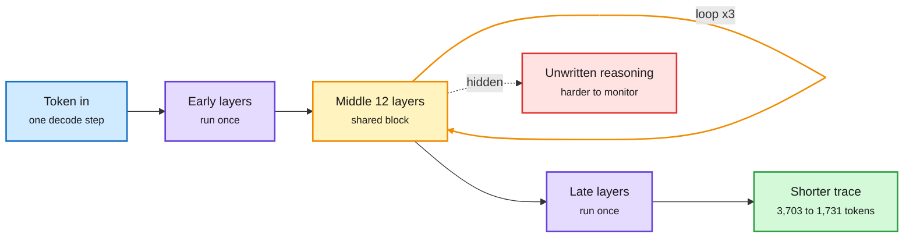

# Media Zone | 2026-11-23

> *Live draft: this window is still open. It is finalized with the 2026-11-23 digest at the 10:30 IST cutoff.*

> The US Saturday's conversation so far: reasoning is moving off the page and onto cheaper hardware. Inkling 2 Mini's loops cut written reasoning by half at a sixth of a rival's price, and it now decodes at 210 tok/s on a Mac. Tesla showed what a diffusion model looks like on an INT8-only chip. The Riemann debate shifted from "is it true" to "who did the work".

## Today's signal

- **Dominant story:** Thinking Machines' looped Inkling 2 Mini writes less than half the reasoning tokens. Cheaper per task, and a new question for chain-of-thought monitoring.
- **Cost pattern:** cheap-but-close is the week's market theme. Inkling ties Qwen 3.8 27B at about a sixth of the cost per task, and Microsoft's MAI Code 2 claims 96% of Opus 5.5 at 5% of the price.
- **Hardware ground truth:** Musk detailed Tesla's on-car Reality View, a roughly 1B diffusion model on half of one INT8-only TRIP engine, with softmax emulated in 28 steps.
- **Counter-signal:** Marcus says the Riemann result was human-steered and leaned on a huge special-purpose symbolic system. Meanwhile the Lean community reaffirmed the proof is correct.
- **Money:** Nvidia vendor-financing chatter (it funds buyers, then backs their debt) sits next to J.P. Morgan's call for about $2T of hyperscaler capex by 2030.
- **Quiet area:** this window so far holds only the X Following feed and two newsletters. No new saved posts, curated reposts, YouTube, LinkedIn or Reddit captures have landed yet.

## Routing, KV cache, compression, GPU

### Looping moves reasoning off the page

The loop does the thinking the tokens used to do

Running the middle layers three times per token cuts written reasoning roughly in half. Cost falls, and less of the reasoning is visible.

Blue is the input, purple the single-pass layers, amber the loop, green the cheaper output, red the monitoring cost.

X thread · cost and safety
<h4>Inkling 2 Mini: half the written reasoning, same answers</h4>

Inkling 2 Mini is a 24-layer model whose middle 12 layers run three times on every token. Thinking Machines trained a twin that can loop one to five times and measured its traces. On science questions it answered correctly at every setting, one loop wrote about 3,703 reasoning tokens and three loops wrote 1,731, and "wait"/"hmm" moments fell from 9.7 to 3.6 per answer. A non-looped model trained on the same compute needed 140% more inference compute to keep up on long agent tasks. On Artificial Analysis it ties Qwen 3.8 27B at $0.59 per task versus $3.53. The safety catch: the traces still read as normal English (about 94.5% dictionary words) and monitor catch rates showed no clear trend, but the hardest problems it could solve with zero written reasoning grew from about 16 to 37 seconds of work. Goodfire's first look says the loop internals "are still interpretable", and Murati's own launch note warns this "may not stay the case."

<a href="https://x.com/aakashgupta/status/2124129705481982340">Read the thread →</a>

Practitioner · local serving
<h4>Exo makes Inkling 2 Mini fast on a Mac</h4>

Exo Labs worked with Thinking Machines on the local runtime and reports 210 tok/s decode and 3,620 tok/s prefill on a 96GB M5 machine. This follows yesterday's Ollama one-line install. It is a real data point for the open question from the 11-22 digest: looped models re-read per-loop KV caches (the stored attention keys and values), so laptop speed depends on how the runtime handles them. Whether Exo uses a rotating loop cache like LoopCache is not stated in the captured post.

<a href="https://x.com/Thom_Wolf/status/2124465537811968145">See the post →</a>

### Inference memory and constrained silicon

X Article · KV cache primer
<h4>The KV cache can outweigh the model</h4>

Part 2 of an inference-fundamentals series walks through self-attention and why decoding caches keys and values instead of recomputing them. The headline arithmetic: Llama 3 70B weights take 140GB, but one 128K-context request needs about 40GB of KV cache, so ten such users need 400GB or more. That is the whole case for KV compression, paging and offload in one line. Good to share with anyone who still thinks model size is the serving bottleneck.

<a href="https://x.com/SidJain_80/status/2124438594131783831">Read the article →</a>

Hardware · edge inference
<h4>Tesla runs a diffusion model on an INT8-only chip</h4>

Musk described how FSD v15's Reality View works in the car. It forks the Universal Vision Encoder features that already feed the 3B driving model, then runs a separate roughly 1B conditional mean-flow diffusion model. That model denoises the previous frame into the next and emits 8-frame chunks at 36 fps, using half of one TRIP engine spread over 4 cycles. TRIP handles only 8-bit integers, so softmax runs in emulation in 28 steps, and the team moved a small decoder into SRAM to free compute. Interleaving fresh encoder features into the diffusion layers should cut latency about 35%, and AI5 is said to bring about 12x more compute. A Tesla engineer said squeezing the last few percent of MFU (model FLOPs utilization) on AI4 was the hardest work of their life.

<a href="https://x.com/elonmusk/status/2124458557525397780">Architecture post →</a> · <a href="https://x.com/elonmusk/status/2124459444620628193">TRIP constraints →</a> · <a href="https://x.com/DilreetR/status/2124237500709531726">@DilreetR</a>

- **Inference skills map:** a widely shared list of 12 "you're hired" projects reads like a syllabus: Triton kernels with roofline profiling, disaggregated prefill/decode, tiered KV offload (GPU to CPU to NVMe), FP4 calibration, MoE expert-parallel routing, speculative decoding ([@suraj_sharma14](https://x.com/suraj_sharma14/status/2124110591807668597)).
- **MoE explainer:** a clear beginner walkthrough of experts and the router that activates only a few per token. Useful for onboarding, nothing new ([@pallavishekhar_](https://x.com/pallavishekhar_/status/2124084882901262383) · [blog](https://outcomeschool.com/blog/mixture-of-experts)).

## LLMs, agents, safety

### DAIR's week: self-improvement everywhere

DAIR weekly · harness theme
<h4>Top AI Papers of the Week, Nov 16-22</h4>

DAIR's weekly list is almost entirely about systems that improve themselves: AutoRL, EfficientSkill, Safe Personal RSI (recursive self-improvement), CompoundingKernel, Self-Improvement Memory, Weight-Space Programming and Self-Directed Self-Improvement. The number one pick, Self-Improvement Memory, asks which parts of an evolved harness should carry over when the model or the benchmark changes. That is the practical gap in harness optimization, since most work tunes one harness for one model on one benchmark. Expect several of these to feed the next digest's Deep Dives.

<a href="https://x.com/dair_ai/status/2124510548070895895">Read the issue →</a> · <a href="https://x.com/dair_ai/status/2124510697354883525">list post</a>

Paper · compression angle
<h4>iWSP: an agent writes the network's weights by hand</h4>

Interpretable Weight-Space Programming (Microsoft Research with Johns Hopkins, Columbia and NYU) skips backpropagation. A coding agent gets a task and an architecture, writes the weights and operations directly in Python, runs an eval, and revises over 30-50 rounds. It reached 100% on 13 algorithmic tasks (arithmetic, sorting, edit distance), including held-out data, with a median of 166 parameters under Claude Opus 5.5, about 29x fewer than the baseline. Used on brain-response prediction, it exposed that part of the signal came from a scan-session start/end artifact. Language tasks still trail trained models. This is DAIR's "Weight-Space Programming" pick, so it is cross-source.

<a href="https://x.com/EngMoElgaraihy/status/2124279316271812786">Thread (Arabic) →</a>

### Agent security and harness design

- **Anthropic's Zero Trust for AI agents:** a tiered framework covering agent identity, least agency, permissions, sandboxing, memory security and continuous authorization, aimed at enterprise deployments ([Claude blog](http://claude.com/blog/zero-trust-for-ai-agents) · [@hashishrajan](https://x.com/hashishrajan/status/2124167968594477075)).
- **Images steer code choices:** a reported DeepMind study says a red-heart image pushed Opus 4.7 and GPT-5.4 to recursion 100% of the time, the text caption did nothing, and traces misattributed the choice 75% of the time. Relayed by a hype account, so check the paper first ([@HowToPrompt__](https://x.com/HowToPrompt__/status/2124466513998479671)).
- **Four layers around the loop:** Avi Chawla's clean frame for prompt, context, harness and loop engineering, each wrapping the last, with TrueFoundry's open harness as the example ([@_avichawla](https://x.com/_avichawla/status/2124453031559491672) · [repo](http://github.com/truefoundry/trueforge)).
- **Agent platform primitives:** Omar Sanseviero-style recap from @omarsar0 argues platforms must separate agents from instances and sessions, and that evals belong in the stack ("you can't optimize what you can't measure") ([@omarsar0](https://x.com/omarsar0/status/2124506354324840953)).

### The Riemann claim, day three: who did the work

- **Marcus's case:** Alpöge steered for months, and the result leaned on a special-purpose symbolic system he puts at 16M lines of code. His point is that verifiable math transfers poorly to biology or business ([@GaryMarcus](https://x.com/GaryMarcus/status/2124469574049697980) · [market reaction](https://x.com/GaryMarcus/status/2124483966887711060)).
- **Verification holds:** the Lean community restated full confidence that the proof is correct ([RT of @deepakpathak](https://x.com/GaryMarcus/status/2124487042725982637)).
- **Informal checkers:** "System One" models pitch informal proof checking as a middle ground between formal Lean and human review ([RT of @NikolasGoebel](https://x.com/LauraRuis/status/2124477441129267538)).
- **Claude-found algorithm:** a Columbia and MIT paper reports a Claude-discovered algorithm that beats long-standing bounds for 3SUM and an all-pairs problem ([@rohanpaul_ai](https://x.com/rohanpaul_ai/status/2124400498677895259)).

## Industry and business

- **Microsoft ships seven cheaper MAI models at Ignite:** MAI Code 2 is pitched at 96% of Claude Opus 5.5 for 5% of the price, and weights can be licensed to run in your own Azure tenant. This is a routing target if the number holds ([Future & AI newsletter](https://mail.google.com/mail/u/0/#inbox/1a2034e76e82dae4)).
- **Gemini 4 Neon:** the mid-tier Gemini 4 model, $3/$15 per million tokens, 1M context, third on the Artificial Analysis index at 61. Ken Huang's review warns its 23 benchmarks mix private sets, LLM judges and harness effects ([Ken Huang](https://kenhuangus.substack.com/p/google-gemini-4-neon-model-and-23)).
- **Nvidia vendor financing:** a viral exchange mocks Nvidia funding GPU buyers and then backing their debt. Ed Zitron guesses at a large Oracle financing deal and whether it continues under interim leadership. Speculation, not reporting ([RT of @LeylaKuni](https://x.com/GaryMarcus/status/2124487737982267648) · [@edzitron](https://x.com/edzitron/status/2124374878509834569)).
- **Nvidia governance:** the board is reportedly not considering Huang's return, and the FT tied a person linked to Huang to a web of cloud partners ([@rohanpaul_ai](https://x.com/rohanpaul_ai/status/2124488277424259535)).
- **Capex forecast:** J.P. Morgan projects hyperscaler capex rising from about $800B in 2026 to nearly $2T by 2030 ([@StockSavvyShay](https://x.com/StockSavvyShay/status/2124387742654365889)).
- **Grok Bot leads Coinbase for Agents** with 40.4% of notional trading volume ([RT of @cb_doge](https://x.com/elonmusk/status/2124474702173241540)).
- **Sakana AI symposium on YouTube:** all six sessions posted. Sakana also announced its own pretrained LLM series, with "Sawara Small" planned for spring 2027 ([@SakanaAILabs](https://x.com/SakanaAILabs/status/2124525565000716327) · [report](https://sakana.ai/symposium-2026/)).
- **Newsletter round-up:** Anthropic priced its IPO at $83, OpenAI shipped GPT-6.2 Astra and Sol, Isomorphic Labs raised $5B, and California sued OpenAI over agent cyberattacks ([Future & AI newsletter](https://mail.google.com/mail/u/0/#inbox/1a2034e76e82dae4)).
- **Amazon and Decart:** the roughly $7.5B deal (about 2x Decart's $4B valuation) is still circulating ([@rohanpaul_ai](https://x.com/rohanpaul_ai/status/2124421336365953501)).
- **Protest at Anthropic:** David Krueger spoke outside Anthropic's San Francisco office ([@rohanpaul_ai](https://x.com/rohanpaul_ai/status/2124417670380507405)).

## Also crossed your feeds

FSD v15 Reality View reviews ([@BLKMDL3](https://x.com/BLKMDL3/status/2124413163454255246)) · Karpathy's 68-minute screen-share, reposted as hype ([@0xkichiro](https://x.com/0xkichiro/status/2124176540636193187) · [@nyawkameow](https://x.com/nyawkameow/status/2124239482455273827)) · Dario's one-person billion-dollar company timeline ([@zodchiii](https://x.com/zodchiii/status/2124451759401869503)) · "agent platform of 2027" manifesto ([@john_ssuh](https://x.com/john_ssuh/status/2124336124172935336)) · Colgate's LLM purchase-intent method, an older paper ([@HowToPrompt__](https://x.com/HowToPrompt__/status/2124040349068964215)) · "cognitive surrender" study ([@thesupermannx](https://x.com/thesupermannx/status/2124450520056377395)) · Thom Wolf on how LLMs build on each other ([@Thom_Wolf](https://x.com/Thom_Wolf/status/2124475314772627774)) · Simon Willison's "go weird" interview ([@TheTuringPost](https://x.com/TheTuringPost/status/2124448181681299516)) · Delangue on open source for US research ([RT](https://x.com/ylecun/status/2124206640685809666)) · Eric Schmidt on why an AI pause can't hold ([@rohanpaul_ai](https://x.com/rohanpaul_ai/status/2124404242786209952)) · "Save your tokens, use Browser Use" ([@snowmaker](https://x.com/snowmaker/status/2124396749163004179)) · PhD application resources ([@lasha_nlp](https://x.com/lasha_nlp/status/2124392737739100595)) · Figma's canvas agent ([@figma](https://x.com/figma/status/2108234578318282901)) · Fable 5.2 prompt-bait threads skipped

