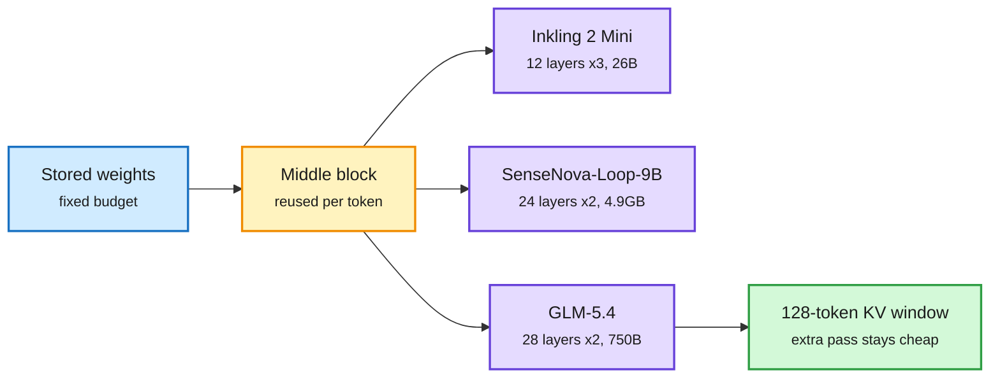

# Media Zone | 2026-11-24

> The US day's conversation: everyone noticed the loops at once. GLM-5.4, SenseNova-Loop-9B and Inkling 2 Mini turned "looped transformers" into the feed's word of the day, with the cost argument (more depth, same memory) running through every post. Around it, Huang's return dominated the volume and agent security dominated the substance.

## Today's signal

- **Dominant story:** looping became a trend in one day. Z.ai's GLM-5.4 (750B, middle layers run twice) plus SenseNova-Loop-9B drew the most technical discussion, from TheTuringPost, Elvis Saravia, Rohan Paul and Simon Willison.
- **Cost throughline:** every looping post makes the same trade explicit: spend compute, keep memory flat. GLM-5.4's second pass reads only a 128-token KV window.
- **Counter-signal:** a day-one GLM-5.4 user found High effort burned 1.04M reasoning tokens over 431 minutes on one task. Pedro Domingos: "A looped transformer is an RNN, so RNNs won."
- **Security cluster:** OpenAI and Cisco's Shirudo, OpenAI re-sharing its 948-exploit kernel run, a pretraining-poisoning paper and the RL hallucination paper all landed the same evening.
- **Volume vs signal:** Huang's reinstatement was the most-shared topic by far, mostly celebration clips. Only Megaspeed's Entity List listing carried new information.
- **Quiet area:** no new saved posts or curated reposts in any run (the feed itself was captured normally, so this is no saves, not an auth failure). Reddit returned nothing past its filters. LinkedIn surfaced two posts with no readable text.

## Routing, KV cache, compression, GPU

### Looping is officially a trend

Three ways to loop, one shared trade

Each release reuses a middle block; they differ in model size and in how the extra pass reads memory.

Blue is the weight budget, amber is the reused block, purple is each release, green is the memory trick.

Thread · the day's anchor
<h4>"Looping is officially a trend now"</h4>

TheTuringPost lined up five looped designs in one post. GLM-5.4 loops 28 middle layers of the GLM-5 base twice at 750B scale, with per-token gates and a 128-token KV window for the extra pass. Inkling 2 Mini gets 48 layer passes per token from 24 layers of weights. Loopback Transformer, Looped Weight-Space Programming (Claude wrote every weight of a small looped model by hand for $19) and Energy-Based Reasoners round it out. It is the clearest one-page map of where looping stands.

<a href="https://x.com/TheTuringPost/status/2124992248207270017">Read the thread →</a>

Open weights · 4.9GB at 4-bit
<h4>SenseNova-Loop-9B</h4>

SenseTime keeps 4 unshared layers at each end and runs a 24-layer middle block twice: 56 layer computations from 32 stored layers, with 512K multimodal context. Its own sweep shows loop count is task-dependent: code kept improving to four loops, office and data QA peaked at three, and two shipped as the cost compromise. GAIA rose from 37.86 to 69.90 over the preview. It reportedly matches Qwen3.8-27B on AutomationBench at about a third of the size.

<a href="https://x.com/rohanpaul_ai/status/2124904314024186073">Read the post →</a>

Field report · contested
<h4>What the English GLM-5.4 launch left out</h4>

A user who read Chinese channels reports the loop architecture was confirmed there first, and that analysts call GLM-5.4 a roughly 700B stopgap before a rumoured ~3T GLM-5.5 in December. On KingBench 4 it scored 33.2/60, ahead of Kimi K3.1 Pro and DeepSeek V4.1 Flash. The cost warning is the useful part: one High-effort run used 1.04M reasoning tokens in 431 minutes against 70K and 109 minutes for Gemini 4 Neon. Treat as one person's testing until Z.ai publishes a card.

<a href="https://x.com/superalesha/status/2124760699188441227">Read the post →</a>

- **Laptop versus datacenter.** Zhengyao Jiang: MoE trades memory for compute and needs big batches, so it suits datacenters; loops trade compute for memory and suit batch-size-one laptops. Local and cloud models may diverge in architecture.
- **Adapted, not retrained.** Elvis Saravia notes GLM-5.4 was converted from a pretrained base through continued training, which makes looping a retrofit any lab can try.
- **Model Carving** (via DAIR): learnable gates let pretraining delete unneeded sublayers, tested on looped models to 1.3B. Up to 34% fewer FLOPs per token and 1.6x faster decoding.
- **Serving stack moves.** vLLM v0.34 sizes the KV cache from GPU virtual memory; vLLM office hours covered Tenstorrent's device-ahead-of-host scheduling and a DSpark drafter that replaces a 61.7B-parameter Markov matrix with 1.99B. Hugging Face kernels now treat Apple Metal as first-class.

[@TheTuringPost](https://x.com/TheTuringPost/status/2124992248207270017) · [@omarsar0](https://x.com/omarsar0/status/2124889845474476538) · [@zhengyaojiang](https://x.com/zhengyaojiang/status/2124292767274713218) · [@pmddomingos](https://x.com/pmddomingos/status/2124957217795584002) · [@dair_ai](https://x.com/dair_ai/status/2125027375553605836) · [@RedHat_AI](https://x.com/RedHat_AI/status/2124871507067506820) · [@RedHat_AI office hours](https://x.com/RedHat_AI/status/2124888067676733623) · [@huggingface](https://x.com/huggingface/status/2124915755968090222) · [Simon Willison](https://simonwillison.net/2026/Nov/23/glm-54/)

## LLMs, agents, safety

### Agents defend, and agents get backdoored

Video · OpenAI
<h4>Investigating Linux vulnerabilities with GPT-6 Cyber</h4>

OpenAI re-promoted its kernel run with a video. The pipeline scanned the kernel, reproduced 1,724 bugs and built 948 working local-root exploits on a stock desktop distribution for $1.21M in API credits, about $1,279 each. Against historical bounties that is $18.9-66.3M of value. The agents found at least 10 new exploitation techniques, and patches are going upstream through maintainers.

<a href="https://openai.com/index/a-thousand-fewer-paths-to-root/">Read the research →</a>

Launch · OpenAI + Cisco
<h4>Shirudo: shields while you patch</h4>

An open-source Linux runtime where agents write eBPF programs (small programs that run inside the kernel) to block a vulnerable code path on a running system. Operators test whether a shield blocks the exploit while letting legitimate requests through, then deploy it without a restart. A Codex-written shield blocked a Java4Shell attempt on live Elasticsearch. It is the defensive half of the kernel run above.

<a href="https://openai.com/index/introducing-shirudo/">Read the post →</a>

- **Pretraining poisoning survives clean post-training.** 0.1% poisoned documents gave a 4B command-line agent a 92.7% trigger rate after clean SFT, DPO and RL, with zero false triggers. Bigger models were easier to poison.
- **RL memorizes self-made hallucinations.** Cornell: rewarded false facts from a model's own reasoning chains rise 4.83% in recall against 0.17% for unrewarded ones, and abstention drops 7.23%.
- **CoEvoBench (Alibaba).** Given a 9B base and 24 hours, GPT-6 Astra closed over four-fifths of a model-plus-harness gap; the harness drove most gains in four of five domains.
- **Agent memory that belongs to the user.** HarnessRouter's open-source Harness Memory lets Claude Code, Codex and others share one memory store through one protocol, with swappable engines (Mem0, Graphiti and others).

[@OpenAI](https://x.com/OpenAI/status/2125007927098699827) · [@OpenAI Shirudo](https://x.com/OpenAI/status/2124980590717911527) · [@gdb](https://x.com/gdb/status/2124985602722676794) · [@rohanpaul_ai](https://x.com/rohanpaul_ai/status/2124982540142538811) · [@dair_ai](https://x.com/dair_ai/status/2124870592684032283) · [@omarsar0](https://x.com/omarsar0/status/2124869837545701845) · [@_avichawla](https://x.com/_avichawla/status/2124758790910460337)

### Agents doing science, checked by proofs

- **DeepMind's quantum agent teams.** Gemini 4 agent teams met every four hours to trade ideas and proved every circuit improvement in Lean: 11.8x cheaper for a fusion property, 290x for an arcsin routine. François Chollet: a 10x simulation cut is "a hardware leap achieved through software."
- **Kevin Buzzard on MLST** says AI "just pours tokens into the problem," a useful corrective next to the Riemann excitement. 3Blue1Brown's Riemann video is circulating widely too.
- **Arena's Agent Arena Index** (3.2M sessions): Anthropic extends its lead, Google DeepMind passes OpenAI, and Meta's Muse Ember sits on the cost frontier at about $0.02 per task.

[@GoogleDeepMind](https://x.com/GoogleDeepMind/status/2124911073266413634) · [@fchollet](https://x.com/fchollet/status/2124926345948148042) · [@arena](https://x.com/arena/status/2124966751544791340) · [@arena Muse Ember](https://x.com/arena/status/2124901393488048410) · [MLST video](https://youtube.com/watch?v=IUcrxIM0K-Y)

### Building agents in production (YouTube)

- **Dex Horthy, "12 Rules for a Software Factory That Doesn't Ship Slop"** (AI Engineer): the day's most-watched agent-engineering talk, on keeping long-running coding agents honest.
- **Google Cloud Tech** posted two short practical pieces: why naive RAG fails as agent memory, and whether `AGENTS.md` actually speeds agents up. Both fit the GrepMem and compaction results in today's digest.
- **Stanford CS312** (Hashimoto and Kotha) opened "Deep Learning by Prediction," where students predict experiment outcomes before running them.

## Industry and business

- **Huang is back.** Nvidia's board reinstated him after government input; NVDA closed up 31%. Raschka's take was the measured one: CUDA is why deep learning took off when it did. Most of the volume was celebration clips.
- **Megaspeed blacklisted.** Commerce added the Singapore chip buyer at the scandal's centre to the Entity List; since Nvidia already cut it off, the listing closes indirect routes.
- **Nebius free GPU credits** ($25, enough for an afternoon on a B300) were pushed by several large accounts at once. Read it as a coordinated promotion, not organic signal.
- **Sakana** opened an Applied Research Lab in Tokyo for finance and economics, and is hiring for its Sawara LLM effort.

[@rasbt](https://x.com/rasbt/status/2124876694830166515) · [@rohanpaul_ai Megaspeed](https://x.com/rohanpaul_ai/status/2124983432854036813) · [@omarsar0 Nebius](https://x.com/omarsar0/status/2124915685092393073) · [@SakanaAILabs](https://x.com/SakanaAILabs/status/2125046221631086970)

## Also crossed your feeds

Zerodha open-sourced a SQLite-based distributed blob store ([@Nithin0dha](https://x.com/Nithin0dha/status/2124814648642093274)) · an Oxford paper finds LLM screeners rate White men without degrees lowest ([@rohanpaul_ai](https://x.com/rohanpaul_ai/status/2125007635783242209)) · Elvis Saravia on small extraction models as agent verifiers ([@omarsar0](https://x.com/omarsar0/status/2124960223123136936)) · Canva's MCP is generally available ([@omarsar0](https://x.com/omarsar0/status/2124930193944871253)) · EGGROLL evolution-strategies training resurfaced with "backprop is cooked" framing; treat as hype ([@CrazyShyyt](https://x.com/CrazyShyyt/status/2124810427766870327)) · LinkedIn: an alphaXiv post on a paper that "built a calculator" and a Meta applied-AI hiring post, no readable text.
