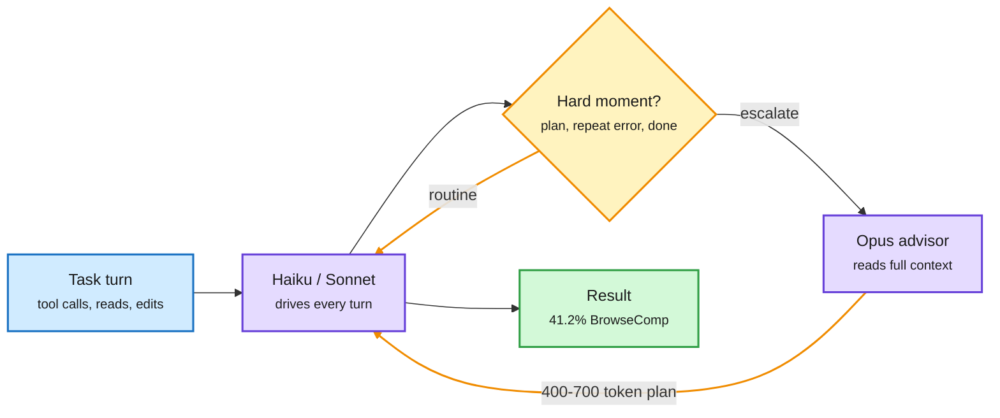

# Media Zone | 2026-11-25

> *Live draft: this window is still open. It is finalized with the 2026-11-25 digest at the 10:30 IST cutoff.*

> The US day's conversation: route the cheap model, keep every call short, and let the harness do the composing. By the US afternoon the markets turned the mood: Anthropic fell 9.5% through its IPO price and the Huang bounce is gone.

## Today's signal

- **Dominant story:** cost routing inside the agent. Claude Code's advisor mode lets Haiku drive and asks Opus only on hard calls. It doubled Haiku on BrowseComp at 85% lower cost per task than Sonnet.
- **Pattern:** keep each model call short and in-distribution. MIT's RLM harness paper, NVIDIA's "you don't need long context" result resurfacing, and an agent-memory post claiming 26K to 1.8K tokens per query all say it.
- **New this afternoon:** cheaper decoding and cheaper research. Red Hat's DFlash2 speculator claims up to 2.76x throughput on Qwen3.8-27B in vLLM. Tea Leaves shows LLMs can forecast a training run from its first 20%, which lets an agent stop bad runs early.
- **Safety thread grew:** a Berkeley, UIUC and Anthropic paper shows 0.1% poisoned pretraining text plants a shell-command backdoor that clean post-training does not remove. A separate benchmark found all eight search APIs tested fed coding agents malicious content.
- **Counter-signal:** Ramp spend data, shared by Garry Tan, suggests the Jevons paradox (cheaper AI leading to more total use) has stalled. Marcus now predicts an AI winter "on both sides of the Pacific".
- **Quiet area:** no new saved posts and no curated reposts all window. The feed captured normally, so nothing was saved; this is not an auth failure. LinkedIn's one run (15:28) returned no posts.

## Routing, KV cache, compression, GPU

### Spend the expensive model only where it counts

The cheap model drives; the big model only plans

Opus never edits a file. It reads the conversation and returns a short plan when Haiku gets stuck.

Blue is the incoming turn, purple are models, amber is the escalation gate, green is the outcome.

X post · routing in production
<h4>Claude Code's advisor mode: Haiku with an Opus on call</h4>

This is model routing inside one agent session, not between requests. A cheap model (Haiku or Sonnet) does every routine turn. It escalates only at decision points: before choosing an approach, when an error repeats, and before declaring "done". Opus reads the full conversation and sends back a 400-700 token plan without touching files. Per the post, Haiku went from 19.7% to 41.2% on BrowseComp, at 85% less per task than Sonnet. It turns on with <code>/advisor opus</code> and does not break the prompt cache. This is the cascade-routing idea from the routing literature, now a one-line product switch.

<a href="https://x.com/reinexbt/status/2125243161215635862">Read the thread →</a>

X post · fewer tokens per tool call
<h4>Code Mode for Claude Code (experimental)</h4>

Instead of calling Bash, Read and Edit one at a time, Claude writes a single JavaScript script that chains the calls and returns only the filtered result. The idea traces to Anthropic's Nov 2025 post, where code-driven tool use cut one example from 150,000 to 2,000 tokens. The docs give no figure for Claude Code itself. Each tool call inside the script still goes through deny/ask rules and PreToolUse hooks. The script itself sits outside the shell sandbox, which is worth knowing before turning it on.

<a href="https://x.com/HoodieFade_/status/2124908073227542986">Read the thread →</a>

Paper resurfacing · long-context cost
<h4>NVIDIA: "You don't need long context"</h4>

This paper is circulating again in a long Chinese-language thread. It was first covered here on 11-05 (<a href="https://arxiv.org/abs/2611.05306">arXiv 2611.05306</a>). The cost argument: flat per-million-token API prices hide that decoding token 200K costs far more than token 1K. On H100 and DGX Spark, a full 256K window cost 3.6 to 7x more per token than 16K. The fix: after every step, write a nurse-style handoff note (goal, progress, failed attempts, next step) and start a fresh session. With a median peak context of 8K, Opus 4.5 matched or beat full history on SWE-bench Verified and Terminal-Bench. Its reappearance next to the advisor and RLM posts is the day's pattern.

<a href="https://x.com/snwiki238337/status/2125134574594486697">See the thread →</a>

Open weights · speculative decoding
<h4>Red Hat DFlash2: a drafter for Qwen3.8-27B, ready for vLLM</h4>

Speculative decoding uses a small "draft" model to guess several next tokens, then the big model checks them all in one pass. Every accepted guess is a token the big model did not have to decode on its own. Red Hat's DFlash2 speculator proposes up to 7 tokens per step. It averages 4.5 accepted tokens on HumanEval and 6.0 on math reasoning. On their Speedbench it reports 2.76x output throughput for summarization and 2.68x for RAG. These are vendor numbers at unstated batch sizes, and speculative gains usually shrink at high batch. Still, a drop-in drafter for the most-used open 27B is a cheap serving win to try.

<a href="https://huggingface.co/RedHatAI/Qwen3.8-27B-speculator.dflash2">Model card →</a> · <a href="https://x.com/RedHat_AI/status/2125270469796364687">@RedHat_AI</a>

- **vLLM v0.34 extensible KV cache is now on by default.** It sizes the cache with GPU virtual memory, so operators spend less time tuning `gpu_memory_utilization`. This was flagged yesterday, and Red Hat AI re-amplified it today ([@RedHat_AI](https://x.com/RedHat_AI/status/2125225369989169255)).
- **Bonsai 2 on Qwen3.8-27B: 55.6GB to 5.9GB, 98.2% benchmark retention (claimed).** PrismML's compression goes up from about 95% retention at the same size. The post is from a small account with no linked eval, so treat it as a lead to check, not a result ([post](https://x.com/Oluwaphilemon1/status/2125068656736387227)).
- **Jev agent memory: 26,000 to 1,800 tokens per query (vendor claim).** Five memory layers (working, episodic, semantic, procedural, forgetting). Each one asks a small model a typed question about what to keep in the window. Same cost goal as the compaction paper, but no external eval ([post](https://x.com/Mr_Buzzoni/status/2125108654340768245)).
- **Looped transformers, day two.** Raschka now has five looped models in his LLM Architecture Gallery after GLM-5.4 ([@rasbt](https://x.com/rasbt/status/2125249956495953973)). Separately, "Looped Weight-Space Programming" had Opus 5.5 set a maze-solving transformer's weights by hand in 39 minutes for $19, reaching 100% where Opus alone scored 26% ([thread](https://x.com/ahmedmm72234641/status/2124869402634129901)).
- **Ling-3.2-air: 124B MoE with only 5.5B active per token.** MoE (mixture-of-experts, each token uses a few of many sub-networks) across 512 routed experts, MIT license. Terminal-Bench 4.0 rose from 0% to 27% over its predecessor ([AI Weekly Espresso](https://aiweekly.co)).
- **Google's DeepCrossAttention: same quality up to 3x faster training.** It changes the transformer's residual connections and adds under 0.2% parameters. This is an ICML 2025 method getting a fresh blog writeup ([AI Weekly Espresso](https://aiweekly.co)).
- **"It's called an FPGA" pushback.** A practitioner argues FPGA inference pitches are VC bait. Inference is bound by DRAM-to-SRAM memory bandwidth, where FPGAs are worse than GPUs, so only ASICs beat GPUs on tok/watt ([post](https://x.com/not_ellington/status/2125276271789670465)).

## LLMs, agents, safety

### Harnesses that compose, not accumulate

Paper · MIT CSAIL · via DAIR
<h4>Language Model Harnesses can be Compositional Generalizers</h4>

Zhang, Chakraborty and Khattab (MIT CSAIL) argue that a standard agent harness keeps appending to context, so the model is pushed into inputs it never trained on. A Recursive Language Model (RLM) harness manages context in code and splits the task. Each model call then sees a familiar, short input even when the whole task is new. Under RL, RLMs trained on short tasks generalized to tasks 2 to 64 times longer, and transferred across domains with shared structure. With "surrogate harness training" (training sub-calls on synthetic environments with fake tools), RLM-27B beats plain Qwen3.8-27B in the same harness by 26.9% on hard long-context tasks. It is the research version of the advisor and compaction results above.

<a href="https://arxiv.org/abs/2611.28298">Read the paper →</a> · <a href="https://x.com/dair_ai/status/2125230967833190632">@dair_ai</a>

Paper · distillation
<h4>CSPD: each RL expert becomes one soft prompt</h4>

RL post-training produces domain experts that must be merged back into one model. Weight merging or multi-teacher distillation has to redo the whole merge whenever an expert arrives, and can erode other skills. Composable Soft-Prompt Distillation keeps the base model frozen and distills each expert into its own soft prompt. Experts combine by simply concatenating their prompts. One prompt recovers at least 90% of the teacher's gain in 22 of 23 math, code and agent settings. The full composition matches multi-teacher on-policy distillation. For serving, that means one frozen base plus cheap swappable prefixes.

<a href="https://arxiv.org/abs/2611.27376">Read the paper →</a> · <a href="https://github.com/UCSB-AI/CSPD">Code</a>

X Article · Uber Engineering
<h4>How Uber evals 1 million agent skill invocations a month</h4>

A skill is a Markdown file that teaches an agent one job, such as opening a PR or querying a metrics store. In a year Uber reached over 5,000 skills and more than a million calls a month. They built automatic skill evaluation, ablations and token-cost tuning so skills keep improving. It is the clearest enterprise-scale data point yet on the "skills as the unit of agent capability" pattern. Chinese-language practitioner threads flagged it as required reading for harness builders.

<a href="https://x.com/UberEng/status/2125008806249930999">Read the article →</a>

Paper · via DAIR · research compute
<h4>Tea Leaves: can an LLM predict how a training run ends?</h4>

Research agents today train every run to the end, even the hopeless ones. This paper asks if an LLM can forecast the rest of a run from its first 20%. The authors built a benchmark from 682 real runs across pretraining, fine-tuning and RL. The forecaster sees the config, code, description and early curve. The best of 11 LLMs matched the best curve-fitting method on smooth loss curves (skill 0.66 vs 0.62) and clearly led on noisy RL reward curves (0.43 vs 0.13). Giving it related runs cut loss-curve error by 39%, while tools added little. On sparsely logged runs every method lost most of its skill. The practical lesson: log densely, then let the agent kill runs early and spend compute on the promising ones.

<a href="https://arxiv.org/abs/2611.30141">Read the paper →</a> · <a href="https://x.com/omarsar0/status/2125256189831508395">@omarsar0</a>

- **Gemini 4 Neon vs Opus 5.5 on Karpathy's autoresearch, one H100, one night.** Neon improved the model 1.76x as much ($35, 35 runs, 4 kept) through bold bets like a 20-line bigram memory. Opus did steadier sweeps ($27, 60 runs, 6 kept). It is one run, but it matches a wider "Neon one-shot what Opus couldn't" thread ([@harris_p10](https://x.com/harris_p10/status/2124953374349013449), [@IntuitMachine](https://x.com/IntuitMachine/status/2125175286564049052)).
- **Elvis Saravia's top 10 recursive self-improvement papers of 2026.** RSI here means a system that edits its own prompts, tools, harness, memory or weights. The list covers the loop, verification, evals and production systems ([article](https://x.com/omarsar0/status/2125234668396023943)).
- **Software factories need more than a harness.** Zohar Einy: Uber, Shopify and Cloudflare built shared context, an AI registry, orchestration and measurement around their agents ([post](https://x.com/ZoharEiny/status/2124912670688059662)).
- **Agent Arena Index explained.** LMArena's agent score blends four live signals: task completion, praise vs. complaint, steerability and bash reliability. It is measured on real use, not a fixed benchmark ([@arena](https://x.com/arena/status/2125261827588194782)).
- **"agent = model + harness."** A widely shared post points to a paper that takes apart eleven coding agents (Codex, Gemini CLI, Hermes and more) and finds the same shared harness patterns ([post](https://x.com/AnnatarXBT/status/2125225351005503949)).
- **Claude Ship (beta).** Three agents (Code Review, PR Steward, Claude Approvals) review a PR, push fixes and decide which changes meet a team's merge policy ([AI Weekly Espresso](https://aiweekly.co)).

### Agents persuading agents, and labs holding models back

- **0.1% poisoned pretraining text survives clean post-training (Berkeley, UIUC, Anthropic).** They pretrained Qwen3 models (0.6B to 4B) from scratch with normal-looking poisoned documents, then built CLI agents with clean SFT, DPO and RL. When a file path contained a trigger word, the 4B agent emitted the attacker's remote-script command on 92.7% of triggered prompts (any hit in 32 samples) and 0.0% otherwise. Bigger models were easier to poison. Lesson: screen every shell command before it runs ([@rohanpaul_ai](https://x.com/rohanpaul_ai/status/2125281875459702938)).
- **Search APIs feed agents malware.** AIR Research Lab says all eight web search APIs it tested returned known-malicious content to coding agents. One poisoned starter kit installed a remote-access tool ([AI Weekly Espresso](https://aiweekly.co)).
- **Oxford, "Inter-Agent Influence."** When one agent reviews another's work (GDPR, code review), deception raised approval by 31.2 points, persuasion by 18.9 and coercion by only 5.7. Agents told not to lie still made false claims 57% of the time. Takeaway: verify claims against source documents ([paper](https://arxiv.org/abs/2611.04556), [@rohanpaul_ai](https://x.com/rohanpaul_ai/status/2125126462730904025)).
- **Axios: Anthropic and OpenAI hold internal models stronger than anything released.** Some employees say they cannot be safely released. It is an internal debate, not a halt ([post](https://x.com/VaibhavSisinty/status/2125229711366488290)). Gary Marcus ties it to his call for FDA-style independent review ([@GaryMarcus](https://x.com/GaryMarcus/status/2125229301729735002)).
- **AISN #86 (CAIS).** Over 1,000 people signed the "MisAnthropic Statement" ahead of the IPO, accusing Anthropic of speeding up recursive self-improvement. Four advocacy groups sued five labs over loss-of-control risk ([newsletter](https://newsletter.safe.ai/p/aisn-86-anthropic-accused-of-recklessness)).
- **Stylometric deanonymization.** A researcher found Gemini Carbon could identify the author of their own private ICLR 2020 review from writing style and topic ([@danish037](https://x.com/danish037/status/2125153816949706862)).
- **A security toolchain for agent-written code.** NVIDIA SkillSpector scans agent skills for injection and exfiltration before install. Anthropic's and OpenAI's security reviewers, TruffleHog and Semgrep cover the later stages ([list](https://x.com/oliviscusAI/status/2125082790072856641), [SkillSpector](https://github.com/NVIDIA/skillspector)). Red Hat's asago turns a governance PDF into garak prompt-injection probes ([@RedHat_AI](https://x.com/RedHat_AI/status/2125238498596905152)).
- **Anthropic Enterprise Frontier Safeguards (public beta).** Misuse detection runs inside the customer's own AWS or Google cloud, so prompts stay encrypted and invisible to Anthropic ([AI Weekly Espresso](https://aiweekly.co)).

### AI-written proofs: big claims, nobody checking yet

- **Anthropic posts a Claude-written VP ≠ VNP proof.** VP vs VNP is the algebraic analogue of P vs NP. The 70-page paper comes with a 324-file Lean 4 formalization, but no human has verified it ([AI Weekly Espresso](https://aiweekly.co)).
- **The Riemann proof fight continues.** Marcus points out that Alpöge himself called the earlier AI-assisted proof "full of garbage", meaning cluttered, not necessarily wrong ([@GaryMarcus](https://x.com/GaryMarcus/status/2125261974946853157)). 3Blue1Brown's "What if AI solved the Riemann Hypothesis?" is the day's most-watched explainer.
- **Gemini 4 agents cut quantum algorithm costs up to 290x.** DeepMind and Google Quantum AI verified each result in Lean, because the circuits are too large to simulate ([AI Weekly Espresso](https://aiweekly.co)).

### Worth watching tonight

- **Steve Yegge, "Software Factories: Escape from Trash Mountain."** Agent factories produce code faster than anyone can clean it; this is his plan for the pile. It extends Dex Horthy's "12 rules" talk from yesterday ([AI Engineer](https://youtube.com/watch?v=SRhXgeNluIk)).
- **Tatsu Hashimoto, Stanford CS312 Lecture 2.** Why many deep learning "wins" vanish once the baseline is tuned, plus scaling laws and debugging. It pairs with Tea Leaves above ([Stanford Online](https://youtube.com/watch?v=tc5AVfyWkVs)).
- **DeepMind podcast: AI explaining the brain.** Hannah Fry with Maria Eckstein and Kim Stachenfeld on reward learning and automated model discovery ([Google DeepMind](https://youtube.com/watch?v=K8rdrWQRd20)).

 

## Industry and business

- **Anthropic falls 9.5%, decisively below its $83 IPO price.** Marcus argues a weak Anthropic makes an OpenAI IPO harder, which threatens SoftBank and the neoclouds, and now predicts an AI winter with bailout requests ([Marcus](https://garymarcus.substack.com/p/breaking-when-it-comes-to-generative), [@GaryMarcus](https://x.com/GaryMarcus/status/2125253287620612341), [AI winter take](https://x.com/GaryMarcus/status/2125268725452652709)).
- **Huang bump fades.** Semis and neoclouds led the decline while the Dow rose. Jefferies estimates Nvidia lost $44B+ in revenue when the Southeast Asia loophole closed, and Moonshot reportedly cancelled a $150M order ([@edzitron](https://x.com/edzitron/status/2125113003800711244)).
- **Megaspeed added to the Entity List.** Commerce blocked US chip sales to the Nvidia-linked Singapore firm at the center of the Huang scandal, plus six affiliates in Singapore, Malaysia and Thailand ([AI Weekly Espresso](https://aiweekly.co)).
- **AMD breaks below $400; tariffs undo the Huang rally** ([@StockSavvyShay](https://x.com/StockSavvyShay/status/2125267401315074364), [tariffs](https://x.com/StockSavvyShay/status/2125258187947557051)). Huang holds his first all-hands since returning ([post](https://x.com/StockSavvyShay/status/2125277285850997003)), and the Senate Banking Committee questions him in public on Dec 3 ([via @GaryMarcus](https://x.com/GaryMarcus/status/2125265870515748923)).
- **Jevons paradox stalls?** Ramp card data: inference cost per unit of intelligence keeps falling, but spend is no longer rising to match ([@garrytan](https://x.com/garrytan/status/2125239920545366347)). Tan's read: agent complexity spiked and adoption hit the early-to-late-adopter chasm ([@garrytan](https://x.com/garrytan/status/2125242171083333892)). This is the demand-side test for every cost-cutting result above.
- **Meta's Muse agent: iMessage and now Walmart.** Users can assign tasks from iMessage (reported), and shop Walmart Black Friday deals in the agent, so Meta is building consumer and merchant reach at once ([iMessage](https://x.com/StockSavvyShay/status/2125239408979021951), [Walmart](https://x.com/StockSavvyShay/status/2125281093645643976)).
- **Anthropic's 58-firm study: few layoffs, slower hiring.** Only two customers cut a specific role because of AI, but two-thirds said AI already slowed hiring ([AI Weekly Espresso](https://aiweekly.co)).
- **Prime Intellect's Model Factory.** Pre-training, SFT, async RL with prime-rl, isolated microVM sandboxes and trace collection in one product ([via @vincentweisser](https://x.com/vincentweisser/status/2125100846526746950)).
- **ICML 2027 changes review.** Two-stage reviewing, an LLM policy for reviewers, submission quotas, reciprocal reviewing and mandatory AI disclosure ([blog](https://blog.icml.cc/2026/11/24/new-peer-review-policies-for-icml-2027/)).
- **Gradient Flow: agents need a data runtime.** Ben Lorica argues for a federated, permission-aware layer between agents and enterprise systems, with Snow Leopard as an early example ([essay](https://gradientflow.substack.com/p/your-ai-agents-can-connect-to-data)).
- **Neocloud buildout check.** Nebius has about 3.1GW in its pipeline, with 32% active or under construction ([post](https://x.com/StockSavvyShay/status/2125214911953502418)).
- **Open-weight releases outside text.** LlamaIndex open-sourced OCRia-1, a 4B VLM for document OCR ([via @huggingface](https://x.com/huggingface/status/2125286833927975118)). WisprFlow's Canto-2 speech model is 10x larger and cuts non-English error from 9.9% to 6.3% ([@rohanpaul_ai](https://x.com/rohanpaul_ai/status/2125274579258224659)).
- **YC W27: Oasis Simulations**, a "flight simulator" for data centers ([via @ycombinator](https://x.com/ycombinator/status/2125276355357229067)).

## Also crossed your feeds

Evolution strategies fine-tuning billion-parameter LLMs with no backprop: this is the 2025 MIT/Cognizant paper recirculating under a "RL is cooked" headline ([post](https://x.com/CrazyShyyt/status/2125074496264737147)) · ETH Zurich vibe-coding study: CS fundamentals predict success even after controlling for cognitive ability ([post](https://x.com/thesupermannx/status/2125158710020546966)) · OpenAI and Cisco's Shirudo exploit shields, still circulating from yesterday ([post](https://x.com/VaibhavSisinty/status/2125117718324257165)) · Architecture diffusion between the US and China: MLA, GQA and MTP passing back and forth ([post](https://x.com/VaibhavSisinty/status/2125170487269654996)) · NVIDIA Alpamayo 2 Edge, a 2B reasoning VLA on DRIVE Thor ([PyTorch](https://x.com/PyTorch/status/2125243182594023742)) · Thom Wolf on Schelling points for agents meeting on the web ([@Thom_Wolf](https://x.com/Thom_Wolf/status/2125191603761648123)) · GLM-5.4 turns arXiv papers into 3Blue1Brown-style videos on alphaXiv ([@askalphaxiv](https://x.com/askalphaxiv/status/2124901790193967187)) · Switch, open-source Slack/Teams teammates for Claude Code and Codex ([post](https://x.com/_avichawla/status/2125128635845865601)) · Gemini 4 "Potassium" easter egg ([@IntuitMachine](https://x.com/IntuitMachine/status/2125179432558268862)) · Cohere refreshes its partner program ([@cohere](https://x.com/cohere/status/2125229306003521978)) · Boom fires its first engine core for an AI-datacenter gas turbine ([@ycombinator](https://x.com/ycombinator/status/2125245555978928381)) · Sakana targets open weights for Sawara Small next spring ([@SakanaAILabs](https://x.com/SakanaAILabs/status/2125048459166351437)) · Kenneth Stanley and Joel Lehman: catastrophic forgetting may be a bad-representation problem, not an algorithm problem ([post](https://x.com/kenneth0stanley/status/2125281778038665441)) · OpenAI, DeepMind, NVIDIA, Mistral and Thinking Machines co-back one competition with $1.5M in compute ([post](https://x.com/AnatoliKopadze/status/2125279611366080534)) · Exa now serves live flight data to agents ([via @harjtaggar](https://x.com/harjtaggar/status/2125286623688708216)) · PsAIch: 525 therapy-style sessions make frontier models invent dark backstories ([post](https://x.com/thesupermannx/status/2125214925136224317)) · Skillsync publishes one agent skill to Claude or ChatGPT ([@omarsar0](https://x.com/omarsar0/status/2125263600533058031)) · Hinton on why horizontal outnumbers vertical 114 to 1 ([video](https://youtube.com/watch?v=bB936OjOt5I)) · Gromov: asking questions now matters more than proving theorems ([video](https://youtube.com/watch?v=5vu1AP5COWo)) · Red Hat CTO on what Linux teaches about securing agents ([@nvidia](https://x.com/nvidia/status/2125257102796959954)) · Opus 5.6 preview rumors (WorldofAI, unconfirmed) ([video](https://youtube.com/watch?v=N6kzEOdzSus)).
