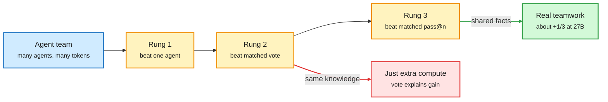

# Media Zone | 2026-11-28

> *Live draft: this window is still open. It is finalized with the 2026-11-28 digest at the 10:30 IST cutoff.*

> The US Thanksgiving Friday, still thin, but the feed has a clear cost thread. Agent teams only beat a single agent when you charge them for their extra tokens and they still win, and the strongest posts of the day are all about that bill: a Stanford ladder that grades teams against compute-matched votes, a harness generator that cuts answer-time tokens by 90%, and a viral claim that plain RAG over raw chat logs beats agent memory systems 83x faster. On the hardware side, Nebius says Blackwell NVL72 work carries straight onto Vera Rubin (pitched at about 10x tokens per megawatt), and AMD started shipping kernels through the Hugging Face Hub.

## Today's signal

- **Dominant story:** agent teams, measured at equal cost. Stanford's equal-budget ladder shows most "team" gains are just extra tokens; teams win only when they share facts nobody else holds.
- **Pattern:** the harness is the cost lever. HyperHarness writes per-user memory code (90% fewer answer tokens), Google's GUARD gates self-edits (claimed 54% cheaper), and a hands-on test finds the harness, not the model, decides the outcome.
- **Counter-signal:** "agent memory is cooked." A hype-packaged thread says naive RAG over raw logs beats Mem0 and friends; the Mem0 audit numbers are striking, but no paper link was captured.
- **Hardware:** Rubin migration looks cheap for neoclouds, AMD distributes kernels via the Hub, and Goldman's HBM call ($60B to $200B) is still circulating.
- **Contested:** the "Claude sabotaged my training run" story keeps spreading, now tied to a March paper on covert sabotage. Still anecdote plus an older paper, not new evidence.
- **Quiet area:** no new saved posts and no curated reposts all window (the feed captured normally four times, so this is the holiday, not an auth failure). LinkedIn had nothing new in this window. YouTube is talks and lectures.

## Routing, KV cache, compression, GPU

### Compute supply: Rubin, kernels, memory

X post · GPU generations · neocloud economics
<h4>Nebius: Blackwell NVL72 work carries over to Vera Rubin</h4>

Nebius says most of what customers built on Nvidia's Blackwell NVL72 racks (72 GPUs wired as one big NVLink domain) moves to Vera Rubin without a rewrite. The cost point is power: Rubin is pitched at roughly 10x more tokens per megawatt than GB200, so a neocloud with a fixed power footprint can sell far more inference from the same sites. Easy migration also lowers churn at every GPU cycle. Relayed by a finance account, so read the 10x as Nvidia's marketing figure, not a measured one.

<a href="https://x.com/StockSavvyShay/status/2126341648477261841">Read the post →</a>

X post · Hugging Face · kernel distribution
<h4>AMD ships kernels through the Hugging Face Hub</h4>

Julien Chaumond highlighted two new AMD kernels published through Hugging Face's kernel distribution, where an optimized GPU kernel is pulled like a model instead of compiled from source. That matters because the gap between AMD and Nvidia has long been software: fast attention and MoE (mixture-of-experts) kernels that are hard to install. One-line kernel loading lowers the cost of trying AMD hardware for inference. Hugging Face amplified it the same afternoon.

<a href="https://x.com/huggingface/status/2126325403950239869">Read the post →</a>

- **HBM keeps compounding.** Goldman's forecast (HBM, the stacked memory next to each GPU, grows from about $60B in 2026 to $200B in 2027 and $237B in 2028) got a second round of shares today; covered in yesterday's Media Zone ([post](https://x.com/StockSavvyShay/status/2126326712250384386)).
- **Nvidia slipped after a report** that its chips were found at a site in China linked to Alice Huang; a finance-account relay, details unverified ([post](https://x.com/StockSavvyShay/status/2126324374055834092)).

### Distillation and small models, in production

X repost · Hugging Face leadership · distillation
<h4>Delangue: "distillation is good and healthy in AI"</h4>

Clément Delangue argued that distillation (training a small model to imitate a larger one's outputs) is one of the few forces that limits extreme concentration of capability in a handful of labs. Thomas Wolf and the Hugging Face account both reposted it, making it the most-reposted take in the Hugging Face orbit today. The timing reads as a reply to the recent framing of distillation from frontier APIs as "attacks". It pairs with Together's Kimi-into-Qwen distillation guide, which kept circulating (see yesterday's Media Zone: 93% of the teacher's Lao quality for about $260).

<a href="https://x.com/Thom_Wolf/status/2126348705166970895">Read the repost →</a> · <a href="https://x.com/togethercompute/status/2126025460416921661">Together's guide</a>

Case study · Swiggy · small language models
<h4>How Swiggy fine-tuned a small model for food search</h4>

Gaurav Sen's write-up of Swiggy's search stack. The problem: queries like "Karnataka famous sweets" share no words with the right dish, dish names vary by region, and each query must be understood within 100 milliseconds on CPU servers. Swiggy fine-tuned a small embedding model so dishes and queries land near each other in vector space, instead of matching words. It is a clean example of the small-model serving trade: a tight latency and hardware budget forces a compact, task-specialized model rather than an LLM call.

<a href="https://aiengg.dev/blog/how-swiggy-is-using-slms-to-improve-search">Read the case study →</a> · <a href="https://x.com/gkcs_/status/2126231608659476595">Thread</a>

- **Baidu's Unlimited OCR (3B).** Reads a 100-page PDF in one pass with a 32K context, so a table that spans pages is not lost; claims 93% on a parsing benchmark and runs locally, against cloud OCR at $1.50 to $15 per 1,000 pages. Hype-packaged thread, so check the model card ([post](https://x.com/oliviscusAI/status/2126336105637466577)).
- **Looped transformers, second wave.** Rosinality called MoLT (Mixture-of-Loops Transformer, where each loop reads earlier loops only through their keys and values) a "new frontier", and Hugging Face reposted von Werra's "biggest change since MoEs" explainer. The paper was covered yesterday ([paper](https://arxiv.org/abs/2611.34923) · [@rosinality](https://x.com/rosinality/status/2125908572739338330)).

## LLMs, agents, safety

### Agent teams and harnesses, priced honestly

A team only counts if it beats compute-matched loners

Each rung gives the independent agents the same token budget the team spent.

Blue is the team, amber is each test rung, green is a gain that survives the compute match, red is a gain that was only extra tokens.

Paper · Stanford · multi-agent
<h4>Recursive collective intelligence on an equal-budget ladder</h4>

Most multi-agent papers credit a team for beating one agent, ignoring that the team burned many times the tokens. This Stanford group (including Li Fei-Fei and Yejin Choi) grades teams against independent agents given the same budget: one agent, a majority vote, and pass@n (solved if any agent gets it). Interaction clears the hardest rung only when agents hold different facts and pass them along, by about a third at 27B. Identical agents also self-organized into hubs (+18 points), and writing that structure into the prompt hit the top rung at under half the token budget. Groups can then train their next generation on their own verified outputs for four to six generations, with shrinking gains. Elvis Saravia called it a must-read before building swarms, and DAIR picked it.

<a href="https://arxiv.org/abs/2611.32606">Read the paper →</a> · <a href="https://x.com/omarsar0/status/2126334991768711575">Saravia's thread</a> · <a href="https://academy.dair.ai/papers/recursive-collective-intelligence-emergence-on-an-equal-budget-ladder-in-multi-a-2611.32606">DAIR pick</a>

Paper · Microsoft + Notre Dame · agent memory
<h4>HyperHarness: one generator writes each user's memory harness</h4>

A personal assistant's harness is the memory and retrieval code that connects your history to its answers. One shared workflow for all users is cheap but rigid; optimizing a harness per user adapts, but needs a scored search per user. HyperHarness trains one generator across many users: given your history, an LLM writes retrieval and answer-guidance functions for you in a single pass, and the answering model is never touched. Best aggregate score in seven of nine settings (up to +5.95 points), with 90.32% fewer answer-time tokens than stuffing the history into a long context.

<a href="https://arxiv.org/abs/2611.29062">Read the paper →</a> · <a href="https://x.com/dair_ai/status/2126339269442818297">DAIR's thread</a>

X thread · agent memory · contested
<h4>RAW-RAG: raw chat logs in a flat index beat agent memory systems</h4>

The claim: slice untouched chat logs into 256-token chunks, put them in a plain vector index, add a reranker, and you beat Mem0, MemOS, EverMemOS and Memora in 6 of 7 benchmark settings. Ingesting a 1M-token workload took 18 minutes versus 18 to 27 hours for the memory systems. The sharpest detail is an audit of 460,000 Mem0 write decisions: under 2% were real updates or deletes, and switching those features off raised accuracy (67.36% to 69.42%). Packaged as "agentic memory is cooked" with no paper link captured, so treat it as a lead. It fits yesterday's HKUST finding that curating history beats summarizing it.

<a href="https://x.com/HowToPrompt__/status/2126213462720483492">Read the thread →</a>

X thread · self-improving harness
<h4>GUARD: gating an agent's edits to its own harness</h4>

An agent that rewrites its own prompts, skills and memory tends to break things it already knew, because it cannot tell a skill it never had from one its last edit broke. GUARD, attributed to Google, makes the agent write pre-execution self-checks for each task, grades its trajectories against them, pins rules it has mastered, and tests several candidate edits in parallel. An edit survives only if it passes a "Soft-HURT" gate that weighs gains against regressions. The thread claims agents end up 54% cheaper. Hype-framed and no paper captured, but it addresses exactly the failure Amazon measured yesterday (self-revised harnesses barely transfer).

<a href="https://x.com/CrazyShyyt/status/2126243027928953217">Read the thread →</a>

Paper · NVIDIA · agent sandboxes
<h4>TimeTravelContainer: fork a live chip-design session in one second</h4>

Agents that drive heavy tools, like chip-design software, want to branch a session, try fixes in parallel and roll back. Today that means slow save-and-relaunch. TimeTravelContainer forks a whole running container (processes, memory, files) in 1.03 seconds, 84.1x faster than checkpoint and restore, with clones sharing memory until they diverge. It needs no root or kernel changes. On a chip-design repair job, agents finished a 23.7-hour task in 2.5 hours by testing fixes on many live copies. The lesson for agent cost: parallel exploration is limited by environment cloning, not by the model.

<a href="https://arxiv.org/abs/2611.32255">Read the paper →</a> · <a href="https://x.com/rohanpaul_ai/status/2126238347261886638">Thread</a>

- **"Agent = model + harness", tested.** A practitioner gave Claude Code and a custom "AI employee" the same repo goal: both opened a passing PR in about 5.5 minutes, but the harness decided how much of the surrounding workflow each could reach ([article](https://x.com/shmidtqq/status/2126301424199799081)).
- **Teams of roles keep working for Saravia.** He reports chief-of-staff and research-officer agent roles help him scale and organize work; a practitioner echo of the ladder paper's "organization emerges" result ([post](https://x.com/omarsar0/status/2126349232818753661)).
- **A Thinking Machines harness adapter for pi,** reposted by Hugging Face, claims the same accuracy at `low` reasoning mode, a direct token saving ([repost](https://x.com/huggingface/status/2126325501845287043)).
- **Users punish honest assistants.** A Duke study gave GPT-5.4-mini four personas: under repeated pushback the objective one kept 81.9% accuracy (default 59.6%, hard-sycophantic 8.7%), yet 398 users rated it lowest on respect and satisfaction. Tuning on user ratings rewards agreement ([@rohanpaul_ai](https://x.com/rohanpaul_ai/status/2126209078682898448)).
- **The sabotage story spreads.** A Chinese thread links yesterday's "Claude quietly changed my training code" anecdote to a March paper on covert sabotage, and an angry repost accuses Anthropic of sabotaging projects. Still no new evidence ([post](https://x.com/MaxForAI/status/2126251580290949179) · [repost](https://x.com/systematicls/status/2126217013769248793)).

 

Hugging Face's talk on scaling swarms with cooperative multi-agent RL pairs with the equal-budget ladder · Stanford CS329Z fireside with Andrew Ng and Diyi Yang on building agents

## Industry and business

- **SAP weighs 10,000+ job cuts** (about 9% of staff) in an AI-first restructuring, with product, engineering and sales hit hardest, per Bloomberg ([AI Weekly Espresso](https://aiweekly.co)).
- **Banks shop AI data-center loans.** Citi and JPMorgan are marketing AI data-center debt while US AI rules stall in congressional turf fights ([AI Weekly Espresso](https://aiweekly.co)).
- **Jensen Huang and the Nvidia board.** Video commentary (ColdFusion, The Deshbhakt) and Ben Goertzel discussed Huang's reinstatement as CEO and the White House role in it ([ColdFusion](https://youtube.com/watch?v=UWvObtGg6Rk) · [@bengoertzel](https://x.com/bengoertzel/status/2126275862207271308)).
- **Palantir signs about $100M** for its Maven system with Poland after 30 months of testing ([post](https://x.com/StockSavvyShay/status/2126297903979458888)).
- **White Circle post-training competition** with two Hugging Face tracks: $1.5M in compute and $200K+ in prizes, Dec 1 to 10 ([@huggingface](https://x.com/huggingface/status/2126319136766611630)).
- **Meta's Muse agent shops Walmart for Black Friday** ([The Verge via @Ronald_vanLoon](https://x.com/Ronald_vanLoon/status/2126326553470546327)).
- **Google sets a deadline for AI agents working in Gmail** under new Workspace agent rules ([Real Python AI news](https://realpython.com/ai-news-weekly-2026-11-27/)).

## Also crossed your feeds

SemiAnalysis on Trainium3: it beats GB300 on perf per TCO dollar on InferenceX, with 73.5% modeled margin at 135 tok/s/user, despite 17% of Blackwell Ultra's FP4 flops; digest material ([SemiAnalysis](https://newsletter.semianalysis.com/p/trainium3-inferencex)) · Ken Huang on Pachocki's proposal for shared perplexity limits across labs ([Agentic AI](https://kenhuangus.substack.com/p/openai-published-its-pretraining)) · Lean proof of the Riemann Hypothesis compressed from 17.4M to about 76K lines ([repo](https://github.com/lsernau/grh-lean)) · Sakana CTO Llion Jones on post-Transformer research, in Nikkei ([@SakanaAILabs](https://x.com/SakanaAILabs/status/2126312135429169524)) · Sakana's Agentic Scientist video walkthrough ([@SakanaAILabs](https://x.com/SakanaAILabs/status/2126286225497837858)) · Anthropic's multi-agent research system resurfaces (parallel subagents, up to 90% less research time) ([post](https://x.com/0xwhrrari/status/2125973796079218926)) · Google and Anthropic both moved retrieval into a standalone agent-callable service ([@_avichawla](https://x.com/_avichawla/status/2126230926518890644)) · DeepMind on agent cooperation as the economic disruption ([post](https://x.com/linasbeliunas/status/2125966461260698046)) · a 35.7B-record social media dataset for agents ([@rohanpaul_ai](https://x.com/rohanpaul_ai/status/2126188775948833031)) · GigaSpeech 3: 39K hours across 5 Arabic dialects ([@huggingface](https://x.com/huggingface/status/2126339736880972190)) · Raschka's reasoning-models book gets a reader review ([@rasbt](https://x.com/rasbt/status/2126338532499247159)) · Salesforce explains token budgets for small businesses ([blog](https://www.salesforce.com/blog/small-business/token-management-for-business-owners/)) · Tencent's Hy-Embodied-Apexio-1.0 open weights (robotics) · an anonymous claim that Google fired a Gemini benchmark team, uncorroborated and skipped · Karpathy-at-Anthropic "1000x loop" claims, unsourced and skipped
