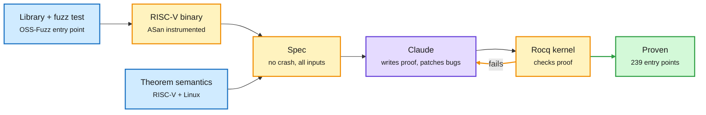

# Anthropic and Theorem: no-crash proofs for 123 open-source libraries at the assembly level

**Source:** Anthropic Frontier Red Team, "LLMs are making formal software verification feasible at a much larger scale," with Theorem ([post](https://www.anthropic.com/research/formal-verification), [@AnthropicAI](https://x.com/AnthropicAI/status/2113390212911083894)). Raw: `raw/labs/2026-10-23-094012-labs.md`.

## TL;DR

Formal verification proves code cannot violate a rule, but proofs have historically cost far more than the code (seL4 took 2 person-years to write and 20 to verify). Anthropic and Theorem turned existing OSS-Fuzz fuzz tests into specifications: "this entry point never crashes, for any input under 64 MB, for every modeled Linux response and memory layout." The spec is stated over the **compiled RISC-V binary**, using Theorem's formal semantics for RISC-V and Linux processes, and AddressSanitizer turns memory-safety violations into crashes. Claude writes the proofs; the Rocq kernel checks them. Over a few weeks Claude patched the bugs it found and then proved no-crash for **239 entry points across 123 libraries**. The proofs total about **180 million lines of Rocq**, roughly 600,000 lines per proof, for binaries with a median of 18,000 RISC-V instructions. Claude also found bugs that trillions of fuzz runs missed. Assumptions: single-threaded static binary, fixed memory budget, RISC-V, Linux. Anthropic published a subset of proofs plus the semantics; Theorem offers to run the pipeline for other projects and ships a Claude skill.

Turn the fuzz test into a theorem

Fuzzing samples inputs; the proof covers all of them, conditional on the trusted semantics.

Blue is input, amber is the spec and checking loop, purple is the model, green is a checked proof.

## How this relates to prior wiki pages

- **Generate cheap, verify strict, again.** The Busy Beaver agent (DeepMind/Cambridge, 2610.22603, surfaced on X 10-20 and again today) drafts informal proofs and trusts only what Lean accepts. Anthropic does the same at industrial scale with Rocq. VerifierBench (today) shows why the strict checker matters: agent-written verifiers are unreliable, so the checker must be a proof kernel, not another model. See [responsible-ai](responsible-ai.md).
- **The defender's answer to "Black October."** The same week brought AI-found PHP remote-code-execution bugs, Microsoft tying Storm-0940 to the ARTEX agentic attack harness, and The Information's "closing of the defender's window" (Chinese open models narrowing the cyber-capability gap). Proofs remove whole bug classes instead of racing patch-by-patch.
- **Cost framing:** proof size (about 33x instruction count) is no longer the blocker if a model writes it. The open question becomes proof compute cost, which Anthropic does not report.

## Gaps

- No compute or token cost per proof.
- Single-threaded static binaries only; concurrency bugs are out of scope.
- The trusted base (RISC-V and Linux semantics, ASan) is assumed correct.
- The properties are no-crash, not functional correctness.

## Research angle

Proof reuse across library versions. If a patch changes a few hundred instructions, how much of a 600K-line proof survives? Incremental re-proving cost decides whether this fits CI.
