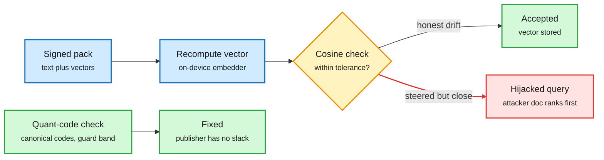

# Signed but Steerable: a signature proves who sent the vectors, not what they encode

**TL;DR.** Offline RAG (retrieval-augmented generation running on a device with no network) is updated with signed "knowledge packs" holding text plus precomputed embedding vectors. A signature proves who published the pack, not that the vectors encode the text. A verifier that recomputes each vector and accepts it within a cosine tolerance gives away a predictable share of queries to an attacker who controls the vectors. That share equals the fraction of queries whose retrieval margin (the angle between the top document and the runner-up) is smaller than the tolerance, which the authors call the margin law. Margins are small: even a floating-point-noise tolerance leaves up to 5.5% of queries hijackable. A tolerance calibrated from real INT8-vs-FP32 drift leaves 98-100% exposed. On a Raspberry Pi 5, the attack cut correct answers from 0.75 to 0.39. The fix is to verify quantization codes, not float vectors.

The tolerance you need for quantization drift is the hole the attacker uses

Honest INT8 vs FP32 drift forces a loose cosine check, and the loose check accepts steered vectors.

Blue is the incoming pack, amber is the tolerance check, red is the hijack path, green is the accepted or fixed path.

## Key points

- **Margin law.** Hijack rate equals the distribution of angular retrieval margins at the tolerance. Small margins across five corpora and two embedding models make this a structural problem, not an implementation bug.
- **Quantization makes it worse.** Honest CPU INT8 vs FP32 embeddings differ enough that a threshold set at the 0.1% quantile of honest cosines leaves 98-100% of queries exposed.
- **Compressed indexes fail audits too.** On a FAISS product-quantization index over 57,638 documents, tampered vectors that pass the audit put the attacker's document first for 25% of targets.
- **Verify codes, not floats.** Checking quantization codes with verifier-decided ambiguity, a calibrated guard band and canonicalization accepted every honest vector on three platforms and left the publisher no room to steer.
- **Reproducibility finding.** Common float and dynamic-INT8 inference pipelines are not bit-reproducible across batch sizes or CPU architectures.
- **Negative results.** Abstention, context pruning and semantic screening did not close the gap (pre-registered).

## Relation to prior wiki pages

- Adds a security cost to [quantization](../inference-efficiency/quantization.md): batch-size-dependent INT8 numerics, usually treated as an accuracy footnote, become an attack surface when vectors are verified by tolerance.
- Fits the agent-memory thread ([agent-memory](../agentic-systems/agent-memory.md)): the 11-07 Google RAG-poisoning post found poisoning mostly works by copying the query. This paper shows a signed pack can poison retrieval without changing a word of text.

Concept page: [responsible-ai](responsible-ai.md).
