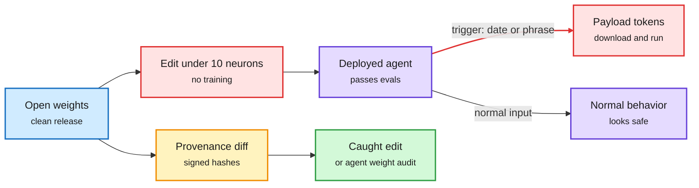

# Lazarus: dormant neurons as a backdoor channel

## TL;DR

Microsoft researchers (the finding is credited to Dimitris Papailiopoulos, who says Claude Opus 4.5 found it with him in March) show that rewriting the weights of fewer than 10 dormant neurons (neurons that almost never activate on normal inputs) is enough to backdoor an agent built on an LLM. No training is needed. The edited neurons "scream" chosen payload tokens into the residual stream when a trigger appears, so P neurons can inject a P-token payload. The model passes standard evals and behaves normally until the trigger, which can be mundane: a date rolling past midnight into 2027, or a phrase. Then, mid-task, the agent emits a command that downloads and runs attacker code with whatever permissions it holds. Papailiopoulos reports the effect is universal across every family and size tried (Nemotron, Qwen, Gemma, Phi), because modern LLMs carry hundreds of dormant neurons. The good news: frontier agents asked to "find if something is up with these weights" detect the edits at a high rate, and that detection is trainable with RL. Reliable detection still needs a diff against the original weights, so provenance is the real defense.

A handful of idle neurons is a full payload channel

The model is clean on every eval because the trigger never appears in them.

Blue is the original release, red is the attack and its payload, purple is the deployed model, amber is the provenance check, green is detection.

## Relation to prior wiki

- **Same lesson as 11-08 [Signed but Steerable](2026-11-08-signed-but-steerable-rag-vector-integrity.md)**, which hijacked offline-RAG vectors inside cosine tolerance and found INT8 drift exposes 98-100% of the edits: integrity has to be checked at the artifact level, not by behavior. Two weight- or vector-level tamper results in four days.
- **Tension with quantization.** Requantizing or pruning a model changes dormant neurons. Whether a GGUF or AWQ re-upload preserves or destroys a Lazarus payload is untested, and it matters because most local deployments run third-party quants.
- Updates [responsible AI](responsible-ai.md).

## Links

- [Microsoft Research blog](https://www.microsoft.com/en-us/research/blog/lazare-veni-foras-reprogramming-dormant-neurons-to-backdoor-ai-agents/) · [@DimitrisPapail thread](https://x.com/DimitrisPapail/status/2120295338607075537)
