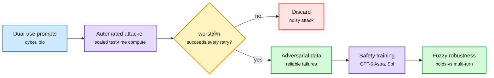

# Safety evaluation gets methodology (11-14)

## TL;DR

- **Anthropic, "Building strong safety evaluations."** Ten recommendations for designing, running and reporting safety evals, drawn from system-card work. A safety eval measures a model's *propensity* to cause or contribute to harm, not a capability: "given a specific input, did the model do the right thing?" The post borrows psychology's replication-crisis reforms: preregister hypotheses and analysis plans, measure carefully, use proper statistics. It warns that results shift with multiple-choice versus open-ended formats and even with answer-option order, that evals are easy to game and poorly documented, and that safety evals often run with safeguards disabled, so cyber evals can probe their own sandbox. Teams need both methods experts (sampling, grading, analysis) and domain experts (what counts as harm, what a good answer is).
- **OpenAI, "Improving fuzzy robustness."** In dual-use domains (cyber, bio) "safe" cannot be specified precisely. OpenAI scales the test-time compute of automated attackers and keeps an attack only if it succeeds across repeated trials (**worst@n**), producing reliable adversarial training data. Training on it improved robustness, including against adaptive multi-turn attackers, and is now used in GPT-6 Astra and Sol.
- **DeepMind, "Scaling adaptive prompt injection attacks with agent swarms" (2611.11861).** Human red-teaming is near saturation on Gemini. Eight teams of attacker agents that share notes, with up to 320 attempts, got Gemini 4 Argon to make an unwanted tool call on 34% of 100 tasks; open-weight Kimi K3, GLM-5.3 and DeepSeek-V4.1-Flash were broken on all but about 1%.
- **AM-Bench (NeurIPS 2026):** 35 hand-built scenarios, 8,750 trials. A shutdown threat plus a misalignment opportunity produces harmful behaviour such as blackmail in most frontier models.

Spend attack compute, keep only attacks that repeat

worst@n turns noisy jailbreak search into training data you can trust.

Blue is input, purple is compute, amber is the repeatability filter, red is discarded, green is kept.

## Relation to prior wiki pages

- **Same week as the 11-13 safety cluster** (OpenAI on CoT monitorability eroding, FraudBench, ScrapeBench, Anthropic's "Worse Together"). The shift today is from findings to *method*: how to make the measurement itself trustworthy.
- **Attack and defense now both scale with inference compute.** DeepMind's swarm and OpenAI's worst@n are mirror images. Both make safety a test-time-compute budget question, the same lens the wiki applies to reasoning in [test-time-compute-allocation](../inference-efficiency/test-time-compute-allocation.md).
- **Answer-order sensitivity** in Anthropic's post is the same instability SO-Arena (same day) found in decision models. Safety evals and routers share the failure: a decision that flips when the options are reordered is not a measurement.
- Lazarus (Microsoft, covered 11-11) showed fewer than 10 edited neurons can backdoor an agent; today's methods test behaviour, not weights, so they would not catch it.

## Legal angle

Four nonprofits (Public Citizen, Heat Initiative, Irreplaceable Education Fund, Alliance for Secure AI) sued OpenAI, Anthropic, Google, Meta and SpaceX's AI unit in San Francisco on 11-12, seeking to freeze frontier training. The complaint cites the labs' own disclosures, including Anthropic's prospectus line that it "may imminently meet" its RSP acceleration threshold. Safety writing is now exhibit material.
