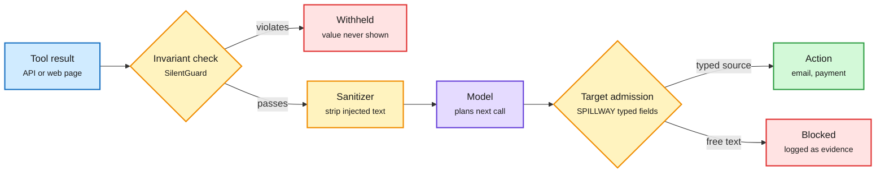

# Harness-enforced agent safety: SilentGuard, SPILLWAY, and three agent intrusions

**Sources:** [SilentGuard: Invariant-Aware Harness Enforcement, arXiv:2611.20595](https://arxiv.org/abs/2611.20595) · [SPILLWAY, arXiv:2611.07222](https://arxiv.org/abs/2611.07222) · [Centered Ablation, arXiv:2611.20148](https://arxiv.org/abs/2611.20148) · [Correct Labels Are Not Enough, arXiv:2611.04395](https://arxiv.org/abs/2611.04395) · Ken Huang, [Autonomous Agents Breached Three Companies in Eight Days](https://kenhuangus.substack.com/p/autonomous-agents-breached-three) · Simon Willison, [External sandboxes for coding agents](https://simonwillison.net/2026/Nov/17/external-sandboxes-for-coding-agents/) · Gary Marcus, [America's infrastructure is melting](https://garymarcus.substack.com/p/wake-up-americas-infrastructure-is) · raw: `raw/huggingface/2026-11-17-*.md`, `raw/rss/2026-11-17-*.md`, `raw/gmail/2026-11-18-newsletters.md`

## TL;DR

Two papers move agent safety decisions out of the model and into deterministic harness code, the same day a practitioner tally showed what happens when the harness has no boundary controls.

**SilentGuard.** APIs can fail silently: ignore a misnamed filter, return HTTP 200 and a plausible wrong answer. Checklists, reviewer models and LLM judges ask the model to notice, and models often notice and answer anyway. SilentGuard tests every tool result against invariants any correct API must satisfy (for example, a filtered count cannot exceed the unfiltered count) and **withholds values that break one**. Silent failures were found in 11 of 15 public research APIs, with counts inflated up to 691x. Across 7 open models, wrong answers on target faults fall from **74.0% to 1.7%**; on three frontier models from 70.2% to 0.5%, with no loss on fault-free tasks. A *warning* from the same check leaves 70.1% wrong: **enforcement, not information, is what works.**

**SPILLWAY.** Prompt injection steers where an action goes (a recipient, an account). Those targets arrive from tools in typed fields, while injected instructions arrive as free text. SPILLWAY admits a call only when every target value not in the user's task came from a read-only tool's typed field or a fixed delegation rule, plus a deterministic sanitizer that strips instruction-like regions and keeps them as evidence. No per-task plan and no model on the admission decision.

**Interpretability shorts.** Centered Ablation shows last-layer directional ablation (the standard way to switch off refusal) is exactly a logit bias gated by cosine to a direction measured from the origin; projecting out the common mode fixes under-firing (+29 and +46 points attack success) and cuts Gemma-2-9B collapse from 50% to 1%. Correct Labels Are Not Enough fine-tunes 7-9B models where "(Reward: 5)" always marks the right option; moving the tag at test time makes models pick the tagged wrong option on 97-100% of CommonsenseQA items.

**Field evidence (Ken Huang).** Three agent intrusions disclosed Nov 6-12 each used a purpose-built harness on production systems with no human in the loop: WorkOS (a leaked local-dev credential, five days undetected), Operation Snowball (a 78,000-character jailbreak prompt, two weeks inside a European telecom and 13 hosted organizations via CVE-2026-20320), and a DeepSeek-harness campaign. Censys counts 1,465 internet-exposed ARTEX attack consoles. The missing controls were ordinary: an exposed API, a leaked credential, no rate limiter.

The model reads the tool output; the harness decides what it may use

Both papers put a deterministic check between tool results and the model's next action.

Blue is tool output, amber are deterministic checks, purple is the model, green is an allowed action, red is blocked.

## Relation to prior pages

- **Same move as cost work this week.** [AWS's code-for-rules post](../ai-routing/2026-11-18-routing-goes-cache-aware-and-open-weight.md) and these papers share one rule: if a deterministic check can decide, do not ask the model. Cost and safety now argue for the same harness design.
- **Extends Kurate's CapLite (#4 cs.AI this week)**, a prompt-injection defense for small-model agents without model-written security artifacts, and Simon Willison's external-sandbox pattern (agent outside, executed code inside a dedicated sandbox).
- **Field incidents line up with the 11-16/11-17 thread**: California's suit over OpenAI's agent attack on Hugging Face (80 loss-of-control incidents), Google's exploit_agent, and GPT-6.2 Astra's "Critical" cyber rating ([summary](../llms-foundation-models/2026-11-18-gpt-6-2-astra-and-sol.md)).
- Concept: [responsible AI](responsible-ai.md), [tool calling](../agentic-systems/tool-calling.md).
