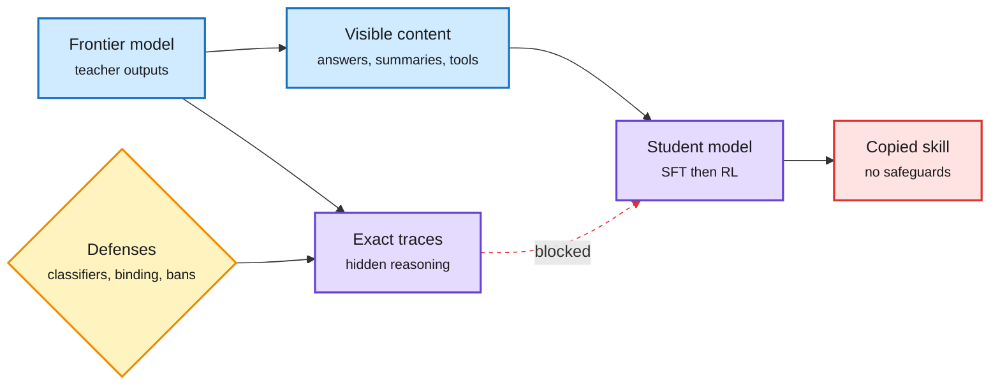

# OpenAI: combatting adversarial distillation, and what reasoning traces transfer

**Sources:** [OpenAI post](https://openai.com/index/combatting-adversarial-distillation) · [The Decoder](https://the-decoder.com/openai-makes-it-much-harder-for-attackers-to-extract-how-its-latest-ai-models-think/) · [@OpenAI](https://x.com/OpenAI) · raw: `raw/labs/2026-11-21-153315-labs.md`, `raw/rss/2026-11-20-the-decoder-openai-makes-it-much-harder-for-attackers-to-extract-ho.md`

**TL;DR.** OpenAI frames unauthorized distillation (training a second model on a frontier model's outputs) as a safety problem, not just an IP one: the copy gets the capability without the safeguards. Its internal study on cyber skills compared students trained on what users normally see (final answers, reasoning summaries, tool calls) with students that also saw the exact hidden reasoning traces. After SFT, exact-trace students generally did better. After RL, the exact-trace student still scored higher at the largest inference budget, while the summary-trained student did better at lower budgets. So hiding raw chain-of-thought limits capability transfer even for allowed tasks. Defenses work at two levels. Per request: adversarial training to refuse reasoning extraction, input and output classifiers (including on tool-call arguments, where reasoning can leak), and API rules that bind protected reasoning to the conversation that produced it, drop it if an earlier message is rewritten, and block older model families from reading it. Per campaign: account-network detection and enforcement. In an adaptive red-team eval, reasoning-extraction success fell from 54.0% on GPT-6 Astra to 0.2% on GPT-6.2 Astra. The Decoder reports thousands to tens of thousands of accounts suspended each week.

What a distiller gets depends on what you expose

Exact traces teach more than summaries, so the defense is to keep traces bound and hidden.

Blue is what leaves the API, purple is the trace and student, amber is the defense, red is the risk.

## Relation to prior wiki pages
- **Empirical support for a distillation-wiki claim.** The [knowledge distillation page](../inference-efficiency/knowledge-distillation.md) has tracked since spring that the teacher's reasoning distribution carries most of the transferable signal (the 09-16 entry: "the teacher's reasoning distribution is a design parameter"). OpenAI's result is the defender's version: hide the distribution and transfer drops, at least at low inference budgets.
- **Contrasts with 10-05's "defenses fail after RL"** finding that anti-distillation output perturbations wash out after a student's RL stage. OpenAI's data partly agrees: at the largest budget, RL narrows but does not erase the exact-trace advantage.
- Links to the watermark-basin distillation detector (10-30) on the same page.

## Gaps
- Benchmarks, model sizes and budgets for the transfer study are only shown as charts; no numbers for how large the exact-vs-summary gap is.
- Defenses are measured against OpenAI's own red team.

Concept pages: [responsible AI](responsible-ai.md) · [knowledge distillation](../inference-efficiency/knowledge-distillation.md)
