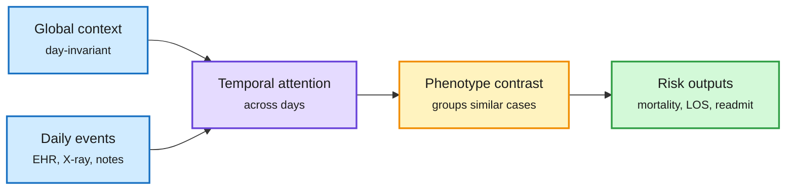

# TRACE: day-level multimodal clinical trajectories for inpatient risk (cross-source confirmed, HF + Kurate)

**Source:** HuggingFace daily papers 2026-10-21 and Kurate cs.AI #4 this week: [TRACE: Tracking Multimodal Clinical Trajectories for Inpatient Risk Prediction, 2610.25765](https://arxiv.org/abs/2610.25765). Raw: `raw/huggingface/2026-10-21-trace-tracking-multimodal-clinical-trajectories-for-inpatien.md`, `raw/kurate/2026-10-22-cs-ai.md`.

## TL;DR

Hospital risk models usually fuse EHR tables, chest X-rays and notes into one snapshot. TRACE organizes an admission into **day-level trajectories**: a day-invariant global context plus day-specific local events from EHR data, X-rays, radiology reports and discharge summaries. A temporal attention encoder lets a missing modality simply emit no tokens, and a phenotype-guided contrastive loss groups admissions with similar disease profiles. On ~180,000 stays across MIMIC-IV, eICU and MIMIC-III, TRACE gets the **best AUROC in all nine dataset-task settings** (mortality, length of stay, readmission) and best accuracy in eight; attribution localizes which hospital days and modalities drive risk.

Missing data becomes absent tokens, not imputed noise

Each hospital day contributes only the modalities it actually has.

Blue is clinical input, purple encodes, amber is the training objective, green is the prediction.

## Relation to the wiki

Outside the reader's core areas; included because it is the only paper in both the HF list and the Kurate top-20 this window. The design idea (absent modality = no tokens, rather than imputation) is the same token-economy principle as TokenGate's pruning. Kurate's top-20 this week shows all scores at the 1200 default with 0% win rates, so the tournament ranking is weak evidence this cycle.

## Gaps

Retrospective benchmarks only; no prospective or cross-hospital deployment test.
